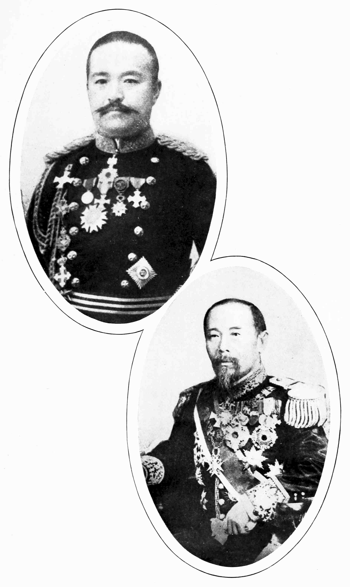

# 메이지 헌법 — 의회가 생기면 국민이 주권자가 되는 걸까

*1889년의 권한과 권리, 선거의 조건과1890년 의회의 시작*

History · Asia

> 출처 대조와 공개 게시 승인을 마친 이야기입니다. 실제 게시 여부는 사이트 배포 상태를 따릅니다.

*Ernest Wilson Clement, A Handbook of Modern Japan, Statesmen of New Japan: Marquis Katsura and Prince Itō · Public Domain. 후대 역사 인물 도판이며1889년 헌법 공포 현장이나 당시 회의 사진이 아닙니다.*

[이미지 출처·제작 근거](https://raw.githubusercontent.com/GITenberg/A-Handbook-of-Modern-Japan_65253/master/65253-h/images/i_336f.jpg) · Public Domain · 저작권 만료 작품 및 역사 출판 자료

헌법이 있고 의회가 열리면 오늘날과 같은 민주주의가 시작된 것일까. 1889년 공포된 메이지 헌법은 일본의 통치를 문서와 제도로 정리했지만 주권과 정치 참여를 지금과 다르게 배치했다. 천황의 권한과 신민의 권리, 선거와 귀족의 지위가 한 체계에 들어 있었다. 새 제도가 무엇을 열었고 어떤 문턱을 남겼는지 나누어 읽어 보자.

## 01. 중앙집권 뒤에는 통치의 규칙이 필요했다

메이지 정부는 번을 없애고 중앙의 행정과 군대를 정비했다. 그러나 국가가 중앙에 모였다는 사실만으로 누가 어떤 절차에 따라 결정할지 모두 정해진 것은 아니었다. 세금과 법률, 정책을 다룰 제도적 틀이 필요했다.

정부 안의 논의뿐 아니라 의회를 요구하는 자유민권운동도 있었다. 헌법은 통치자가 아무 요구도 없는 상황에서 선의로 내려 준 문서만은 아니었다. 아래에서의 요구와 정부가 변화의 방향을 통제하려는 선택이 함께 작용했다.

의회를 요구하는 사람들에게도 원하는 참여의 범위와 방식은 같지 않았다. 중앙의 권한을 제한하려는 요구와 지역의 목소리를 키우려는 요구가 만날 수 있었다. 정부와 민중이라는 두 칸으로만 나누면 각 집단 안의 차이와 경쟁이 보이지 않는다.

## 02. 외국의 제도를 보고도 하나를 그대로 옮기지는 않았다

일본의 지도자들은 여러 유럽 국가의 헌정 체제를 조사했다. 이토 히로부미 등은 군주의 권한과 의회, 관료 조직의 관계를 검토했다. 서양이라는 하나의 동일한 정답이 있었던 것은 아니다.

정부가 중요하게 본 것은 대표를 두면서도 국가의 중심 권력을 유지하는 방식이었다. 외국 제도의 이름만 가져온 것이 아니라 일본의 기존 권력과 맞물릴 조항을 골라 구성했다. 배움의 결과는 모방과 선택, 정치적 계산이 결합한 제도였다.

## 03. 헌법은 천황의 권위를 출발점에 두었다

1889년 헌법은 천황의 지위와 권한을 중심으로 통치의 틀을 정했다. 국민이 국가의 주권을 가진다는 오늘날 일본 헌법의 출발점과 다르다. 헌법이라는 같은 이름 아래에도 권력의 근거는 다르게 놓일 수 있다.

그렇다고 모든 실무를 천황 개인이 혼자 처리했다는 뜻은 아니다. 대신과 관료, 여러 기관이 권한을 행사하는 구조가 있었다. 문서에 적힌 군주의 권한과 실제 정책을 결정하는 관계를 구분해서 살펴야 한다.

헌법은 통치의 권위를 확인하면서 그 권위를 행사할 형식도 정했다. 그래서 제한이 남았다는 사실만으로 문서의 모든 효과를 부정할 수는 없다. 반대로 권한의 형식을 적었다고 책임과 통제가 충분히 보장되는 것도 아니었다. 실제 운영에서 무엇을 요구할 수 있는지가 중요했다.

## 04. 두 의회는 같은 방식으로 뽑히지 않았다

제국의회에는 귀족원과 중의원이 있었다. 중의원에는 선거로 뽑힌 대표가 들어갔지만 귀족원은 귀족의 지위와 임명 등 다른 경로로 구성되었다. 두 원이 모두 오늘날의 보통선거로 뽑힌 기관이라고 생각하면 오해가 생긴다.

의회는 법률과 예산을 다루는 중요한 공간이었다. 정부가 그 안의 정치 세력과 관계를 맺고 협의해야 할 이유가 생겼다. 다만 의회가 존재한다는 사실과 정부가 언제나 선거 결과에 따라 바뀌는 체제라는 사실은 같은 말이 아니었다.

예산을 심의하는 공간은 세금과 지출을 둘러싼 정치적 협상의 장이었다. 정부가 하고 싶은 사업과 대표들이 동의하는 사업이 같지 않으면 조정이 필요했다. 새로운 의회는 법률의 형식만이 아니라 정책의 자원을 둘러싼 관계를 바꾸었다.

## 05. 선거권에는 성별과 세금의 문턱이 있었다

처음 선거에 참여할 수 있는 사람의 범위는 좁았다. 일정한 연령과 납세 조건을 갖춘 남성이 중심이었고 여성은 참여하지 못했다. 선거제도가 생겼다고 모든 성인이 동등하게 대표를 선택한 것은 아니다.

세금 기준은 이후에도 바뀌었으므로 한 시기의 금액을 메이지 시대 전체의 고정된 규칙으로 설명하면 곤란하다. 어떤 사람이 실제로 선거인 명부에 오를 수 있었는지 묻는 편이 헌법과 현실의 관계를 더 정확히 보여 준다.

납세를 선거의 자격과 연결하면 재산과 소득의 차이가 정치적 참여의 차이가 될 수 있다. 같은 국가의 신민이라는 지위만으로 같은 표를 가진 것은 아니었다. 대표의 숫자보다 먼저 어떤 주민이 그 대표를 고를 수 있었는지 물어야 제도의 범위가 드러난다.

## 06. 권리의 문장 옆에는 법률의 조건이 있었다

헌법에는 신민의 권리와 의무가 적혔다. 그러나 여러 권리는 법률이 정한 범위와 조건 안에 놓였다. 권리를 문서에 적는 일은 중요했지만 정부가 어떤 법을 만들고 집행하는지도 그 권리의 실제 폭을 좌우했다.

군사와 행정, 대표 정치의 관계에도 긴장이 있었다. 권한을 여러 기관에 나눈다고 모든 기관이 같은 책임 구조 안에 들어가는 것은 아니다. 서로 다른 권위의 경로가 공존하면 누구에게 책임을 물을지의 문제도 복잡해질 수 있었다.

## 07. 1889년의 공포와1890년의 의회 개회를 구분하기

헌법은1889년에 공포되었고 첫 제국의회는1890년에 열렸다. 문서가 나온 날과 제도가 실제로 작동하기 시작한 장면은 구분해야 한다. 이후의 정부와 정당은 조항의 의미를 현실의 정치 안에서 만들어 갔다.

메이지 헌법을 진보의 완성이나 단순한 장식으로만 평가하면 열렸던 공간과 남은 제한을 함께 볼 수 없다. 의회와 선거는 새 정치의 장이었지만 주권과 권리의 배치는 오늘날과 달랐다. 헌법을 읽는 일은 이름의 유무를 확인하는 것보다 권력과 참여의 조건을 구체적으로 따지는 작업이다.

## 이야기의 바탕이 된 자료

- [Ernest Wilson Clement, A Handbook of Modern Japan — constitution, Diet and election law](https://raw.githubusercontent.com/GITenberg/A-Handbook-of-Modern-Japan_65253/master/65253-0.txt) · 확인일 2026-11-08
  - 확인 내용: 자유민권/의회 요구·1889헌법·천황의 주권과 기관·1890의회·귀족원/중의원 구성·성별/나이/납세 조건과 시기별 차이·권리의 법률 조건. 헌법을 군주의 자비만으로 설명하는 서술과 문명 우열은 배제

---

[같은 소주제의 이야기](README.md) · [전체 서가](../../README.md)
