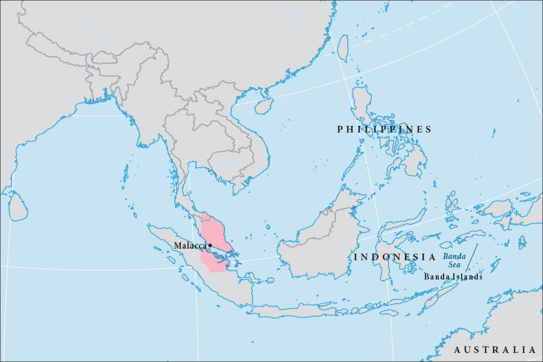

# 말라카 — 항구를 점령하면 바다의 장사도 차지할 수 있을까

*말라카 해협의 상업 질서와 1511년 포르투갈 점령 뒤의 항로 변화*

역사 · 교역과 세계의 연결

> 자료 대조를 마친 검토용 이야기입니다. 공개 게시 승인은 아직 받지 않았습니다.

*Demis/Wikimedia Commons, Banda Sea를 바탕으로 한 말라카 위치 지도 · OpenStax 수록. 현대 설명 지도이며 1511년의 지도 원본이 아닙니다.*

[이미지 출처·제작 근거](https://raw.githubusercontent.com/openstax/osbooks-world-history/main/media/OSX_WorldHist_B02_02_M-Malacca.jpg) · Public Domain

말라카를 차지한 포르투갈은 아시아의 향신료 무역에 더 가까이 갈 수 있으리라 생각했다. 1511년 군대가 도시에 들어왔지만, 항구의 성벽을 손에 넣는 것과 상인이 계속 그곳을 이용하게 만드는 것은 다른 일이었다. 말라카의 번영은 좁은 해협에 자리 잡은 지형에서만 나온 것이 아니었다. 서로 다른 곳에서 온 사람들이 안심하고 거래할 수 있도록 만든 관계와 규칙도 중요했다.

## 01. 좋은 위치만으로 항구가 번성하지는 않았다

말레이반도와 수마트라 사이의 말라카 해협은 인도양과 동아시아의 바다를 잇는 중요한 통로였다. 배가 오가면 물자를 보급하고 상품을 바꾸어 실을 항구가 필요했다. 말라카는 이런 이동의 흐름을 붙잡을 수 있는 곳에 있었다.

그러나 지나가는 배가 반드시 같은 항구에 들르는 것은 아니다. 물품과 중개상, 안전과 정보가 함께 모여야 했다. 배가 많이 오는 곳에는 더 많은 장사 기회가 생기고, 그런 기회가 다시 다른 배를 불러오는 연결이 만들어졌다.

## 02. 상인들이 오래 머물수록 도시가 달라졌다

15세기 말라카에는 인도와 중국, 페르시아와 아라비아 등 여러 지역의 상인이 드나들었다. 일부는 물건만 팔고 떠나지 않고 정착했다. 상품의 교환은 가족과 언어, 신앙이 함께 움직이는 과정이 되었다. 주석과 향신료, 비단과 도자기의 거래도 이런 연결 속에서 이루어졌다.

말라카는 이미 인도양에서 활동하던 교역망에 들어가 성장했다. 유럽인이 오기 전에는 바다가 비어 있었다는 설명은 틀리다. 포르투갈이 찾아온 곳은 처음 거래를 시작할 무대가 아니라, 여러 세력이 오래 관계를 쌓아 온 시장이었다.

중국의 명과 관계를 맺은 일도 말라카가 주변의 압력에 대응하는 데 도움이 되었다. 해협의 도시는 작은 땅의 크기만으로 힘을 계산할 수 없었다. 주변 국가의 보호와 상업상의 이익을 연결하며 자기 위치를 지킬 수 있었다.

## 03. 항구 관리인은 세금과 신뢰를 함께 다루었다

도시에는 외국 상인을 관리하는 샤반다르라는 관직이 있었다. 상인 집단을 나누어 감독하고 세금을 거두는 역할이었다. 서로 다른 관습을 가진 사람들이 거래할 때 책임자를 알 수 있다는 점은 도시의 중요한 장점이었다.

항해와 거래를 다루는 법과 규칙도 필요했다. 어느 배가 무슨 짐을 실었고 분쟁이 생기면 어떻게 처리할지 예측할 수 있어야 했다. 세금이 있다는 사실만으로 항구가 불리해지는 것은 아니다. 그 대가로 어떤 질서와 보호를 제공하는지가 중요했다.

항구에 모인 사람의 출신이 다양할수록 규칙을 전달하는 일도 중요했다. 다른 곳에서 통하던 관습을 그대로 고집하면 분쟁이 생길 수 있었다. 관리와 법은 거래를 제한하는 장치이면서 서로 다른 상인이 같은 시장을 이용하게 하는 기반이기도 했다.

## 04. 신앙과 언어도 상업의 연결망이었다

말라카의 이슬람화는 주변의 무슬림 교역 사회와 관계를 넓혔다. 공통의 신앙과 법적 관행은 낯선 상대와 거래할 때 도움이 될 수 있었다. 동시에 말레이어는 여러 출신의 상인이 사용하는 중요한 교역 언어로 성장했다.

이를 모두 종교를 이용한 장사 전략으로만 설명할 수는 없다. 신앙에는 개인과 공동체의 삶이 담겨 있었다. 다만 종교와 상업을 완전히 별개의 영역으로 나누면, 사람들이 먼 항구에서 어떻게 신뢰를 만들었는지 이해하기 어려워진다.

## 05. 포르투갈의 도착은 기존 경쟁 속으로 들어왔다

1509년 포르투갈 함대가 도착했을 때 말라카의 모든 세력이 같은 반응을 보인 것은 아니었다. 새로운 거래 상대나 군사적 동맹을 기대한 이들이 있었고, 인도에서 포르투갈의 공격을 경험한 상인들은 강하게 경계했다.

곧 충돌과 포로 문제가 이어졌다. 1511년 아폰수 드 알부케르크의 함대가 왔고, 협상이 무너진 뒤 포르투갈은 무력으로 도시를 점령했다. 도시 내부의 경쟁과 갈등은 외부 세력이 개입할 틈을 만들었다. 정복은 단순히 유럽과 아시아 두 편의 대결만은 아니었다.

## 06. 성채를 얻어도 상인의 선택까지 묶을 수 없었다

포르투갈은 요새를 세우고 거래가 이어질 것이라고 알렸다. 그러나 점령군이 장사를 계속하라고 선언한다고 해서 기존 관계가 유지되지는 않았다. 상인은 자신의 안전과 이익을 따져 다른 항구를 선택할 수 있었다.

말라카를 떠난 술탄과 후계 세력은 새로운 거점에서 저항했다. 무슬림 상인 가운데에는 조호르나 수마트라의 아체로 거래를 옮긴 이들이 있었다. 항구 하나의 통치자를 바꾸는 군사적 성공이 바다 전체의 독점으로 이어지지 않은 이유다.

## 07. 항구의 힘은 사람들이 돌아오는 데 있었다

이후에도 말라카는 여러 세력이 다투는 중요한 장소로 남았다. 하지만 해협의 교역은 한 성채의 운명과 완전히 같지는 않았다. 다른 항구가 성장하고 새로운 동맹이 생기면서 물건과 사람의 길은 계속 조정되었다.

말라카의 역사는 지리와 제도를 함께 보게 한다. 좋은 위치는 기회였고, 그 기회를 도시의 부로 바꾼 것은 상인과 관리, 중개인과 선원이었다. 길목을 지배하는 일과 사람들이 그 길목에서 계속 거래하게 만드는 일 사이에는 도시를 운영하는 능력이 놓여 있었다.

## 이야기의 바탕이 된 자료

- [OpenStax, World History Volume 2 — The Malacca Sultanate](https://raw.githubusercontent.com/openstax/osbooks-world-history/main/modules/m00009/index.cnxml) · 확인일 2026-11-11
  - 확인 내용: 해협 위치·다양한 정착 상인·명과의 관계·샤반다르·법과 말레이어/1509포르투갈 도착·1511점령/조호르·아체로의 교역 이동. 모든 교역의 유일 통로, 전설적 창립, 논쟁적인 개종 시점은 쓰지 않음.

---

[같은 소주제의 이야기](README.md) · [전체 서가](../../README.md)
