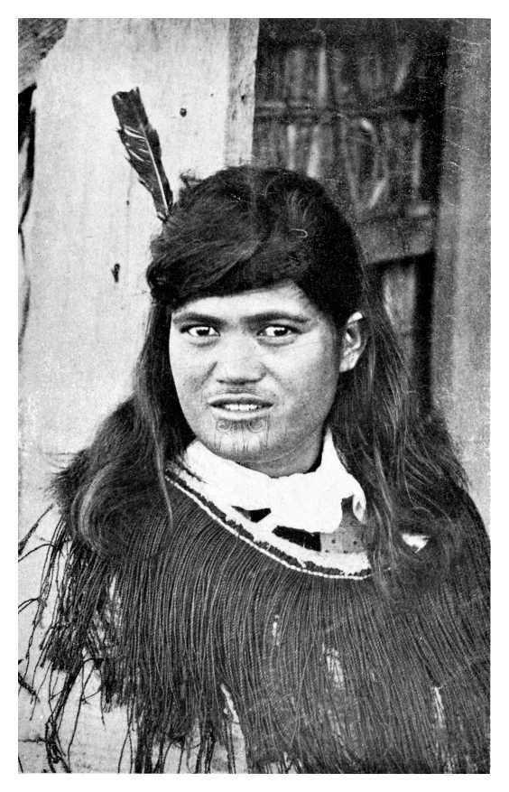

# 뉴질랜드 1893 — 투표할 권리와 출마할 권리는 왜 따로 왔을까

*여성 참정권 운동과 의회의 반복된 문턱, 법 통과 뒤의 선거*

역사 · 법과 제도

> 출처 대조와 공개 게시 승인을 마친 이야기입니다. 실제 게시 여부는 사이트 배포 상태를 따릅니다.

*William Pember Reeves, The Long White Cloud (1899), Maori Wahine, Photo by General Robley. 인물의 이름·투표 참여·운동 경력은 확인하지 않았으며 참정권 운동가의 초상으로 제시하지 않습니다.*

[이미지 출처·제작 근거](https://raw.githubusercontent.com/GITenberg/The-Long-White-Cloud--13--Ao-Tea-Roa-_12411/master/12411-h/img/image08.jpg) · Public Domain

1893년 뉴질랜드의 여성들은 국회의원을 뽑는 선거에 참여할 권리를 얻었다. 그러나 그때부터 자신이 국회의원 후보가 될 수 있었던 것은 아니다. 누군가를 선택하는 권리와 선택받을 자리에 나아가는 권리는 따로 열렸다. 이 차이를 따라가면 여성 참정권을 한 번의 진보적인 결정으로만 기억하기 어려워진다. 오랜 운동과 법안의 좌절, 등록과 투표라는 실제 작업이 함께 있었기 때문이다.

## 01. 의회의 좋은 말은 법과 같지 않았다

뉴질랜드에서는 19세기 후반 여성의 투표를 인정하자는 주장과 법안이 이어졌다. 정치인이 찬성 연설을 하는 것과 필요한 표를 모아 법을 통과시키는 일은 달랐다. 의회 안의 지지가 언제나 제도의 변화로 이어지지는 않았다.

1887년 법안의 논의에서는 여성 가운데 재산을 가진 사람에게만 권리를 주려는 견해도 드러났다. 모든 여성의 참여를 주장하는 사람과 일부 여성의 참여만 허용하려는 사람은 같은 찬성표를 던져도 목적이 달랐다. 참정권의 확대에는 그 범위를 둘러싼 갈등이 있었다.

## 02. 여성들은 서명과 조직으로 요구를 보였다

기독교여성절제회 등을 통한 조직 활동이 중요한 기반이 되었다. 케이트 셰퍼드는 참정권 운동을 연결하는 역할을 했다. 지역에서 서명을 모으고 정보를 나누는 일은 따로 있던 사람의 요구를 하나의 공적 목소리로 바꾸었다.

청원은 단지 종이의 양을 늘리는 일이 아니었다. 여성도 정치적 판단을 하고 공동의 문제에 의견을 낼 수 있음을 보이는 행동이었다. 자신의 이름을 쓰는 사람과 그 이름을 의회로 전달하는 사람 사이에 운동의 조직이 만들어졌다.

참정권 운동이 금주 운동과 만났다고 모든 참여자가 같은 종교나 정책을 가져야 했던 것은 아니다. 서로 다른 이유에서 정치적 권리를 요구할 수 있었다. 무엇을 바꿀지에 대한 의견 차이를 가진 채 공통의 권리를 위해 함께 행동하는 일이 가능했다.

## 03. 하원을 넘은 법안도 다시 막힐 수 있었다

1891년 법안은 하원을 통과했지만 상원에 해당하는 입법평의회에서 막혔다. 다음 해에도 두 기관 사이의 차이로 시행에 이르지 못했다. 문턱 하나를 넘었다는 소식이 최종 승리와 같은 말은 아니었다.

법안에 대한 세부 조건도 중요했다. 찬성 의원이 얼마나 많은지만이 아니라 어떤 내용을 받아들일지, 어느 기관이 결정을 지연할 수 있는지가 결과를 바꾸었다. 운동은 여론을 넓히는 일과 의회의 절차를 통과하는 일을 함께 해야 했다.

## 04. 1893년에는 투표권의 문이 열렸다

1893년 선거법으로 성인 여성의 국회의원 선거 참여가 인정되었다. 당시 뉴질랜드는 영국 제국 안의 식민지였으며, 여성의 전국적 선거 참여를 넓게 인정한 중요한 선례가 되었다. 오늘날의 독립 국가 제도를 그대로 소급해서는 안 된다.

이 변화에는 유럽계 여성뿐 아니라 마오리 여성의 참여도 포함되었다. 여성 전체를 백인 중산층의 경험만으로 대표하면 제도가 바꾼 범위를 놓친다. 다만 투표권의 확대가 식민 지배와 토지 문제까지 해결한 것은 아니었다.

선거에 표를 더하는 일은 기존 정치인에게도 계산을 바꾸는 사건이었다. 그들이 새 유권자를 누구의 지지층으로 예상하는지에 따라 찬성과 반대의 이유가 달라질 수 있었다. 권리를 둘러싼 원칙과 다음 선거에 대한 기대는 같은 의회 안에서 함께 움직였다.

## 05. 법을 얻은 뒤에도 이름을 등록해야 했다

선거가 가까웠으므로 새 유권자들은 선거인 명부에 등록해야 했다. 권리를 법에 적는 일과 실제 투표장에서 행사할 수 있게 준비하는 일 사이에는 행정과 정보의 과정이 있었다. 서류와 절차를 알고 기한을 맞추는 일이 필요했다.

당시 여성들은 상당한 규모로 등록하고 투표에 참여했다. 이것은 여성에게 표를 주면 정치에 관심을 보이지 않을 것이라는 예상에 대한 실제 답이었다. 반면 투표율 하나만으로 모든 집단이 같은 조건에서 참여했다고 결론 내릴 수는 없다.

## 06. 여성의 표가 하나의 정당을 뜻하지는 않았다

참정권을 둘러싼 논쟁에는 금주 운동과 정당의 이해도 얽혀 있었다. 여성에게 표를 주면 특정 세력이 크게 이길 것이라고 기대하거나 두려워한 사람들이 있었다. 그러나 새 유권자는 하나의 생각을 가진 단일 집단이 아니었다.

직업과 재산, 가족과 지역에 따라 관심은 달랐다. 여성의 참여가 곧 동일한 정책을 지지하는 표의 출현은 아니었다. 누구나 하나의 정치적 성향을 가졌기 때문에 권리를 얻는 것이 아니라, 서로 다르게 판단할 수 있는 사람으로 인정받는 일이 핵심이었다.

## 07. 의회에 들어갈 권리는 뒤에 열렸다

여성이 국회의원 선거에 출마할 수 있게 된 것은 1919년이었다. 투표권을 얻은 뒤에도 더 오랜 시간이 걸렸다. 유권자라는 이름 안에 정치 참여의 모든 권한이 한꺼번에 담겨 있지 않았음을 보여 준다.

1893년의 성과는 중요했지만 완성된 결말은 아니었다. 권리를 얻는 역사는 한 번의 허용보다 세부의 문턱을 살피게 한다. 이름을 명부에 올릴 수 있는가, 투표할 수 있는가, 후보가 될 수 있는가. 민주주의의 확대는 그 질문마다 다른 날짜를 남겼다.

## 이야기의 바탕이 된 자료

- [Susan B. Anthony·Ida Husted Harper 편, The History of Woman Suffrage, Vol. IV (1902), New Zealand](https://raw.githubusercontent.com/GITenberg/The-History-of-Woman-Suffrage-Volume-IV_29870/master/29870-8.txt) · 확인일 2026-11-11
  - 확인 내용: 1878/1887/1891/1892의 법안과 상·하원 문턱/절제회·케이트 셰퍼드·청원/1893선거법·등록과 투표/마오리 여성 참여. 1893투표권과 1919의원 출마권은 별도 자료로 대조.
- [Ida Husted Harper 편, The History of Woman Suffrage, Vol. VI (1922), New Zealand](https://raw.githubusercontent.com/GITenberg/The-History-of-Woman-Suffrage-Volume-VI_30051/master/30051-8.txt) · 확인일 2026-11-11
  - 확인 내용: 1893년 투표권과 1919년 국회의원 출마 자격을 구별.

---

[같은 소주제의 이야기](README.md) · [전체 서가](../../README.md)
