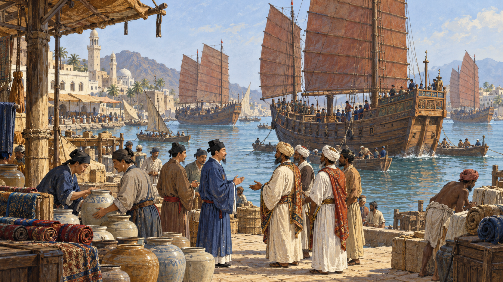

# 정화의 항해 — 큰 배에는 무엇이 실려 있었을까

*명나라의 선물과 인도양 항구들의 관계*

History · Asia

> 자료 대조를 마친 검토용 이야기입니다. 공개 게시 승인은 아직 받지 않았습니다.

*AI 관련 장면 삽화 · 정화의 항해 시대를 떠올리는 인도양 항구와 교역의 상상 장면. 실제 인물의 초상·현장·문서·장치의 정확한 복원 자료가 아닙니다.*

큰 배가 항구로 들어오면 사람들은 그 크기뿐 아니라 무엇을 싣고 왔는지도 궁금해한다. 비단과 도자기, 먼 나라의 선물과 사절이 함께 왔다면 항구의 만남은 물건을 사고파는 일보다 넓어진다. 15세기 정화의 항해는 그런 장면을 생각하게 한다.

명나라 영락제의 시대에 시작된 원정은 1405년부터 1433년까지 일곱 차례 이어졌다. 동남아시아에서 인도, 아라비아와 동아프리카로 향했다. 이번에는 배의 크기를 과장하는 이야기보다 그 배가 어떤 관계를 만들려 했는지 살펴보자.

## 1. 바다를 대하는 황제의 선택

명나라를 세운 홍무제와 그 뒤의 영락제는 바다를 대하는 정책에서 차이를 보였다. 교재는 홍무제가 외부의 위험을 경계하며 해상 활동을 제한하려 한 반면, 영락제는 다른 지역에 명나라의 부와 힘을 드러내려 했다고 설명한다.

같은 나라에서도 통치자의 목표와 판단에 따라 큰 원정의 조건이 달라질 수 있었다. 배를 만들 기술이 있다는 사실만으로 언제나 같은 항해가 이루어지는 것은 아니다. 무엇을 얻고 어떤 관계를 만들려는지가 자금과 사람을 움직이는 중요한 이유였다.

## 2. 정화가 이끈 원정의 길

정화의 선단은 이미 사람과 물건이 오가던 인도양의 여러 항구로 나아갔다. 동남아시아와 인도, 아라비아와 동아프리카는 서로 다른 사회와 교역의 관계를 가진 지역이었다. 배가 나타난 곳을 누군가가 처음 발견한 빈 세계처럼 볼 수는 없다.

따라서 항해의 의미는 지도에 처음 이름을 썼다는 식의 기록 경쟁과 다르다. 어떤 항구에 들어가 누구를 만나고 무엇을 교환했는지가 중요하다. 큰 배의 이동은 이미 있던 바다의 연결에 새로운 외교적 무게를 더하는 행위였다.

## 3. 비단과 도자기는 왜 선물이 되었을까

교재는 정화가 외국 통치자들에게 비단과 도자기, 금 등의 선물을 전했다고 설명한다. 선물은 물건의 사용 가치뿐 아니라 보낸 나라가 어떤 부와 기술을 가졌는지 보여 주었다. 먼 곳에서 온 좋은 물건에는 그 물건을 보낼 수 있는 힘의 이미지도 붙었다.

이때 선물을 현대의 개인적인 호의와 완전히 같은 것으로만 생각할 수는 없다. 누구에게 무엇을 보내고 상대를 어떻게 대할지는 외교적 관계의 일부였다. 항구에 내려놓은 물건은 말로 전하는 메시지와 함께 움직였다.

## 4. 돌아오는 배에도 이야기가 실렸다

원정은 선물을 주고 끝나는 일만은 아니었다. 교재는 돌아오는 길에 상아와 이국적인 동물 등이 실렸다고 설명한다. 얼룩말과 타조 같은 동물은 궁정에서 먼 지역의 존재를 눈앞의 경험으로 바꾸었을 것이다.

이것을 오늘의 동물 전시 방식과 그대로 같은 것으로 볼 필요는 없다. 중요한 점은 멀리 있는 관계가 물건과 살아 있는 존재의 이동을 통해 보이는 형태를 얻었다는 것이다. 항해는 지리 지식뿐 아니라 다른 세계를 상상하는 재료도 옮겼다.

## 5. 말라카가 원정을 보는 자리

말라카는 여러 바닷길이 만나는 중요한 항구였다. 교재는 말라카가 명나라와 관계를 맺었고 정화의 항해에서도 반복해서 등장했다고 설명한다. 이곳에서 명나라의 사절과 관계를 맺는 일은 멀리 있는 강국의 위세를 구경하는 것만은 아니었다.

말라카에는 가까운 세력과의 경쟁이라는 현실이 있었다. 교재는 시암의 아유타야가 위협할 때 명나라의 사절이 말라카와의 관계를 내세워 견제한 일을 소개한다. 같은 항해를 중국 궁정에서 볼 때와 항구의 통치자가 볼 때 의미가 달라질 수 있었다.

## 6. 큰 나라의 선물과 작은 나라의 판단

명나라의 기록에서 외국이 가져온 물건은 조공이라는 질서 안에서 설명되기도 했다. 그러나 항구의 주민과 통치자가 원하는 이익과 안전이 모두 같은 표현으로 정리되지는 않는다. 의례의 언어와 각 지역의 실제 판단을 나누어 볼 필요가 있다.

큰 국가가 관계의 이름을 정한다고 상대가 아무 선택도 하지 않은 것은 아니다. 말라카의 사례는 먼 강국과의 관계를 가까운 위협에 대응하는 자원으로 활용할 수 있음을 보여 준다. 외교의 역사에는 힘의 차이와 그 차이 속에서 이루어진 판단이 함께 있었다.

## 7. 일곱 차례 뒤의 바다는 어떻게 되었을까

이 대규모 국가 원정은 계속 같은 방식으로 이어지지 않았다. 교재는 15세기 중반 명나라의 관심이 달라지는 흐름을 설명한다. 그러나 그 변화가 인도양의 모든 교역이나 중국인의 해상 활동을 같은 날 끝냈다는 뜻은 아니다.

한 정책의 변화와 바다 전체의 생활은 범위가 다르다. 말라카 같은 항구들은 자기 지역의 관계 속에서 계속 움직였다. 정화 이후를 단순히 문을 닫아 모든 발전이 멈춘 이야기로 줄이기보다 무엇이 중단되었고 무엇은 이어졌는지 구분해 볼 수 있다.

## 8. 큰 배보다 넓었던 관계

함께 실은 AI 삽화는 15세기 인도양 항구의 만남을 떠올리는 상상 속 장면이다. 실제 정화 선단의 정확한 선박 크기나 특정 입항 현장을 복원하지 않았다. 배와 사람, 물건이 만나는 분위기를 표현한 그림이다.

정화의 항해를 기억할 때는 거대한 선체와 함께 비단을 받은 통치자, 배를 맞은 항구, 다른 물건을 싣고 돌아오는 길도 떠올려 보자. 원정의 역사는 누가 가장 큰 배를 가졌는지보다 그 배로 어떤 관계를 만들려 했는지 물을 때 더 넓은 세계를 보여 준다.

## 이야기의 바탕이 된 자료

- [OpenStax World History — 명 왕조와 정화의 항해](https://raw.githubusercontent.com/openstax/osbooks-world-history/main/modules/m00124/index.cnxml) · 확인일 2026-10-31
  - 확인 내용: 1405~1433년 항해·외교와 선물·인도양의 교역
- [OpenStax World History — 말라카와 동남아시아](https://raw.githubusercontent.com/openstax/osbooks-world-history/main/modules/m00009/index.cnxml) · 확인일 2026-10-31
  - 확인 내용: 이미 존재한 교역망·명과 말라카의 관계·정화의 방문

---

[같은 소주제의 이야기](README.md) · [전체 서가](../../README.md)
