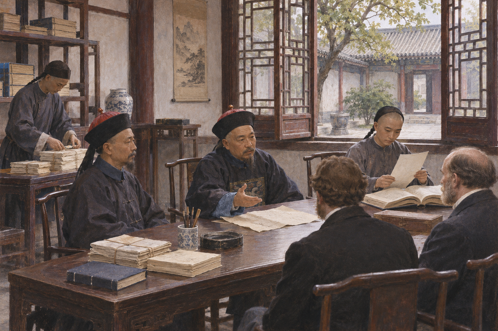

# 총리아문 — 청의 외교는 왜 번역하는 관청이 필요했을까

*전쟁 뒤의 외교 창구, 통역과 동문관이 맡은 새로운 업무*

History · Asia

> 출처 대조와 공개 게시 승인을 마친 이야기입니다. 실제 게시 여부는 사이트 배포 상태를 따릅니다.

*AI 역사 이해용 상상 삽화 · 당시 사진이나 실제 인물의 초상, 특정 장면과 건물의 정확한 복원이 아닙니다.*

조약 문서 한 장이 도착했다. 글자를 옮기는 것만으로 내용을 이해했다고 말할 수 있을까. 항구와 관세, 외국인의 재판을 둘러싼 표현에는 청 조정이 익숙하게 운영하던 질서와 다른 규칙이 들어 있었다. 1861년 설치된 총리아문은 이런 문제를 계속 처리할 창구였다. 그 역사는 외국어를 배우는 이야기를 넘어, 전쟁 뒤의 압박 속에서 새로운 업무를 떠맡은 국가 조직의 이야기다.

## 01. 전쟁이 바꾼 수도의 일상

제2차 아편전쟁 말기인 1860년 영국·프랑스 군대는 베이징으로 진격했다. 황제가 수도를 떠난 상황에서 공친왕은 협상과 조약 처리에 나섰다. 전쟁의 손실과 외국의 요구는 추상적인 바깥 소식이 아니라 조정이 당장 해결해야 할 문제가 되었다.

베이징에 외국 공사들이 상주하게 된 것도 큰 변화였다. 정해진 때에 사절을 맞이하는 방식만으로는 반복되는 문서와 면담 요청을 감당하기 어려웠다. 외교를 일시적인 사건이 아니라 일상적인 행정 업무로 다룰 조직이 필요했다.

## 02. 외국 일을 맡는 별도의 창구

총리아문이라는 약칭의 긴 이름은 각국과 관련된 사무를 총괄한다는 뜻을 담고 있었다. 공친왕과 문상 등은 새로운 대외 업무를 처리하는 주요 인물이었다. 조약과 통상에 관한 문서, 외국 사절과의 접촉이 이 관청의 업무가 되었다.

이를 중국에 외교가 처음 생긴 순간이라고 설명하면 이전 역사가 지워진다. 청은 이미 주변 국가와 다양한 방식으로 관계를 맺고 있었다. 달라진 것은 전쟁 뒤 서구 열강과의 관계를 상시적으로 처리하는 조직과 업무의 비중이었다.

## 03. 관청이 생겨도 권한은 겹쳤다

새 조직이 모든 대외 사안을 혼자 결정할 수 있었던 것은 아니다. 기존 중앙 관청과 지방의 유력 관리들도 관련 업무를 맡았다. 조정의 판단과 항구 현장의 상황이 다르면 보고와 협의를 거쳐야 했다.

따라서 총리아문을 오늘날 외교부와 완전히 같은 것으로 생각하기는 어렵다. 옛 조직을 모두 없애고 새 체제를 만든 것이 아니라, 기존의 통치 구조 안에 새로운 창구를 덧붙인 성격이 있었다. 이런 겹침은 타협의 방법이면서 책임과 권한을 조정해야 하는 부담이었다.

외교 업무는 수도의 책상에만 머물지 않았다. 항구에서 생긴 사건을 이해하려면 현장의 보고가 필요했고 중앙의 답변은 다시 지방에서 집행되어야 했다. 총리아문의 존재만 확인하기보다 보고와 지시가 어떤 길로 오갔는지를 생각해야 조직의 실제 역할이 보인다.

## 04. 번역은 단어를 바꾸는 일 이상이었다

외교 문서의 표현은 실제 권리와 의무로 연결되었다. 같은 문장을 두고 서로 다른 뜻을 주장하면 통상과 재판의 문제가 될 수 있었다. 조정에 필요한 것은 외국인이 보내 준 번역문을 그대로 받아 적는 사람만이 아니었다.

외국어와 문서의 형식, 상대가 근거로 제시하는 규칙을 이해할 인재가 필요했다. 번역관의 문제는 결국 누가 정보를 판단할 수 있는가의 문제였다. 언어를 모르면 협상 자리에서 어떤 선택이 가능한지도 상대의 설명에 크게 기대게 된다.

외국어를 배운 사람이 전통적인 관직 경로에서 어떤 평가를 받을지도 문제였다. 실무에 필요하다는 인정과 사회적으로 높은 지위를 얻는 일은 같지 않았다. 새 지식의 도입을 학교 설립 연대만으로 설명하기 어려운 까닭이다.

## 05. 동문관의 교실이 넓어지다

1862년 외국어 교육을 위한 동문관이 문을 열었다. 영어나 프랑스어, 러시아어 등을 가르칠 인력이 들어왔고 교육은 점차 수학과 천문학 같은 영역으로도 넓어졌다. 국제법을 소개하는 작업 역시 이 새로운 지식의 환경과 연결되었다.

동문관에 관여한 미국인 선교사 마틴은 자신의 책에서 이런 확대 과정을 설명한다. 다만 그는 개혁을 외부인이 이끈 진보로 강조하는 경향이 있다. 그의 회고를 읽을 때에는 그 안에서 배우고 가르치며 선택한 중국인들의 판단과 역할도 함께 생각해야 한다.

## 06. 문서를 읽는 능력과 협상력의 차이

규칙을 배운다고 힘의 차이가 곧 사라지지는 않았다. 청이 마주한 조약 관계에는 전쟁의 결과로 강요된 조건과 외국의 특권이 포함되어 있었다. 총리아문의 업무는 처음부터 동등한 조건의 국가들이 평온하게 협의하는 상황과 달랐다.

더구나 조정 내부에서도 어떤 지식과 제도를 받아들일지 의견이 갈렸다. 외국의 기술을 활용하려는 필요와 기존 질서에 대한 불안은 함께 존재했다. 개혁은 찬성과 반대가 분명히 나뉜 단순한 구도가 아니라 여러 목적이 부딪치며 진행된 선택의 연속이었다.

어떤 제도를 받아들일 것인가를 묻기 전에 그 제도가 무슨 일을 하는지 정확히 아는 과정이 필요했다. 외교 문서와 교재는 그 이해의 기반이었다. 번역의 축적은 즉각적인 승리를 주지는 않아도 기존의 표현만으로 설명하기 어려운 세계를 다룰 수 있게 했다.

## 07. 외교사의 현장은 책상 위에도 있다

총리아문의 역사를 통해 전쟁과 회담 사이에 놓인 긴 실무를 볼 수 있다. 문서가 오고, 번역을 검토하고, 관청 사이에서 답을 조율하는 과정이 없으면 국가는 지속적인 관계를 운영할 수 없다. 새로운 지식은 교실을 넘어 행정의 언어가 되어야 했다.

함께 실은 이미지는 문서를 검토하는 관원들을 연상하도록 만든 상상 삽화다. 총리아문의 실제 실내나 특정 인물의 모습을 복원한 것은 아니다. 장면의 분위기보다 중요한 것은 그 책상에 어떤 문제가 올라왔으며, 결정할 수 있는 권한은 어디에 있었는지를 묻는 일이다.

## 이야기의 바탕이 된 자료

- [W. A. P. Martin, The Awakening of China — education reforms and notable officials](https://raw.githubusercontent.com/GITenberg/The-Awakening-of-China_15125/master/15125-8.txt) · 확인일 2026-11-08
  - 확인 내용: 청의 Foreign Office와 통역 수요·1862학교 설립·외국어에서 과학/국제법으로 교육 확대·공친왕/문상의 업무와 마틴의 관여. 외부인 중심 진보 평가와 인종적 편견은 따르지 않음
- [Herbert A. Giles, China and the Manchus — Hsien Feng and Tʽung Chih](https://raw.githubusercontent.com/GITenberg/China-and-the-Manchus_2156/master/2156-8.txt) · 확인일 2026-11-08
  - 확인 내용: 1860전쟁과 수도·외국 공사의 베이징 상주·공친왕과1861년 정치적 변화. 원명원 파괴의 정당화와 민족 일반화는 배제

---

[같은 소주제의 이야기](README.md) · [전체 서가](../../README.md)
