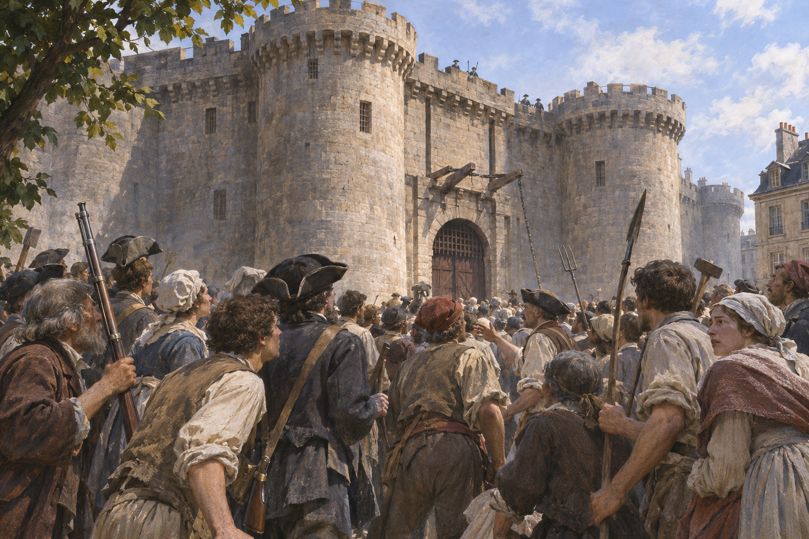

# 바스티유 1789 — 감옥보다 화약이 먼저 필요했던 날

*무장과 협상, 일곱 수감자와 혁명의 기억*

History · Europe

> 자료 대조를 마친 검토용 이야기입니다. 공개 게시 승인은 아직 받지 않았습니다.

*AI 역사 이해용 상상 삽화 · 당시 사진이나 실제 인물의 초상, 특정 장면과 건물의 정확한 복원이 아닙니다.*

1789년 7월 14일 파리 사람들이 바스티유를 공격했다. 흔히 수많은 정치범을 풀어 준 순간처럼 기억하지만, 그날의 사건에는 무기를 구하려는 움직임과 왕의 군대에 대한 두려움이 먼저 있었다. 실제 요새의 하루와 뒤에 만들어진 혁명의 상징을 나누어 살펴보자.

## 01. 국민의회가 생겨도 왕의 군대는 사라지지 않았다

1789년 여름 프랑스의 정치적 질서는 흔들리고 있었다. 대표들이 모여 국가의 권한을 논의했지만, 파리 주변에 모인 군대와 왕의 의중을 둘러싼 불안은 컸다. 사람들은 정치적 변화가 무력으로 되돌려질 수 있다고 걱정했다.

재정 위기와 먹을거리 문제도 이어졌다. 장관 네케르의 해임 소식은 긴장을 키웠고 거리에서는 서로 다른 소문과 주장이 오갔다. 7월 14일을 고립된 감옥 습격으로 보기보다 며칠 동안 쌓인 불안과 무장 움직임 속에 놓아야 한다.

식량 가격의 압박은 정치 소식을 받아들이는 방식에도 영향을 주었다. 하루의 생계를 걱정하는 사람들에게 군대의 집결은 궁정의 인사 문제가 아니었다. 누가 도시를 지키고 질서를 유지할 것인지가 직접적인 생활의 불안과 연결되어 있었다.

## 02. 총을 얻은 뒤에는 화약이 필요했다

사람들은 앵발리드 등에서 무기를 구했다. 그러나 총이 있다는 것만으로 그것을 쓸 수 있는 것은 아니다. 화약과 탄약이 필요했다. 바스티유에는 화약이 보관되어 있었고 요새의 무장도 파리 사람들에게 위협으로 느껴졌다.

바스티유를 향한 움직임은 그래서 상징만을 찾아간 행진이 아니었다. 오늘 당장 무장하고 방어할 조건을 얻으려는 요구였다. 혁명을 생각하는 큰 정치적 언어와 화약을 확보하려는 구체적인 필요가 같은 장소에서 만났다.

무장은 도구와 조직의 문제이기도 했다. 총을 나누어 가진 사람들이 있다고 해서 모두 같은 명령에 따르는 군대가 되는 것은 아니다. 사람들의 요구를 대표해 협상하는 이들과 현장에서 행동하는 이들이 서로 다른 속도로 움직였다는 점도 그날을 이해하는 데 중요하다.

## 03. 오래된 요새는 이미 왕권의 그림자였다

바스티유는 중세에 세운 요새에서 왕실 감옥으로 쓰이는 공간이 되었다. 재판과 권력, 임의적인 구금에 관한 기억이 쌓이면서 왕권의 억압을 떠올리게 했다. 당일 안에 갇힌 사람의 수가 적었다고 이런 상징까지 없었던 것은 아니다.

동시에 감옥의 실제 운영을 항상 같은 상태로 볼 수도 없다. 시대와 수감자에 따라 조건은 달랐다. 공포의 장소라는 명성과 특정 날짜에 그 안에 있었던 현실은 서로 관련되면서도 구분해서 읽어야 한다.

## 04. 요구와 협상은 왜 공격을 멈추지 못했을까

군중과 대표들은 요새 책임자 드 로네와 접촉했다. 무장을 치우고 화약을 넘기라는 요구, 안전에 관한 설명과 약속이 오갔다. 그러나 요새 안팎의 사람들은 상대가 무엇을 할지 확신하지 못했다.

문과 다리, 안뜰과 벽은 단순한 배경이 아니었다. 사람들이 어디까지 들어갔고 무엇을 보거나 듣지 못했는지가 긴장에 영향을 주었다. 먼 곳의 약속과 현장의 행동이 다르게 받아들여지면서 협상과 폭력이 뒤엉켰다.

요새 안의 수비대와 바깥의 군중은 상대의 의도를 같은 방식으로 알 수 없었다. 성문과 도개교, 총안은 방어 시설이면서 정보가 끊기는 경계였다. 누가 먼저 무엇을 보았는지에 따라 같은 움직임도 위협이나 배신으로 해석될 수 있는 긴장된 공간이었다.

## 05. 포위는 군중의 수만으로 끝난 것이 아니다

요새를 향한 공격과 총격 속에서 사람이 죽었다. 일부 군인과 대포가 공격 측에 가담하면서 힘의 관계도 달라졌다. 커다란 성벽이 있다고 방어가 끝없이 가능하거나, 반대로 많은 군중이 모이면 저절로 점령되는 것은 아니었다.

결국 요새는 항복했지만 그 뒤에도 폭력이 이어졌다. 드 로네는 살해되었다. 사건을 시민 모두가 한마음으로 평화롭게 승리한 축제로만 그리면 당시의 혼란과 죽음이 가려진다. 왕권에 대한 저항과 군중의 폭력을 함께 기록해야 한다.

## 06. 풀려난 사람은 일곱 명이었다

그날 바스티유 안에서 풀려난 수감자는 일곱 명이었다. 모두가 민주주의를 주장하다 갇힌 정치 사상가였던 것도 아니다. 이 숫자는 익숙한 해방의 장면과 실제 감옥의 상태 사이에 거리가 있음을 보여 준다.

그러나 적은 수를 들어 사건 전체를 무의미한 오해로 돌리는 것도 맞지 않는다. 요새의 화약과 무장, 왕권에 맞선 시민의 행동, 도시에서의 힘의 변화가 중요했다. 상징은 빈 이야기에서만 생기는 것이 아니라 실제 사건의 일부를 크게 묶어 만들어진다.

건물이 철거된 뒤에도 그 돌과 모형, 그림은 사건을 기억하게 하는 매개가 되었다. 요새가 사라지자 상징이 약해진 것이 아니라 여러 장소로 퍼질 수 있었다. 혁명의 기억은 현장에 남은 벽뿐 아니라 사람들이 옮기고 보여 준 물건을 통해서도 만들어졌다.

## 07. 요새는 사라지고 기억의 장소가 남았다

바스티유는 뒤에 철거되었고 그 조각과 이미지가 혁명의 기억으로 퍼졌다. 감옥을 없애는 행위 자체가 정치적 의미를 가졌다. 이후 기념행사와 국가의 기억 속에서 7월 14일은 계속 새롭게 읽혔다.

오늘의 국경일을 설명할 때에는 1789년의 사건과 이듬해 연맹제 등 뒤의 기념도 함께 구분할 필요가 있다. 함께 실은 이미지는 사건을 떠올리기 위한 상상 삽화다. 감옥의 실제 수감자나 공격의 정확한 순간을 복원한 자료로 쓰지는 않았다.

7월 14일의 기억에는 다음 해인 1790년 연맹제의 의미도 겹친다. 특정 날짜가 국가의 기념일이 되는 과정은 당일의 전투와는 또 다른 역사다. 사건이 일어난 이유와 후대가 그 사건에 부여한 의미를 구분하면 상징을 더 깊이 이해할 수 있다.

## 이야기의 바탕이 된 자료

- [Thomas Carlyle, The French Revolution: A History — Storm and Victory](https://raw.githubusercontent.com/GITenberg/The-French-Revolution--A-History_1301/master/1301.txt) · 확인일 2026-11-08
  - 확인 내용: 1789년7월의 불안·네케르·앵발리드와 화약·바스티유 협상/공격/드로네·수감자와 상징의 차이. 문학적 재현 대사를 실제 증언으로 사용하지 않음

---

[같은 소주제의 이야기](README.md) · [전체 서가](../../README.md)
