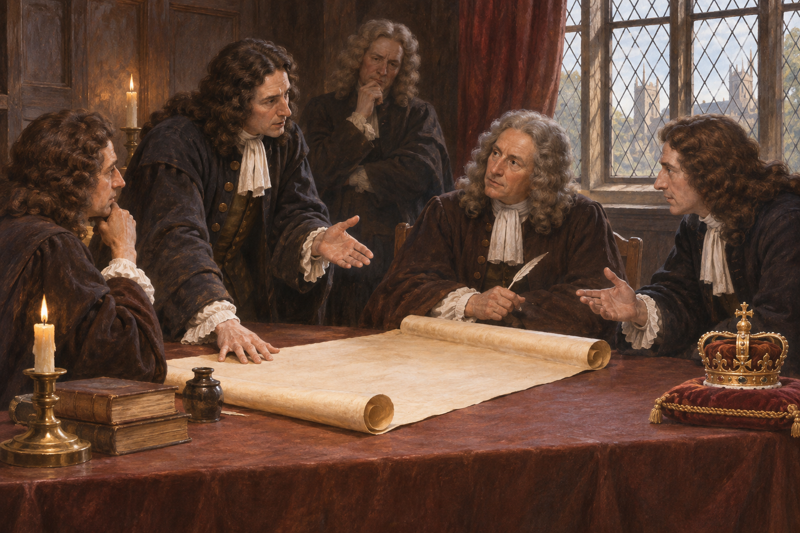

# 명예혁명 — 왕을 바꾸면 권력의 규칙도 바뀔까

*1688~1689년 왕위 교체와 의회, 권리장전의 제한과 배제*

History · Europe

> 출처 대조와 공개 게시 승인을 마친 이야기입니다. 실제 게시 여부는 사이트 배포 상태를 따릅니다.

*AI 역사 이해용 상상 삽화 · 당시 사진이나 실제 인물의 초상, 특정 장면과 건물의 정확한 복원이 아닙니다.*

왕이 달아나고 새로운 군주가 들어왔다. 그런데 이 사건을 단순한 왕위 교체가 아니라 혁명이라고 부르는 이유는 무엇일까. 1688~1689년 잉글랜드에서는 누가 왕이 되는가와 함께, 왕이 어떤 조건으로 통치하는가가 다시 논의되었다. 명예혁명의 이름 뒤에는 종교와 의회, 재정과 전쟁이 얽혀 있다. 오늘의 민주주의가 어느 날 완성되었다는 이야기보다 권력의 작동 방식이 달라지는 과정을 따라가 보자.

## 01. 왕의 종교가 공적인 문제가 되다

제임스 2세는 가톨릭 신자였다. 당시 잉글랜드에서 군주의 종교는 개인의 신앙에만 머무르지 않았다. 어느 교회를 지지하고 누구를 관리로 임명하며 기존 법률을 어떻게 다룰지가 왕의 선택과 연결되었다. 개신교 정치 세력은 왕이 의회와 법의 제한을 넘어설 수 있다고 우려했다.

갈등을 가톨릭과 개신교의 단순한 감정 대립으로만 볼 수도 없다. 통치자가 법의 적용을 멈추거나 예외를 주는 권한을 어디까지 행사할 수 있는지가 걸려 있었다. 종교의 문제는 누가 국가의 규칙을 정하는가라는 정치적 질문과 떨어지지 않았다.

## 02. 바다 건너에서 온 윌리엄

네덜란드의 오라녜 공 윌리엄은 제임스의 딸 메리와 결혼한 인물이었다. 잉글랜드 안의 유력자들이 그의 개입을 원했고, 그는 1688년 군대를 이끌고 상륙했다. 외부에서 온 군주가 아무런 무력 없이 초청장만 들고 입국한 사건은 아니었다.

제임스는 지지를 잃었고 프랑스로 떠났다. 그 결과 왕위의 정당성을 어떻게 설명할지가 문제가 되었다. 왕이 자리를 비웠다는 사실을 인정하는 것만으로는 후계와 통치의 조건이 정해지지 않았다. 새로운 정치적 합의가 필요했다.

윌리엄에게도 잉글랜드의 문제는 국내 정치만이 아니었다. 프랑스와 경쟁하던 유럽의 권력 관계가 개입의 배경에 있었다. 잉글랜드의 유력자들은 왕권을 바꾸려 했고 윌리엄은 국제적 기반을 넓힐 수 있었다. 서로 다른 이해가 같은 왕위 교체를 지지한 셈이다.

## 03. 빈 왕좌를 누가 채울 것인가

의회는 제임스의 행동과 출국을 왕위 포기로 해석하는 길을 택했다. 단순히 가장 가까운 혈족에게 자동으로 넘기는 방식과 달랐다. 윌리엄과 메리를 공동 군주로 받아들이는 결정에는 왕위를 인정하는 정치적 주체로서 의회의 역할이 드러났다.

물론 이것이 왕정을 폐지했다는 뜻은 아니다. 군주제는 유지되었다. 바뀐 것은 왕의 존재 여부만이 아니라, 어떤 조건 아래 그 권위를 인정할 것인지였다. 왕권과 의회가 관계를 다시 맺는 방식이 사건의 중심에 있었다.

## 04. 권리장전은 왕의 행동에 선을 그었다

1689년의 권리 선언과 권리장전은 이전 왕의 행위를 문제 삼고 통치의 제한을 분명히 했다. 의회의 동의 없는 과세나 법의 효력을 중단하는 행위, 평시 상비군의 유지 같은 사안이 중요하게 다루어졌다. 왕에게 돈과 군대가 필요할 때 거쳐야 할 절차가 있었다.

의회 안의 발언과 토론을 보호하는 일도 통치에 대한 견제와 연결되었다. 권력을 비판하는 장소가 안전하지 않으면 형식상 회의가 있어도 실제로 다른 의견을 내기 어렵다. 법문은 왕의 행동과 의회가 활동할 조건을 함께 다루었다.

이 문서는 과거의 법을 왕이 어겼다는 비판에서 출발했다. 완전히 새로운 사회를 선언한다기보다 기존의 권리를 회복하고 확인한다는 언어가 중요했다. 뒤에 혁명으로 기억되는 사건도 당시에는 전통을 지킨다는 주장으로 정당화될 수 있었다.

## 05. 세금을 승인하는 힘은 왜 중요했을까

전쟁과 행정에는 지속적인 수입이 필요했다. 왕이 의회와 상의하지 않고 돈을 마련할 수 있다면 의회의 요구를 무시하기도 쉬웠다. 반대로 재정의 동의를 얻어야 한다면 통치자는 대표들과 관계를 유지해야 했다.

권력의 제한은 왕의 성품이 겸손해지기를 기대하는 방식과 달랐다. 필요한 자원을 얻는 경로에 협의의 절차를 두는 일이었다. 이후 영국의 국가 재정과 군사력이 성장한 역사를 읽을 때에도 왕권의 약화와 국가 역량의 약화를 같은 것으로 생각해서는 안 된다.

## 06. 명예로운 혁명은 누구의 기억일까

잉글랜드에서의 왕위 교체가 비교적 적은 유혈로 이루어졌다는 설명 때문에 평화로운 혁명이라는 인상이 강하다. 그러나 스코틀랜드와 아일랜드까지 시야를 넓히면 무력 충돌과 종교적 배제의 역사가 이어진다. 사건에 붙은 이름이 모든 지역의 경험을 대신하지는 못한다.

또한 권리의 확인이 모든 주민의 동등한 정치 참여를 뜻하지 않았다. 가톨릭 신자에게는 제한이 남았고 여성과 다수의 평민이 오늘날처럼 선거에 참여한 것도 아니었다. 누구의 자유가 강화되었으며 누가 그 바깥에 있었는지를 함께 물어야 한다.

## 07. 끝난 혁명보다 이어진 협상

1689년은 군주가 사라진 해도, 현대의 의회 제도가 완성된 해도 아니다. 장관과 의회, 정당과 선거가 움직이는 방식은 뒤에도 달라졌다. 중요한 전환을 찾아내는 것과 그 뒤의 긴 변화를 한 사건에 모두 넣는 것은 구분해야 한다.

명예혁명을 통해 볼 수 있는 것은 권력을 제한하는 문서가 현실의 제도와 연결되는 과정이다. 왕이 누구인지를 바꾸는 일에서 그치지 않고, 돈과 군대와 법을 다룰 때 누구의 동의를 얻어야 하는지 다시 묻기 시작했다. 왕좌의 주인보다 그 주인이 지켜야 할 절차가 더 오래 남을 수 있었다.

## 이야기의 바탕이 된 자료

- [James Harvey Robinson, An Introduction to the History of Western Europe — Revolution of1688 and Declaration of Rights](https://raw.githubusercontent.com/GITenberg/An-Introduction-to-the-History-of-Western-Europe_26042/master/26042-0.txt) · 확인일 2026-11-08
  - 확인 내용: 제임스2세와 왕권/종교·1688상륙·의회와 윌리엄/메리·권리 선언과 이후 의회/군주 관계. 저자의 평화로운 혁명이라는 잉글랜드 중심 평가를 전 지역에 확대하지 않고 현대 민주주의의 완성과 구분

---

[같은 소주제의 이야기](README.md) · [전체 서가](../../README.md)
