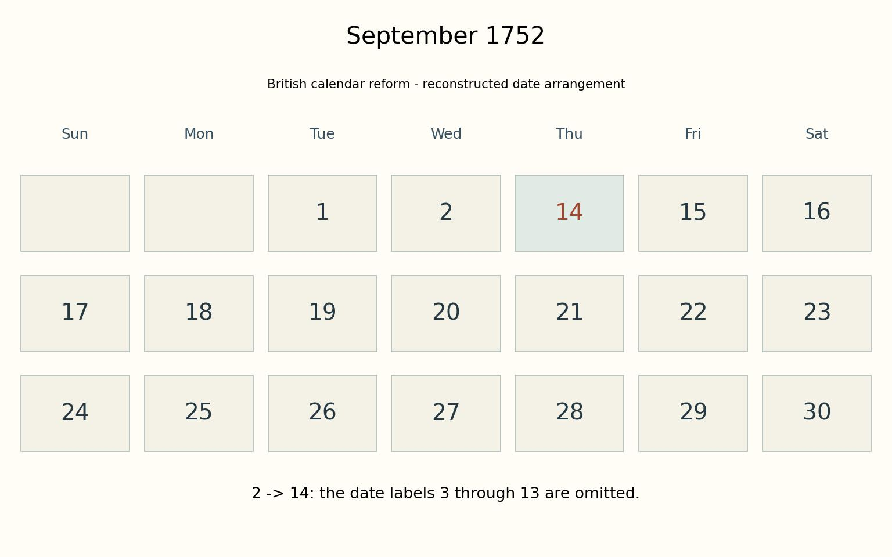

# 9월 2일 다음 날이 14일이었던 달력

*영국 달력에 남은 열하루의 빈자리*

History · Europe

> 출처 대조와 공개 게시 승인을 마친 이야기입니다. 실제 게시 여부는 사이트 배포 상태를 따릅니다.

*KnowledgeWalk 제작 설명도 · 원자료의 수치와 배치를 바탕으로 재구성. 역사적 원본이나 촬영 사진이 아닙니다.*

[이미지 출처·제작 근거](https://raw.githubusercontent.com/util-linux/util-linux/master/misc-utils/cal.1.adoc) · KnowledgeWalk 직접 제작 설명도 · 원자료의 사실·수치에 근거

9월 달력을 펼쳤는데 2일 옆에 14일이 적혀 있다. 3일부터 13일까지가 보이지 않는다. 인쇄를 잘못한 것 같지만, 달력을 바꾸던 시기의 날짜를 보여 주는 방법일 수 있다.

1752년 영국 제국의 그레고리력 전환을 반영한 달력에서는 9월 2일 뒤에 14일이 이어진다. 날짜 이름 열한 개를 건너뛴 것이다. 사람들이 그만큼 잠들어 있었다는 이야기는 물론 아니다.

## 날짜표를 계절에 맞추기

컴퓨터 달력 프로그램 cal의 공식 설명서는 율리우스력과 그레고리력이 윤년을 두는 빈도에서 작은 차이를 가진다고 설명한다. 그레고리력은 춘분 같은 태양의 주기와 달력을 더 잘 맞추려는 조정이다.

이름은 어려워도 출발점은 친숙하다. 우리가 세는 달력의 날짜와 계절의 흐름이 계속 어긋나지 않도록 맞추는 문제다. 오래 쓰던 규칙을 바꾸면서 쌓인 차이를 한 번에 조정할 필요가 생겼다.

## 달력마다 같은 해가 다르게 보일 때

이 설명서의 기본 달력은 1752년의 전환을 반영해 3일부터 13일까지를 표시하지 않는다. 그래서 그해 9월을 찾으면 보통 달과 다른 배열을 만나게 된다.

모든 나라가 같은 날 달력을 바꾼 것은 아니다. 따라서 1752년 9월은 세계 어디서나 똑같았다고 생각하면 안 된다. 어느 지역의 달력 규칙으로 날짜를 보고 있는지가 함께 필요하다.

## 없어진 것은 날짜의 이름

함께 실은 표는 전환 당시의 날짜 배열을 이해하도록 다시 만든 설명도다. 실제 옛 달력을 촬영한 사진은 아니다. 2일과 14일 사이에 빈 이름들이 있다는 점을 눈으로 확인할 수 있다.

흘러간 시간 자체를 없앨 수는 없다. 여기서 바뀐 것은 그다음 날에 붙이는 날짜였다. 늘 당연하게 읽는 달력도 사람들이 정한 규칙이라는 사실을, 이 이상한 9월은 짧고 선명하게 알려 준다.

## 이야기의 바탕이 된 자료

- [util-linux — cal 공식 설명서](https://raw.githubusercontent.com/util-linux/util-linux/master/misc-utils/cal.1.adoc) · 확인일 2026-10-28
  - 확인 내용: 1752년 영국 제국의 그레고리력 채택 / 9월 2일 다음 14일과 3~13일 생략 / 윤년 규칙 차이와 태양 주기 동기화 / 지역별 전환일은 다르며 cal 기본값은 특정 전환을 반영

---

[같은 소주제의 이야기](README.md) · [전체 서가](../../README.md)
