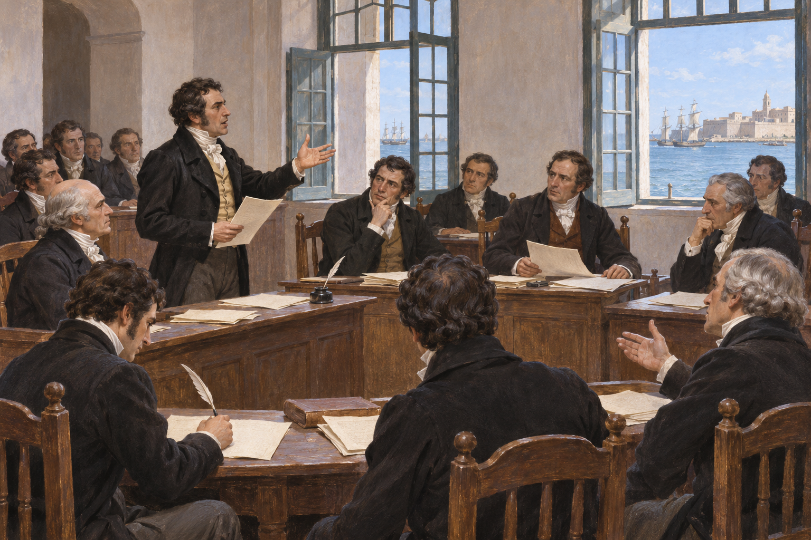

# 카디스 헌법 — 왕이 없는 동안 주권은 누구에게 있었을까

*1812년 국가 주권과 대표, 종교와 대서양의 권리 문제*

History · Europe

> 출처 대조와 공개 게시 승인을 마친 이야기입니다. 실제 게시 여부는 사이트 배포 상태를 따릅니다.

*AI 역사 이해용 상상 삽화 · 당시 사진이나 실제 인물의 초상, 특정 장면과 건물의 정확한 복원이 아닙니다.*

프랑스군과 전쟁을 치르는 가운데 스페인의 대표들은 헌법을 만들었다. 1812년 카디스에서 나온 문서는 외국의 지배에 맞서면서 자국 군주의 권한도 제한하려 했다. 왕을 지킨다는 명분과 국가의 주권을 대표가 행사한다는 주장이 같은 공간에 놓였다. 한 항구 도시의 논의는 바다 건너 아메리카의 관계까지 흔들었다.

## 01. 나폴레옹의 침입이 왕권을 비웠다

1808년의 정치적 위기와 프랑스의 침입은 스페인의 정당한 통치자가 누구인지 흔들었다. 나폴레옹의 형 조제프가 왕으로 들어섰지만 각 지역에서는 저항이 이어졌다. 기존 군주를 지지하는 사람도 당장 어떤 조직의 명령을 따를지 결정해야 했다.

왕이 직접 통치할 수 없다면 누가 국가를 대표할 것인가. 지역의 저항 조직과 중앙의 권위를 세우려는 시도는 이런 공백을 메우려 했다. 독립을 지키는 전쟁이 동시에 내부의 정치 질서를 다시 묻는 계기가 되었다.

저항의 이름으로 만들어진 권력이 전쟁이 끝난 뒤 어디까지 권한을 가질지는 또 다른 문제였다. 임시로 국가를 대표한다는 주장과 영구적인 헌법을 만드는 권한 사이에는 간격이 있다. 코르테스의 작업은 그 간격을 제도와 문서로 메우려는 시도이기도 했다.

## 02. 바다와 연결된 카디스에 대표들이 모였다

카디스는 전쟁 중에도 외부와의 연결을 유지할 수 있는 항구였다. 프랑스군의 위협 아래 대표들이 모여 논의한 장소라는 점은 중요하다. 안전한 평시의 수도에서 오래 합의한 문서가 아니라 전쟁과 불확실성 속에서 나온 헌법이었다.

1810년부터 활동한 코르테스는 통치 권한을 조직하고 국가의 대표성을 주장했다. 대표들의 출신과 실제 대표하는 지역이 모두 같은 조건인 것은 아니었다. 전쟁 때문에 참석과 선출의 방식이 영향을 받았고 해외 지역을 대표하는 문제도 있었다.

## 03. 주권은 왕 한 사람에게만 있지 않았다

1812년 헌법은 국가의 주권을 내세우고 코르테스의 입법 역할을 중심에 두었다. 군주제를 없애지는 않았지만 왕이 자기 의지만으로 모든 권한을 행사하는 구조와 달랐다. 국가와 군주를 같은 존재로 볼 수 없다는 뜻이 들어 있었다.

행정부와 입법부, 사법의 역할을 나누는 구상도 중요했다. 왕의 명령에 장관의 책임을 연결하고 대표의 활동에 제도적 자리를 주려 했다. 전쟁을 치르는 국가가 강한 권력만을 원한 것이 아니라 그 권력의 근거와 제한을 문서로 정하려 했던 것이다.

대표가 법을 만든다고 해도 모든 사람이 직접 참여하는 것은 아니다. 누구를 선출하고 어떤 단계로 의사를 모으며 누가 선거에서 빠지는지에 따라 대표 체제의 성격이 달라진다. 국가의 주권이라는 큰 표현을 구체적인 참여의 절차와 함께 읽어야 하는 이유다.

## 04. 자유주의 헌법이 종교의 자유까지 뜻하지는 않았다

이 문서는 종교의 문제에서는 가톨릭을 국가의 유일한 종교로 인정했다. 신앙 선택의 자유를 오늘의 의미로 보장한 헌법이 아니었다. 정치적 권리의 확대와 종교적 배타성이 한 문서 안에 함께 들어 있었다.

그렇다고 성직자와 헌법 지지자가 항상 완전히 다른 두 집단이었던 것도 아니다. 교회의 제도적 특권을 줄이려는 조치와 가톨릭 신앙의 유지가 공존할 수 있었다. 자유주의와 보수주의라는 이름만으로 당시 사람들의 모든 선택을 나눌 수 없는 이유다.

## 05. 대서양 양쪽을 하나의 국가로 부르다

헌법은 유럽과 아메리카의 스페인인들을 하나의 국가 틀 안에서 설명했다. 이는 바다 건너 지역의 대표와 권리를 어떻게 다룰지라는 질문을 피할 수 없게 만들었다. 제국의 구성원이라는 말과 실제로 동등한 영향력을 행사하는 일은 달랐다.

아메리카에서는 이미 통치의 정당성과 자치, 독립을 둘러싼 움직임이 진행되고 있었다. 카디스의 대표 체제가 모든 갈등을 해결한 것은 아니다. 같은 헌법의 언어를 써도 중앙과 해외 지역이 기대한 관계는 서로 다를 수 있었다.

유럽에서 내놓은 개혁이 해외 지역의 독립 요구를 자동으로 멈출 수는 없었다. 오랜 지역의 이해와 전쟁 중에 세운 권력, 이미 달라진 기대가 있었기 때문이다. 중앙이 같은 국가라고 선언하는 것과 각 지역이 그 관계를 계속 받아들이는 것은 별개의 선택이었다.

## 06. 돌아온 왕은 헌법을 받아들이지 않았다

1814년 페르난도 7세가 돌아오자 헌법과 코르테스의 조치들은 무효화되었다. 왕의 복귀가 대표들이 만든 체제의 완성을 뜻하지 않았던 것이다. 헌법 지지자들은 탄압을 받았고 권력의 정당성을 둘러싼 갈등은 계속되었다.

1820년 다시 헌법 체제가 등장했지만 그것도 오래 안정되지 못했다. 한 번 문서를 만들었다고 현실의 권력 관계가 그대로 따르는 것은 아니었다. 누가 법을 집행하고 군대를 움직이며 정치적 반대를 보호하는지가 제도의 존속을 좌우했다.

## 07. 짧은 시행보다 길게 남은 언어

카디스 헌법은 시행된 시간만으로 영향력을 평가하기 어렵다. 군주와 대표, 주권과 시민권을 논의하는 기준이 되어 스페인과 대서양 세계의 정치에 오래 등장했다. 반대와 지지의 상징으로 쓰인 역사도 문서의 내용만큼 중요하다.

그러나 후대의 명성을 당시의 완벽한 민주주의와 혼동할 필요는 없다. 여성과 여러 집단의 정치 참여에는 한계가 있었고 국가의 범위 안에서도 권리의 차이가 남았다. 카디스의 질문은 누구의 이름으로 통치하는가에 그치지 않고, 그 누구에 실제로 누가 들어가는가까지 이어진다.

## 이야기의 바탕이 된 자료

- [Charles E. Chapman, A History of Spain — Cortes of1810 and Constitution of1812](https://raw.githubusercontent.com/GITenberg/A-History-of-Spainespa-ola-of-Rafael-Altamira_40646/master/40646-0.txt) · 확인일 2026-11-08
  - 확인 내용: 전쟁/통치 공백·카디스 코르테스·국가 주권/왕과 대표·가톨릭 전속·대서양 양안·1814폐기/1820복귀. 초민주적이라는 옛 평가와 모든 남성의 실제 권리가 같다는 요약을 그대로 쓰지 않음

---

[같은 소주제의 이야기](README.md) · [전체 서가](../../README.md)
