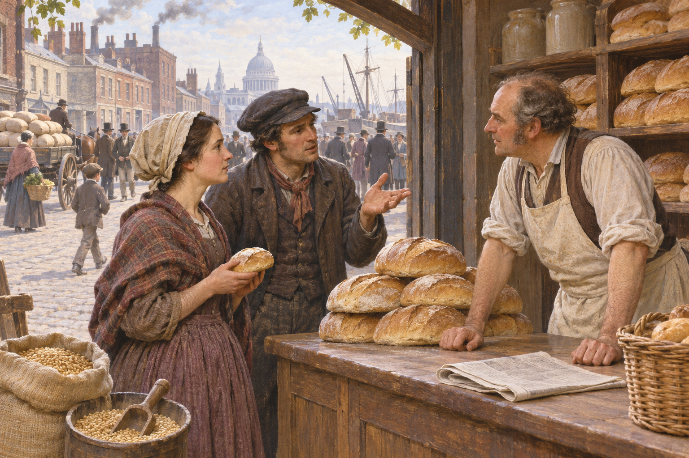

# 곡물법 폐지 — 빵값을 둘러싼 논쟁은 왜 정당을 갈라놓았을까

*1846년 식량 수입과 생활비, 자유무역 운동과 정당의 분열*

History · Europe

> 출처 대조와 공개 게시 승인을 마친 이야기입니다. 실제 게시 여부는 사이트 배포 상태를 따릅니다.

*AI 역사 이해용 상상 삽화 · 당시 사진이나 실제 인물의 초상, 특정 장면과 건물의 정확한 복원이 아닙니다.*

빵 한 덩이의 가격을 두고 공장주와 지주, 노동자가 서로 다른 미래를 보았다. 19세기 영국의 곡물법은 외국산 곡물의 수입을 제한해 국내 농업을 보호하려는 장치였다. 그러나 도시와 공업이 커지면서 누구를 위해 식량의 가격을 지키는가라는 질문이 강해졌다. 1846년의 폐지는 자유무역의 구호만이 아니라 식탁과 정치적 대표의 관계를 바꾼 사건이었다.

## 01. 곡물이라는 말은 옥수수만 뜻하지 않았다

영어의 콘이라는 단어를 오늘날 미국식 옥수수로만 읽으면 곡물법의 대상을 오해한다. 당시 영국에서는 밀을 비롯한 주요 곡물을 가리키는 말이었다. 빵의 재료를 해외에서 어떤 조건으로 들여올 것인지가 법의 중심에 있었다.

곡물의 수입에 높은 부담을 주거나 국내 가격에 따라 조건을 바꾸면 외국의 공급이 들어오는 시점과 양이 달라진다. 국내 생산자를 보호하려는 제도였지만 식량을 사 먹는 사람에게는 생활비의 문제가 될 수 있었다.

같은 무게의 밀을 들여와도 관세와 운임, 보관료가 붙으면 빵을 만드는 비용은 달라진다. 그래서 수입 규칙의 효과는 농장의 곡물 가격에만 머무르지 않는다. 항구의 상인과 제분업자, 빵집과 가정의 지출이 하나의 공급 경로를 통해 연결되어 있었다.

## 02. 전쟁이 끝난 뒤에도 보호를 유지하려 했다

나폴레옹 전쟁 이후 영국의 지주와 농업 이해관계자들은 해외 곡물과의 경쟁을 걱정했다. 생산을 유지하고 토지에서 얻는 수입을 지키려는 목적이 있었다. 법의 지지자에게 식량의 국내 공급 기반은 국가의 안정과도 연결되었다.

그러나 농업에 유리한 가격이 소비자에게도 유리한 것은 아니었다. 특히 현금 임금으로 생활하며 빵을 사야 하는 도시 주민에게 식량비는 큰 부담이었다. 같은 가격표를 보고도 누군가는 보호를, 다른 누군가는 불필요한 장벽을 보았다.

## 03. 공업 도시가 법을 바꾸라고 요구했다

공업과 도시의 성장으로 식량을 많이 구매하는 인구가 늘었다. 제조업자들은 수입 제한을 줄이면 생활비와 생산 비용의 조건이 달라지고 해외 시장과의 거래도 넓어질 것이라고 기대했다. 농업 중심의 정치적 영향력과 새로운 경제의 요구가 부딪쳤다.

반곡물법 동맹은 이런 요구를 조직하고 청원과 연설, 인쇄물을 통해 주장을 퍼뜨렸다. 리처드 코브던과 존 브라이트 같은 인물이 활동했다. 시장의 변화가 저절로 법을 고친 것이 아니라 변화를 요구하는 사람들의 조직적인 정치가 있었다.

운동은 경제적 주장을 널리 이해시킬 표현도 필요로 했다. 수입 규정의 복잡한 수치보다 빵값과 가족의 식탁은 가까운 문제였다. 다만 사람들이 쉽게 공감하는 구호가 있다고 법을 바꿀 의회의 다수까지 자동으로 생기는 것은 아니었다.

## 04. 싼 빵을 원하는 이유도 모두 같지는 않았다

노동자에게 식량비 감소는 당장의 생활과 연결되었다. 공장주에게는 비용과 교역의 문제이기도 했다. 같은 폐지 요구를 지지한다고 두 집단이 임금과 노동 조건에 대해서도 같은 생각을 가진 것은 아니었다.

따라서 이 사건을 생산자와 소비자가 깔끔하게 나뉜 경제학의 그림으로만 볼 수 없다. 노동자도 임금을 받는 생산자였고 농촌의 주민도 빵을 사 먹었다. 누구의 어떤 이익을 대변하는지 구체적으로 나누어야 제도의 효과를 읽을 수 있다.

## 05. 아일랜드의 기근이 결정을 압박했다

1840년대 중반 감자 흉작과 기근은 식량 정책을 둘러싼 압박을 키웠다. 특히 아일랜드의 위기는 먹을거리를 어떤 경로로 확보할 것인가라는 문제를 긴급하게 만들었다. 로버트 필 정부는 기존의 보호 정책을 유지할지 선택해야 했다.

그러나 곡물법을 폐지했다고 기근의 피해가 곧 해결된 것은 아니다. 식량을 살 돈과 구호의 방식, 토지와 빈곤의 관계가 남아 있었다. 수입 조건의 변화와 굶주린 사람에게 음식이 도달하는 일은 같은 정책적 과제가 아니었다.

부족한 식량과 구매력의 부족은 관련되지만 같은 현상은 아니다. 항구에 곡물이 더 들어와도 수입을 잃은 가정이 그것을 살 수 있는지는 별도로 따져야 한다. 기근의 역사를 무역 장벽 하나의 높이로만 설명하면 구호와 빈곤 정책의 책임을 놓친다.

## 06. 1846년의 승리는 보수당의 분열이었다

의회는 1846년 폐지를 결정했다. 필은 자신의 정치적 기반 안에 있던 보호주의 세력의 반대를 넘어서야 했다. 정책을 바꾸는 데 성공하면서도 기존의 당내 결합을 유지하지 못했다. 법의 변화에는 이를 추진한 정치 세력의 재편이라는 비용이 따랐다.

폐지는 식량 수입의 장벽을 줄이는 방향의 전환이었다. 그렇다고 어느 날부터 모든 관세와 무역 규제가 사라진 것은 아니다. 서로 다른 상품과 국가의 재정, 뒤의 정책 변화는 구분해서 보아야 한다.

1846년의 결정에도 경과 기간이 있었고 보호적 부담은 단계적으로 줄어들었다.1849년의 변화까지 함께 보아야 법의 통과와 실제 운영을 구분할 수 있다. 역사에서 폐지라는 단어는 즉시 모든 규정이 사라졌다는 뜻으로 쓰이지 않을 때가 있다.

## 07. 식량의 자유무역은 새로운 연결과 의존을 만들었다

운송과 보관이 발달하면서 영국의 식탁은 더 먼 생산지와 연결되었다. 국내에서 무엇을 키울지뿐 아니라 바깥에서 무엇을 안정적으로 가져올지도 중요해졌다. 장벽을 줄이는 선택은 교역의 확대와 공급의 위험을 함께 바꾸었다.

곡물법의 역사는 자유무역이 언제나 좋거나 보호가 언제나 나쁘다는 짧은 결론보다 넓다. 어떤 사회가 누구의 수입과 생활비를 지키려 했는지, 그 결정을 누가 바꿀 수 있었는지 보여 준다. 빵값은 시장의 숫자이면서 정치적 힘의 배치를 드러내는 기록이었다.

## 이야기의 바탕이 된 자료

- [Edward P. Cheyney, An Introduction to the Industrial and Social History of England — free trade and Corn Laws](https://raw.githubusercontent.com/GITenberg/An-Introduction-to-the-Industrial-and-Social-History-of-England_21660/master/21660-8.txt) · 확인일 2026-11-08
  - 확인 내용: 1815법·식량과 농업 보호·1839반곡물법동맹/코브던·필/1846폐지와1849경과조치. 무역 개방이 곧 기근 구호의 완성이라는 설명을 피함
- [James Harvey Robinson, An Introduction to the History of Western Europe — commerce and grain laws](https://raw.githubusercontent.com/GITenberg/An-Introduction-to-the-History-of-Western-Europe_26042/master/26042-0.txt) · 확인일 2026-11-08
  - 확인 내용: 도시의 식량 공급과 운송·곡물 수입의 제한·1846폐지·이후 무역 조건. 자유무역이 모든 국가의 확정된 정답이라는 옛 평가를 따르지 않음

---

[같은 소주제의 이야기](README.md) · [전체 서가](../../README.md)
