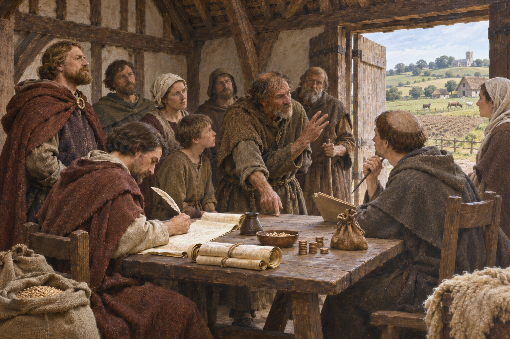

# 둠즈데이 조사 — 왕은 왜 땅과 소의 수를 물었을까

*1086년 토지와 증언, 정복 이후의 권력을 장부로 읽기*

History · Europe

> 자료 대조를 마친 검토용 이야기입니다. 공개 게시 승인은 아직 받지 않았습니다.

*AI 역사 이해용 상상 삽화 · 당시 사진이나 실제 인물의 초상, 특정 장면과 건물의 정확한 복원이 아닙니다.*

왕이 새로 다스리게 된 땅을 알고 싶다면 무엇부터 물어야 할까. 1086년 잉글랜드에서 이루어진 조사는 누가 땅을 가졌고 무엇을 생산하며 얼마만큼의 부담을 질 수 있는지 기록했다. 오늘날 둠즈데이 북으로 알려진 문서는 단순히 오래된 명부가 아니라 정복 뒤의 권력과 생활이 만난 장부다.

## 01. 정복한 국가를 숫자와 이름으로 읽다

노르만 정복 이후 윌리엄 왕은 잉글랜드를 통치했다. 그러나 왕이 국가를 얻었다는 말과 그 안의 토지·재산·권리 관계를 모두 파악했다는 말은 다르다. 지역마다 누가 무엇을 보유하고 어떤 의무를 지는지 알아야 실제 통치와 수입을 조직할 수 있었다.

1085년 말의 논의를 거쳐 조사관들이 파견되었다. 왕이 모든 마을을 직접 돌아다닌 것이 아니라 여러 지역의 증언과 자료를 모으는 방식이었다. 장부의 뒤에는 사람을 보내고 답을 받고 서로 다른 주장을 비교하는 행정의 과정이 있었다.

## 02. 누구의 땅이었고 지금은 누구의 땅인가

조사는 현재의 보유자만 묻지 않았다. 에드워드 왕 시대의 보유와 가치, 정복 이후의 상태를 함께 기록했다. 전쟁과 권력 교체가 토지의 소유와 권리에 어떤 변화를 만들었는지 읽을 수 있는 이유다.

특히 왕에게 직접 땅을 받은 사람과 그 아래에서 보유한 사람의 관계가 중요했다. 땅은 지도 위의 면적만이 아니라 여러 사람 사이의 권리와 의무였다. 같은 장소를 가리켜도 누가 어떤 자격으로 지배하고 사용하는지에 따라 기록의 의미가 달라진다.

정복 전후를 함께 적은 방식은 현재 보유자의 주장에 과거의 근거를 붙이게 했다. 누가 정당하게 넘겨받았고 누가 다투는 땅을 차지했는지는 왕의 질서에도 중요했다. 따라서 이름과 숫자를 모으는 일은 중립적인 관찰만이 아니라 정복 이후 재산 관계를 정리하는 정치적 행위였다.

## 03. 밭만이 아니라 쟁기와 방앗간도 보았다

기록에는 경작지와 목초지, 숲과 물, 쟁기 팀과 방앗간, 사람들의 지위와 재산 가치 등이 등장한다. 경작할 수 있는 땅이 있다는 사실만으로 생산이 이루어지는 것은 아니다. 일할 사람과 가축, 도구와 설비가 함께 있어야 했다.

이런 항목을 나란히 읽으면 중세 농촌의 생활이 보이기 시작한다. 다만 기록의 단위와 용어를 오늘날의 면적이나 직업 이름으로 바로 바꾸면 곤란하다. 당시의 토지 평가와 부담 체계를 이해해야 숫자가 무엇을 의미하는지 알 수 있다.

방앗간은 물과 설비를 이용해 곡물을 가공하는 곳이었다. 그 존재를 기록하면 수확한 곡식이 먹을거리가 되기까지 필요한 시설과 수입의 경로도 보인다. 농촌을 밭에서 일하는 사람의 모습 하나로만 상상하기보다, 가공과 이용 권한까지 포함된 경제로 읽을 수 있다.

## 04. 마을 사람의 대답이 왕의 기록이 되기까지

조사에는 지역의 사정을 아는 사람들이 증언하는 절차가 쓰였다. 서로 다른 사람과 공동체가 진술한 내용을 통해 보유와 권리의 상태를 확인하려 했다. 왕이 모든 정보를 독자적으로 만들어 내려 준 것은 아니었다.

하지만 최종 기록은 증언한 사람들의 일상 언어를 그대로 녹음한 것이 아니다. 질문의 틀과 편집, 라틴어의 행정 기록을 거치며 정리되었다. 지역 사람의 목소리가 들어 있으면서도 왕의 관심과 서기관의 선택을 통과한 자료라는 두 성격을 함께 보아야 한다.

어떤 토지에 관해 두 주장이 충돌했다면 조사관은 그 지역의 기억과 기존 권리를 따져야 했다. 오늘날 남은 짧은 문장은 그런 논쟁을 압축한 결과일 수 있다. 기록이 간결하다는 이유로 실제 사회의 관계까지 단순했다고 생각해서는 안 된다.

## 05. 큰 책과 작은 책은 이름만 다른 복제품이 아니다

둠즈데이 기록은 통상 큰 둠즈데이와 작은 둠즈데이로 구분하는 두 권에 남아 있다. 작은 둠즈데이는 에식스·노퍽·서퍽 세 지역을 다루며, 큰 책과 분량을 정리하는 방식에도 차이가 있다. 작은 책이라고 내용이 덜 상세한 것은 아니다.

조사 과정과 관련된 다른 기록도 남아 있어 서로 대조할 수 있다. 메이틀랜드가 이 자료들을 함께 읽은 이유도 여기에 있다. 한 권의 유명한 책만으로 모든 질문에 답하기보다, 무엇이 생략되거나 다르게 정리되었는지 비교해야 한다.

## 06. 최후의 심판이라는 이름은 무엇을 말할까

둠즈데이라는 이름은 최후의 심판을 떠올리게 한다. 기록의 판단을 쉽게 다툴 수 없다는 권위와 연결되어 설명된다. 그렇다고 조사를 시작할 때부터 왕이 오늘의 정식 책 제목을 그대로 내걸었다고 생각할 필요는 없다.

이 권위는 기록이 재산과 의무를 판단하는 근거로 쓰였음을 보여 준다. 동시에 강력한 문서라고 오류나 모호함이 전혀 없는 것은 아니다. 옛 학자의 해석과 문서에 실제 적힌 내용을 구분하는 일은 여전히 중요하다.

문서의 권위는 기록을 보관하고 다시 찾아볼 수 있는 조직에도 기대었다. 한 번 모은 정보가 뒤의 판단에 쓰이려면 위치와 이름, 보유 관계를 다시 확인할 수 있어야 한다. 둠즈데이 북은 자료를 수집한 사건인 동시에 그것을 오래 유지하는 국가의 능력을 보여 준다.

## 07. 중세의 인구조사로만 읽으면 놓치는 것

둠즈데이 북은 잉글랜드의 모든 주민을 빠짐없이 이름별로 등록한 현대식 인구조사가 아니다. 기록이 빠진 지역과 사람, 왕의 조사 목적에 맞지 않아 자세히 적히지 않은 생활이 있다. 보이지 않는다는 이유로 존재하지 않았다고 판단할 수 없다.

이 글의 삽화는 조사관과 지역 사람들이 만나는 장면을 상상한 그림이다. 실제 문서의 필체나 특정 회의의 복원이 아니다. 장부를 펼친다는 것은 숫자를 찾는 일인 동시에, 국가가 무엇을 알고 싶어 했고 무엇을 기록 밖에 남겼는지 묻는 일이기도 하다.

## 이야기의 바탕이 된 자료

- [F. W. Maitland, Domesday Book and Beyond](https://raw.githubusercontent.com/GITenberg/Domesday-Book-and-BeyondThree-Essays-in-the-Early-History-of-England_43255/master/43255-0.txt) · 확인일 2026-11-08
  - 확인 내용: 1085년 논의와1086년 조사·토지 보유/평가·지역 증언·라틴어 편집·큰/작은 둠즈데이와 관련 기록. 현대식 전수 인구조사와 구분

---

[같은 소주제의 이야기](README.md) · [전체 서가](../../README.md)
