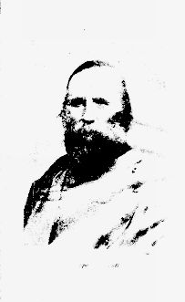

# 가리발디의 천인대 — 붉은 셔츠는 어떻게 왕국의 지도를 바꾸었을까

*시칠리아의 참여와 군주의 선택, 통일 뒤에 남은 과제*

History · Europe

> 출처 대조와 공개 게시 승인을 마친 이야기입니다. 실제 게시 여부는 사이트 배포 상태를 따릅니다.

*Evelyn Martinengo-Cesaresco, The Liberation of Italy, Giuseppe Garibaldi frontispiece · Public Domain. 역사 출판물의 인물 초상 도판이며1860년 원정 현장 사진이 아닙니다.*

[이미지 출처·제작 근거](https://raw.githubusercontent.com/GITenberg/The-Liberation-of-Italy-1815-1870_14078/master/14078-h/images/image1.jpg) · Public Domain · 저작권 만료 작품 및 역사 출판 자료

약 천 명으로 시작한 원정대가 왕국 하나의 붕괴와 이탈리아 통일의 속도를 바꾸었다. 1860년 가리발디의 시칠리아 원정은 이런 문장으로 기억된다. 하지만 숫자가 작은 부대의 용맹만으로 남부 전체의 변화를 설명할 수는 없다. 현지의 불만과 참여, 북부 왕국의 계산, 유럽 열강의 관심이 함께 움직였다. 붉은 셔츠의 행진은 통일의 이야기인 동시에 통일 뒤 무엇을 바꿀 것인가라는 질문의 시작이었다.

## 01. 아직 하나의 국가가 아니었던 이탈리아

19세기 중반 이탈리아반도에는 여러 정치 세력이 나뉘어 있었다. 남부와 시칠리아는 부르봉 왕조의 양시칠리아 왕국 아래 있었고, 북부의 사르데냐 왕국은 통일 과정에서 영향력을 넓히고 있었다. 같은 이탈리아라는 말이 곧 하나의 정부를 뜻하지는 않았다.

북부의 정치가 카보우르는 외교와 전쟁을 조절하며 왕국의 확대를 추진했다. 반면 가리발디는 민중적 명성과 자원병의 행동력을 가진 인물이었다. 통일이라는 큰 방향이 겹쳐도 방법과 최종 목표까지 늘 같았던 것은 아니다.

## 02. 시칠리아로 향한 자원병들

1860년 5월 가리발디 일행은 바다를 건너 시칠리아의 마르살라에 상륙했다. 천인대라는 이름은 출발한 자원병 집단을 가리키는 상징이 되었다. 그러나 이후의 전투와 행진을 처음의 약 천 명이 끝까지 혼자 수행한 것으로 이해해서는 안 된다.

병력은 현지 참여와 지원을 통해 커졌다. 시칠리아에는 부르봉 지배에 대한 반감과 지역의 정치적 요구가 이미 있었다. 외부에서 온 원정대가 행동할 수 있었던 조건은 바로 그 현지 사회에 놓여 있었다. 통일의 영웅담은 이 협력자들을 배경으로 밀어내기 쉽다.

마르살라 항구에 외국 함선이 있었다는 사실도 원정대의 성공을 설명할 때 자주 등장한다. 하지만 그것을 열강이 전투 전체를 대신 수행했다는 뜻으로 바꾸어서는 안 된다. 국제 정세가 행동의 여지를 주는 것과 현장에서 병력과 보급을 확보하는 일은 서로 다른 조건이었다.

## 03. 팔레르모를 얻는다는 것

칼라타피미의 전투를 거쳐 가리발디의 세력은 팔레르모로 진입했다. 도시 안의 저항과 군대의 행동, 협상은 함께 사태를 움직였다. 성벽이나 거리를 차지하는 일과 주민이 새로운 권력을 받아들이는 일은 같은 문제가 아니었다.

시칠리아에서 가리발디는 비토리오 에마누엘레의 이름으로 권력을 행사했다. 공화주의 경력을 가진 인물이 군주의 이름을 내세운 데에는 통일이라는 목표를 우선하는 현실적 선택이 있었다. 혁명적인 동원과 왕권의 언어가 한 행진 안에서 공존한 셈이다.

## 04. 통일과 토지의 문제는 달랐다

현지 주민들이 기대한 변화는 중앙 정치의 지도와 꼭 일치하지 않았다. 농민에게 중요한 것은 토지와 부담, 지역의 권력 관계일 수 있었다. 왕조를 바꾼다는 소식이 생계를 바꿀 것이라는 기대를 불러일으켜도 그 약속이 자동으로 이루어지지는 않았다.

새로운 지배 세력은 질서를 유지하려 했고 사회적 갈등은 계속되었다. 따라서 주민의 참여를 모두 민족 통일에 대한 동일한 열망으로 설명하기 어렵다. 같은 편에서 부르봉 왕조에 반대해도 그다음에 원하는 사회의 모습은 서로 달랐다.

## 05. 바다를 건너 나폴리로

시칠리아를 장악한 뒤 가리발디는 이탈리아 본토로 건너갔다. 부르봉 왕조의 통치 기반은 흔들렸고 그는 나폴리로 들어갔다. 작은 원정이 큰 변화를 낳은 데에는 상대 권력의 위기와 지지 기반의 약화도 중요했다.

성공이 커질수록 북부 정부의 걱정도 커졌다. 가리발디가 로마를 향해 더 진격한다면 교황을 둘러싼 국제 관계와 충돌할 수 있었다. 카보우르에게는 통일의 속도를 높이는 일뿐 아니라 그 방향을 왕국의 통제 안에 두는 일도 필요했다.

## 06. 군주에게 넘겨진 성과

가리발디와 비토리오 에마누엘레의 테아노 만남은 두 흐름의 결합을 상징한다. 가리발디는 자신의 군사적 성과를 바탕으로 별도의 국가를 세우기보다 왕국 중심의 통일로 이어지는 길을 받아들였다. 남부의 편입에는 주민투표도 활용되었다.

다만 당시의 투표를 오늘날의 보통선거와 같은 조건으로 생각해서는 안 된다. 선택의 범위와 정치적 분위기, 참여의 조건을 함께 살펴야 한다. 1861년 이탈리아 왕국이 출범했지만 베네치아와 로마까지 이미 모두 포함된 것은 아니었다.

가리발디가 물러난 장면은 영웅의 겸손만으로 읽을 수도 없다. 어느 정부가 군대와 재정, 국제적 승인을 이어받을 것인지가 걸린 정치적 결정이었다. 인물의 성격과 국가를 운영할 구조를 함께 보아야 통일이 왕국으로 귀결된 과정을 설명할 수 있다.

## 07. 붉은 셔츠 뒤에 남은 질문

통일은 국경과 정부를 바꾸었지만 지역 간의 격차와 사회적 갈등을 끝내지는 못했다. 가리발디의 원정을 읽는 재미는 기적 같은 승리에서 끝나지 않는다. 자원병의 동원과 현지의 기대가 어떻게 왕국의 제도로 이어졌는지 따라갈 때 더 긴 역사가 보인다.

함께 실은 이미지는 역사 출판물에 실린 가리발디의 초상 도판이다. 마르살라 상륙이나 테아노 만남을 현장에서 촬영한 사진이 아니다. 영웅의 얼굴을 바라보되, 그가 움직일 수 있었던 여러 사람의 선택과 통일 뒤에도 남은 과제를 함께 떠올려 볼 수 있다.

## 이야기의 바탕이 된 자료

- [Evelyn Martinengo-Cesaresco, The Liberation of Italy, 1815–1870 — The Thousand](https://raw.githubusercontent.com/GITenberg/The-Liberation-of-Italy-1815-1870_14078/master/14078-8.txt) · 확인일 2026-11-08
  - 확인 내용: 1860마르살라/칼라타피미/팔레르모·현지 참여와 부르봉 지배의 위기·나폴리·카보우르/가리발디/군주·테아노와 편입·1861왕국/베네치아1866/로마1870 구분. 영웅 한 명의 승리로 환원하지 않음

---

[같은 소주제의 이야기](README.md) · [전체 서가](../../README.md)
