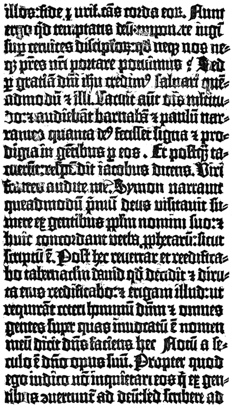

# 구텐베르크의 인쇄 — 글자를 찍으려면 활자 말고 무엇이 필요했을까

*금속 활자와 잉크, 성경과 대출에서 읽는 지식 생산*

History · Europe

> 자료 대조를 마친 검토용 이야기입니다. 공개 게시 승인은 아직 받지 않았습니다.

*Theodore Low De Vinne, The Invention of Printing, Fac-simile of the Types of the Bible of42 Lines, Acts15:10–20 · Public Domain. 실제 인쇄물의 글자와 채색 장식 흔적을 재현한 역사 출판 도판입니다.*

[이미지 출처·제작 근거](https://raw.githubusercontent.com/GITenberg/The-Invention-of-Printing-A-Collection-of-Facts-and-Opinions-Descriptive-of-Early-Prints-and-__51034/master/51034-h/images/i428.png) · Public Domain · 저작권 만료 작품 및 역사 출판 자료

활자를 줄지어 놓고 종이에 눌렀다. 익숙한 설명은 간단하지만 같은 글자를 수천 번 쓸 수 있는 인쇄를 실제 사업으로 만드는 일은 그렇지 않았다. 15세기 중엽 마인츠에서 구텐베르크가 이룬 작업에는 금속과 잉크, 압력과 종이, 자금과 숙련이 함께 필요했다. 성경의 아름다운 글자 뒤에서 여러 기술과 노동이 만나는 장면을 따라가 보자.

## 01. 인쇄의 역사는 마인츠에서 처음 시작되지 않았다

동아시아에서는 목판 인쇄가 오래전부터 이루어졌고 활자를 이용하는 기술도 발전했다. 따라서 구텐베르크를 인류 역사에서 처음으로 글을 찍은 사람이라고 소개할 수는 없다. 그의 중요성은 유럽의 조건 안에서 금속 활자 인쇄를 지속 가능한 방식으로 결합한 데 있다.

한 지역에서 쓰던 기술이 다른 지역에서 어떤 경로로 알려지고 바뀌었는지는 별도로 검토해야 한다. 비슷한 생각이 존재한다는 사실만으로 모든 과정이 직접 복사되었다고 단정할 수는 없다. 세계사의 선후와 지역에서의 구체적인 실현을 함께 보아야 한다.

## 02. 같은 높이의 글자가 필요한 이유

활자는 한 글자씩 떼어 다른 문장에 다시 쓸 수 있어야 한다. 그러나 글자의 모양만 있으면 되는 것은 아니다. 판 위에 놓인 글자들의 높이가 맞지 않으면 어떤 것은 진하게 찍히고 어떤 것은 종이에 닿지 않는다.

작은 금속 조각을 반복해서 만드는 방식과 그것을 일정하게 맞추는 숙련이 중요했다. 한 페이지를 찍은 뒤 활자를 풀어 다음 페이지에 쓰려면 분류하고 보관하는 작업도 필요했다. 재사용이라는 장점은 그만큼 정밀한 물건과 정리의 노동을 요구했다.

한 문장을 만들려면 필요한 글자가 한 종류씩만 있어서는 안 된다. 자주 쓰는 글자는 여러 개를 준비해야 하고 쓰고 난 글자도 다시 제자리로 돌아와야 한다. 인쇄의 반복성은 물건을 다시 쓴다는 원리뿐 아니라 재고와 작업 순서를 관리하는 능력에서 나왔다.

## 03. 잉크와 압력은 종이 위에서 만났다

필사에 쓰는 재료를 그대로 가져온다고 금속 활자 인쇄가 잘되는 것은 아니었다. 금속 표면에 적절하게 묻고 종이로 옮겨 갈 잉크, 판 전체에 힘을 고르게 가하는 장치가 필요했다. 글자의 아름다움은 이런 재료의 성질과 기계의 작동에 기대었다.

종이와 양피지를 마련하는 일도 큰 부담이었다. 인쇄를 시작하면 여러 장을 만들 수 있지만 첫 판매까지 비용이 먼저 들어간다. 지식의 확산을 가능하게 한 작업장은 동시에 비싼 재료를 사고 제품을 기다려야 하는 생산 현장이었다.

## 04. 성경은 작은 시험 인쇄물이 아니었다

구텐베르크와 연결되는 유명한 성경은 대체로 1450년대 중반의 작업으로 본다. 흔히 42행 성경이라고 부르는 이름은 여러 면의 두 단에 놓인 줄 수에서 왔다. 큰 분량의 책을 반복해서 정확히 만드는 능력을 보여 주는 작업이었다.

오늘의 눈에는 인쇄와 손글씨가 뚜렷하게 달라 보이지만 초기 인쇄물은 필사본의 익숙한 모습을 의식했다. 장식과 글자 색을 손으로 더한 부분도 있다. 새 기술은 처음부터 모든 옛 노동을 없애기보다 기존 책 만들기의 관습과 함께 움직였다.

여러 부를 찍을수록 처음 판을 준비한 수고를 나눌 수 있다. 그러나 잘못된 문장까지 많이 찍으면 손해도 커진다. 인쇄가 속도와 수량의 문제인 동시에 확인과 수정의 문제였던 이유다. 교정은 기계의 바깥에 붙은 부수적인 일이 아니라 생산 과정의 일부였다.

## 05. 돈을 빌리면 기술의 주인도 흔들렸다

구텐베르크의 작업에는 요한 푸스트의 자금이 연결되어 있었다. 두 사람 사이의 채무 분쟁은 기술의 개발과 사업의 권한이 서로 다를 수 있음을 보여 준다. 좋은 장치를 만들었다고 재정 문제까지 해결되는 것은 아니었다.

페터 쇠퍼도 초기 마인츠 인쇄의 중요한 인물이다. 이후 푸스트와 쇠퍼의 인쇄물에는 작업을 확인할 수 있는 이름과 연대가 남는다. 누가 무엇을 발명하고 어떤 권한을 가졌는지는 남은 문서와 책을 대조해야 하며, 후대의 영웅담을 그대로 실제 대화와 사건으로 받아들이기 어렵다.

당시의 발명 과정을 설명하는 후대 책에는 이름과 우선권을 둘러싼 논쟁이 많다. 서술자가 자신이 지지하는 인물의 역할을 키우기도 했다. 남은 인쇄물의 특징과 계약·소송 기록이 확인해 주는 범위를 구분하는 일이 영웅의 전기를 읽는 것보다 중요하다.

## 06. 책은 저절로 모든 사람에게 싸게 퍼지지 않았다

인쇄는 같은 글의 여러 부를 만드는 조건을 바꾸었다. 그러나 제작비와 운송, 판매망이 필요했고 글을 읽을 능력과 책을 살 돈도 있어야 했다. 인쇄기의 등장 즉시 모든 사람이 원하는 책을 자유롭게 읽었다고 생각할 수는 없다.

새로운 방식의 생산은 서적상과 교정, 제본과 유통의 일을 넓혔다. 인쇄된 글이 늘어나면서 종교와 교육, 정치의 논쟁도 다른 규모로 움직일 수 있었다. 기술 하나가 사회를 자동으로 바꾸었다기보다 여러 제도와 수요가 그 가능성을 키웠다.

## 07. 남은 책에서 작업장을 되짚어 보다

활자의 모양과 줄의 배치, 인쇄 뒤에 더한 장식을 살피면 완성된 책 안에서도 생산의 흔적을 볼 수 있다. 함께 실은 역사 출판 도판은 42행 성경의 실제 글자와 장식 흔적을 재현한 것이다. 구텐베르크가 일하는 모습을 상상한 그림과는 성격이 다르다.

그의 인쇄를 한 천재의 번뜩임만으로 기억하면 정교한 금속 조각과 종이, 대출과 교정의 세계가 사라진다. 글을 널리 퍼뜨릴 수 있는 기술은 지식의 장치이면서 사람과 돈이 모여야 움직이는 산업이었다. 책 한 면은 그 여러 조건이 만난 결과물이다.

## 이야기의 바탕이 된 자료

- [Theodore Low De Vinne, The Invention of Printing](https://raw.githubusercontent.com/GITenberg/The-Invention-of-Printing-A-Collection-of-Facts-and-Opinions-Descriptive-of-Early-Prints-and-__51034/master/51034-0.txt) · 확인일 2026-11-08
  - 확인 내용: 동아시아 인쇄와 유럽 활자·금속/주조/잉크/종이/압력·42행 성경의 글자 재현·푸스트/쇠퍼/구텐베르크의 권한·소송과 발명 우선권을 둘러싼 후대 서술. 영웅 전기의 상상 대사나 단일 발명 순간을 확정하지 않음

---

[같은 소주제의 이야기](README.md) · [전체 서가](../../README.md)
