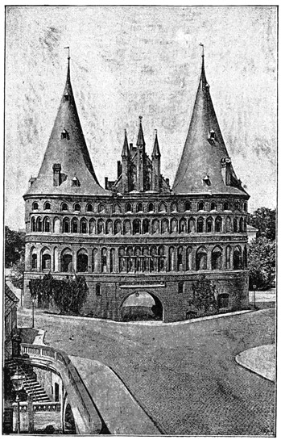

# 한자동맹 — 왕국이 아닌 도시들은 어떻게 바다를 연결했을까

*발트해와 북해의 상품, 콘토어와 도시들의 느슨한 협력*

History · Europe

> 출처 대조와 공개 게시 승인을 마친 이야기입니다. 실제 게시 여부는 사이트 배포 상태를 따릅니다.

*Helen Zimmern, The Hansa Towns, Holstentor, Lübeck · Public Domain. 한자 도시의 건축물을 보여 주는 역사 도판이며 한자동맹 창립 현장 사진이 아닙니다.*

[이미지 출처·제작 근거](https://raw.githubusercontent.com/GITenberg/The-Hansa-Towns_39664/master/39664-h/images/illo110.jpg) · Public Domain · 저작권 만료 작품 및 역사 출판 자료

뤼베크와 함부르크, 발트해와 북해의 항구들은 하나의 왕이 다스린 국가가 아니었다. 그런데도 상인들은 여러 도시를 오가며 거래하고 공동의 특권을 지키려 했다. 한자동맹은 그 느슨하고 끈질긴 연결의 역사다. 현대의 국가 연합이나 거대한 한 회사와 다른 조직을 어떻게 읽어야 할까.

## 01. 상인은 낯선 항구에서 혼자이고 싶지 않았다

먼 곳에서 장사하려면 상품만 있으면 되는 것이 아니다. 배를 대고 물건을 보관할 장소, 거래를 인정받을 권리와 분쟁을 해결할 방법이 필요했다. 외지 상인은 낯선 도시의 규칙과 세금, 위험을 혼자 상대해야 할 수 있었다.

상인들은 집단으로 움직이며 보호와 특권을 구했다. 이런 결합과 도시 사이의 협력이 오랫동안 쌓여 한자라는 이름 아래 연결되었다. 어느 날 대표들이 한곳에서 완성된 헌법에 서명해 국가처럼 출범한 조직으로 상상하면 실제의 복잡한 성격이 사라진다.

배 한 척이 난파하거나 통치자가 외국 상인의 물건을 압수하면 손해를 되찾기 어려웠다. 같은 출신의 상인들이 서로 연락하고 도시가 협상을 지원하는 것은 이런 위험을 나누는 방법이었다. 교역의 역사는 물건을 싸게 사는 기술뿐 아니라 불확실한 거래를 지속할 장치를 만드는 역사이기도 하다.

## 02. 뤼베크는 왜 중요한 연결점이 되었을까

뤼베크는 발트해 쪽 교역에서 중요한 자리를 차지했다. 북해와 이어지는 길, 주변의 여러 항구와 배후 지역을 함께 생각하면 위치의 의미가 보인다. 한 도시가 바다와 육지의 다른 경로를 연결하는 역할을 할 수 있었던 것이다.

도시의 부는 자기 안에서 생산한 것에만 달린 것이 아니었다. 다른 곳의 상품이 지나가고 계약과 보관, 운송의 일이 모였다. 그렇다고 뤼베크가 모든 거래와 회원 도시를 언제나 명령으로 지배한 수도였던 것은 아니다.

## 03. 소금에 절인 생선과 곡물, 밀랍과 모피

한자 교역의 주인공은 왕실의 보석만이 아니었다. 청어와 말린 생선, 곡물과 목재, 소금과 천, 밀랍과 모피처럼 식탁과 작업장에 필요한 물품이 바다를 건넜다. 어디에서 많이 생산되고 어디에서 필요로 하는지가 항로를 만들었다.

예를 들어 생선을 오래 보관하려면 소금과 가공, 운송이 함께 필요하다. 상품 하나의 이름 뒤에도 여러 지역의 일이 연결되어 있었다. 교역을 배가 항구 두 곳 사이를 한 번 움직이는 장면으로만 보면 이런 생산과 생활의 연결을 놓치기 쉽다.

곡물을 내보내는 지역과 생선을 가공하는 지역, 직물을 공급하는 지역은 서로 다른 계절과 생산 조건을 가졌다. 항구의 거래는 그 차이를 이용했다. 한자 전체를 특정 상품의 독점으로만 이해하면 여러 시장을 이어 주었던 다양한 운송과 중개 활동이 가려진다.

## 04. 콘토어는 공장이라기보다 거점이었다

한자 상인들은 런던·브뤼허·베르겐·노브고로드 같은 곳에 중요한 해외 거점을 두었다. 콘토어로 부르는 이런 장소는 거래와 보관, 공동생활과 규칙을 갖춘 상인 집단의 기반이었다. 옛 영어 자료의 팩토리라는 말을 오늘의 제조 공장으로 번역하면 오해가 생긴다.

외국의 통치자나 도시에게 받은 특권은 영구히 당연한 것이 아니었다. 협상과 문서, 현지 세력과의 갈등 속에서 지키고 바꾸어야 했다. 한자의 네트워크는 바다 위 항로와 항구 안의 법적 자리를 함께 가진 조직이었다.

거점의 규칙은 상인들의 행동과 공동의 이익을 관리하는 역할을 했다. 외국 도시 안에서 집단의 신뢰를 지키려면 개인의 거래도 공동체의 평판과 연결되었다. 보호를 받는 대신 일정한 통제를 받아야 한다는 관계는 느슨한 도시 연합 안에서도 존재할 수 있었다.

## 05. 모여서 결정해도 모두가 똑같이 따르지는 않았다

도시 대표들의 회의는 공동의 문제를 다루었다. 그러나 도시마다 거래 상대와 이익, 주변 군주의 압력이 달랐다. 어떤 조치에 적극 참여하는 도시가 있는가 하면 부담을 피하거나 다른 길을 찾는 도시도 있었다.

이 느슨함을 조직이 제대로 존재하지 않았다는 증거로만 볼 필요는 없다. 중앙정부가 모든 규칙을 강제하지 않아도 이익과 신뢰, 반복되는 협력으로 연결을 유지할 수 있었다. 반대로 공통의 이름이 있다고 회원의 이해가 항상 하나였던 것도 아니다.

공동 행동에는 돈과 선박, 시간이 들었다. 같은 항로를 덜 이용하는 도시라면 다른 도시가 원하는 제재나 전쟁에 소극적일 수 있었다. 협력의 성과만 세면 이런 부담의 차이가 보이지 않는다. 한자의 긴 역사는 이해관계의 차이를 없애지 않고 조정하려 한 과정으로도 읽힌다.

## 06. 특권을 지키는 힘은 때로 배제와 충돌이었다

한자 도시들은 외교와 거래 중단, 때로는 무력을 통해 이익을 지키려 했다. 1370년 슈트랄준트 조약은 덴마크와의 충돌 속에서 한자의 힘이 드러난 사례다. 장사와 정치, 군사력이 완전히 떨어져 있지 않았음을 보여 준다.

상인에게 편리한 특권이 현지의 다른 상인과 주민에게도 공정한 규칙이었다고 단정할 수는 없다. 교역의 확장은 협력뿐 아니라 경쟁과 배제를 낳았다. 성공한 상업 네트워크라는 평가와 그 안팎의 권력 차이를 함께 살펴야 한다.

## 07. 한 번의 해체보다 길게 달라진 네트워크

대서양 항로의 확대와 군주 국가의 성장, 도시별 이해의 변화 속에서 한자의 영향력은 달라졌다. 마지막 회의라는 연대를 찾는 일만으로 끝을 설명하기 어렵다. 어떤 연결과 특권은 약해지고 다른 형태로 남았다.

여기 실은 것은 뤼베크의 홀슈텐 문을 보여 주는 역사 도판이다. 한자 활동이 시작되는 순간의 사진은 아니다. 여러 현대 국가에 걸친 역사를 독일 북부 도시의 맥락에서 읽되, 한자를 오늘날 독일이라는 국가의 옛 회사로 생각하지 않는 것이 출발점이다.

## 이야기의 바탕이 된 자료

- [Helen Zimmern, The Hansa Towns](https://raw.githubusercontent.com/GITenberg/The-Hansa-Towns_39664/master/39664-8.txt) · 확인일 2026-11-08
  - 확인 내용: 도시/상인 협력·뤼베크·생선/소금/곡물 등 교역·런던/브뤼허/베르겐/노브고로드 거점·회의/특권·1370슈트랄준트·점진적 변화. 민족 우열과 청어 이동에 대한 잘못된 옛 설명은 배제

---

[같은 소주제의 이야기](README.md) · [전체 서가](../../README.md)
