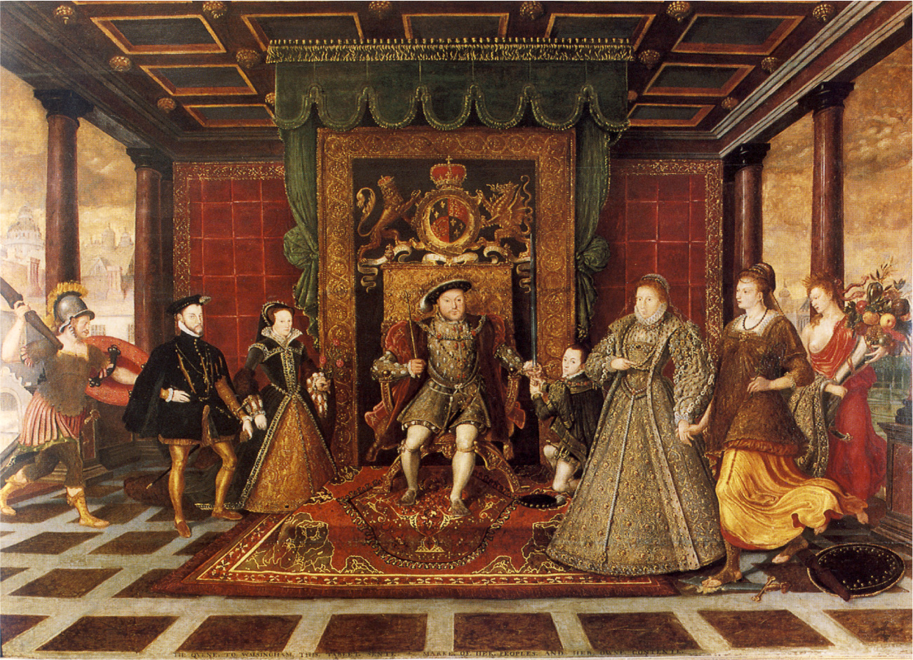

# 헨리 8세의 결별 — 교회의 수장이 바뀌면 신앙도 곧바로 바뀔까

*1534년 수장령과 왕위 계승, 이후에도 이어진 잉글랜드의 종교 변화*

역사 · 법과 제도

> 출처 대조와 공개 게시 승인을 마친 이야기입니다. 실제 게시 여부는 사이트 배포 상태를 따릅니다.

*Lucas de Heere, The Family of Henry VIII: An Allegory of the Tudor Succession (c. 1572), National Museum Cardiff/Wikimedia Commons · OpenStax 수록. 여러 시기의 왕을 함께 배치한 우의화이며 실제 모임 장면이 아닙니다.*

[이미지 출처·제작 근거](https://raw.githubusercontent.com/openstax/osbooks-world-history/main/media/OSX_WorldHist_B05_01_Tudors.jpg) · Public Domain

잉글랜드의 종교개혁은 루터의 주장에 공감한 왕이 새 신앙을 택한 사건으로 시작하지 않았다. 헨리 8세는 한때 가톨릭에 충실했고 루터를 비판했다. 그의 결별에는 왕실 혼인의 무효와 왕위 계승 문제가 놓여 있었다. 1534년 의회가 국왕의 교회 수장권을 인정한 뒤에도 예배와 교리가 한꺼번에 모두 바뀐 것은 아니었다. 권위의 소재와 신앙의 내용은 다른 속도로 움직였다.

## 01. 왕위 계승은 왕실 안의 사적인 문제만이 아니었다

헨리와 아라곤의 캐서린 사이에서 살아남은 자녀는 딸 메리였다. 여성의 왕위 계승이 법으로 완전히 금지된 것은 아니었지만 헨리는 아들이 더 안정적으로 뒤를 이을 수 있다고 생각했다. 왕실의 가족관계는 국가 권력의 미래와 연결되었다.

따라서 혼인 문제를 단순한 연애담으로만 설명하면 당시의 정치가 가려진다. 왕은 자신의 선택을 종교적 권위가 인정하게 하려 했다. 누가 혼인의 유효함을 판단할 것인가가 왕의 의도와 충돌했다.

이 문제에서 딸 메리가 존재했다는 사실은 중요하다. 후계자가 전혀 없었다는 설명과 왕이 원하는 형태의 계승자가 없었다는 설명은 다르다. 왕의 불안과 선택을 당시의 법적 가능성과 구분하면 성별과 권력의 관계도 더 정확하게 볼 수 있다.

## 02. 혼인 무효와 이혼은 다른 판단이었다

헨리는 캐서린과의 혼인이 처음부터 유효하지 않았다는 판단을 원했다. 캐서린이 먼저 자신의 형 아서와 결혼했던 사실을 근거로 들었다. 이미 성립한 혼인을 끝내는 문제와 처음부터 적법한 혼인이 아니었다는 문제는 구분되었다.

교황이 그의 요구를 받아들이지 않자 갈등은 단순한 승인 요청을 넘어섰다. 왕이 원하는 결정을 교황의 권위 아래에서 얻을 수 없을 때 그 권위 자체에서 벗어나는 길이 선택되었다. 종교 제도의 경계가 정치적 선택의 대상이 되었다.

## 03. 1534년의 법은 권위의 위치를 바꾸었다

의회가 통과시킨 수장령은 잉글랜드 교회에서 국왕의 지위를 확립했다. 중요한 것은 교황 대신 누가 최종 권위를 갖는가였다. 왕의 의지만이 아니라 법을 만드는 의회도 변화에 참여했다.

그러나 국왕이 교회의 수장이 되었다는 사실은 국민이 종교 문제를 자유롭게 결정하는 권한을 얻었다는 뜻이 아니었다. 권위가 해외의 교황에서 국내의 왕으로 이동한 일과 개인의 신앙 자유가 확대되는 일은 서로 다른 변화다.

수장령을 교회의 새로운 시작으로 기억하더라도 혼인 무효 판단과 재혼, 법의 제정은 각각의 시간에 일어났다. 하나의 유명한 연도에 모든 과정을 몰아넣으면 결정을 둘러싼 정치가 단순해진다. 법은 이미 진행 중이던 갈등을 제도적으로 굳히는 역할도 했다.

## 04. 헨리의 교회에는 많은 옛 형식이 남았다

헨리는 수도원을 닫았지만 교회는 교리와 예식의 여러 면에서 가톨릭 전통을 유지했다. 그가 교황과 결별했다고 해서 곧바로 모든 개신교 개혁자가 원하는 교회가 된 것은 아니었다.

이 차이는 잉글랜드의 변화를 단순한 가톨릭에서 개신교로의 한 번의 전환으로 정리하기 어렵게 한다. 같은 시기의 개혁자들 사이에서도 무엇을 없애고 남겨야 하는지 견해가 달랐다. 제도의 이름만으로 실제 예배를 알 수는 없다.

## 05. 에드워드 시대에는 예배의 언어와 방식이 바뀌었다

헨리의 뒤를 이은 에드워드 6세는 미성년자였고 섭정들이 통치를 맡았다. 이 시기에는 교회를 더 개신교적으로 바꾸려는 조치가 이루어졌다. 성직자의 결혼을 허용하고 여러 예식과 종교 이미지를 바꾸었다.

1549년 영어로 펴낸 『공동기도서』는 새 예배의 형식을 제시했다. 사람의 생활에서 변화는 국왕의 법적 직함보다 익숙한 기도와 예식이 달라지는 경험으로 나타날 수 있었다. 새 형식에 따르지 않는 성직자에게는 처벌의 위험도 있었다.

기도서의 사용이 강제되었다는 점은 예배의 변화가 단순한 취향의 선택이 아니었음을 보여 준다. 공동체가 같은 형식을 따르는 일이 국가 질서와 연결되었다. 교황에게서 벗어난 뒤에도 종교적 통일을 요구하는 힘이 없어진 것은 아니었다.

## 06. 메리와 엘리자베스의 계승은 방향을 다시 바꾸었다

메리 1세는 가톨릭과의 관계를 되살리려 하며 개신교도를 박해했다. 뒤를 이은 엘리자베스 1세는 다른 방식으로 종교 질서를 조정하려 했다. 군주의 계승이 교회의 방향과 연결되었다.

그렇다고 엘리자베스 시대를 모든 종교가 평등하게 공존한 시대로 부를 수는 없다. 국가의 안정과 충성의 문제는 여전히 신앙에 대한 통제와 이어졌다. 헨리의 결별 뒤에도 종교적 갈등은 끝나지 않았다.

## 07. 한 왕의 결단 뒤에는 긴 조정이 남았다

역사 회화에 한 가족으로 나란히 배치된 튜더 왕들은 실제로 같은 종교 정책을 펼치지 않았다. 그림의 조화로운 구도와 왕위 계승에 따라 흔들린 제도의 시간은 다르다. 미술 자료도 정치적 표현으로 읽어야 한다.

헨리 8세의 결별은 사랑 때문에 교회를 바꾼 왕이라는 이야기보다 넓다. 혼인 판단의 권위, 계승의 안정, 법과 예배의 변화가 얽혔다. 교회의 수장을 정한 결정은 큰 전환점이었지만 그 뒤의 신앙생활까지 한 번에 결정하지는 못했다.

여기에서 수장이라는 말은 왕이 모든 예식을 직접 집전했다는 뜻이 아니다. 최종 권위와 제도적 지위를 설명하는 말이다. 법적 권한과 실제 교회의 업무를 구분해야 국가와 종교의 관계가 어떻게 바뀌었는지 과장 없이 이해할 수 있다.

## 이야기의 바탕이 된 자료

- [OpenStax, World History Volume 2 — The Protestant Reformation](https://raw.githubusercontent.com/openstax/osbooks-world-history/main/modules/m00063/index.cnxml) · 확인일 2026-11-13
  - 확인 내용: 혼인무효와 이혼 구분/계승과 메리/1534수장령/헨리의 교리·수도원/에드워드·1549기도서/메리박해·엘리자베스. 교황결별이 종교자유 실현이나 예식의 즉시 전면교체라는 설명 제외. 원문의 잘못된 혼인무효 판정 순서를 반복하지 않음.

---

[같은 소주제의 이야기](README.md) · [전체 서가](../../README.md)
