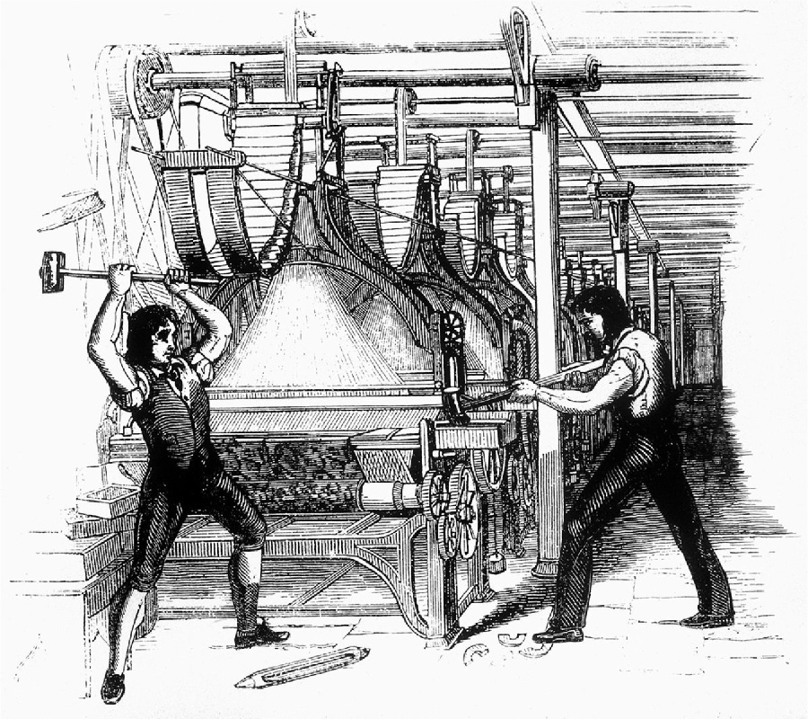

# 러다이트 운동 — 기계를 부순 사람들은 무엇을 지키려 했을까

*1811년 영국 직물 노동자의 저항과 기술 변화의 비용*

도시와 사회 · 노동과 공동체

> 자료 대조를 마친 검토용 이야기입니다. 공개 게시 승인은 아직 받지 않았습니다.

*Unknown, Frame-Breakers, or Luddites (1812), Wikimedia Commons · OpenStax 수록. 당시 삽화이며 현장 사진이 아닙니다.*

[이미지 출처·제작 근거](https://raw.githubusercontent.com/openstax/osbooks-world-history/main/media/OSX_WorldHist_B06_02_Luddites.jpg) · Public Domain

기술 변화를 싫어하는 사람을 러다이트라고 부르는 일이 있다. 그러나 1811년부터 영국에서 기계를 부순 직물 노동자들의 상황은 새 도구가 낯설다는 감정만으로 설명하기 어렵다. 기계가 들어온 작업장에서 숙련의 가치와 생계가 흔들렸다. 오늘의 편리한 별명에서 잠시 벗어나면, 이 운동은 생산성이 높아질 때 그 이익과 손실을 누가 떠안는가라는 질문을 남긴다.

## 01. 숙련은 손기술이자 생활의 기반이었다

직물을 만드는 일에는 오랜 경험과 연습이 필요했다. 노동자가 가진 기술은 상품의 품질을 유지하는 능력이었고, 자신의 노동에 대가를 요구할 근거이기도 했다. 일을 배우는 데 들인 시간은 앞으로의 생활을 기대하게 하는 자산이었다.

기계와 새로운 작업 방식은 그 관계를 바꾸었다. 더 많은 물건을 만드는 능력과 숙련 노동자가 이전의 지위를 유지하는 일은 저절로 함께 이루어지지 않았다. 생산의 개선이 어떤 사람에게는 소득의 불안으로 나타날 수 있었다.

직물 생산이 바뀌는 일은 기계 한 대를 교체하는 사건보다 컸다. 일을 나누는 방식과 노동자가 맡는 역할이 달라질 수 있었다. 숙련자의 지위가 흔들렸다는 자료의 설명은 이 변화가 단지 작업 속도의 문제가 아니었음을 알려 준다.

## 02. 기계는 눈에 보이는 갈등의 대상이었다

1811년 시작된 저항에는 직물 기계를 파괴하고 폭동을 일으키거나 불을 지르는 행동이 포함되었다. 작업장의 변화가 생활을 위협한다고 느낀 사람들은 그 변화를 가장 뚜렷하게 보여 주는 장비를 공격했다.

기계를 부순다고 상품 시장의 변화가 사라지는 것은 아니었다. 하지만 힘의 차이가 큰 상황에서 생산을 멈추는 행위는 자신들의 존재를 드러내는 수단이었다. 행동의 배경을 이해하는 것과 폭력의 결과를 정당화하는 것은 구별해야 한다.

## 03. 네드 러드는 실제 지휘관이었을까

운동의 이름은 기계를 부쉈다고 전해지는 네드 러드에서 나왔다. 그러나 그를 확인된 조직의 창설자나 모든 행동을 지휘한 인물로 취급할 수는 없다. 이야기 속 러드는 저항의 이름과 상징으로 커졌다.

일부 노동자는 러드가 셔우드 숲에서 부패한 산업가에 맞선다고 이야기했다. 로빈 후드를 떠올리게 하는 이런 서사는 분산된 사람들에게 공동의 이름을 주었다. 전설의 역할을 설명하려고 전설을 인물의 실제 전기로 바꿀 필요는 없다.

## 04. 산업을 지키는 법은 노동자의 생계도 지켰을까

영국의 정치 지도자와 사업가 다수는 저항을 질서와 재산에 대한 공격으로 보았다. 의회는 기계 파괴를 사형에 처할 수 있는 범죄로 만들었다. 노동자의 불안은 국가가 보호하려는 산업 질서와 충돌했다.

당국은 러다이트를 처형하거나 유형지로 보냈다. 처벌은 작업장의 장비를 보호하는 힘을 보여 주었지만, 기술 변화의 부담을 어떻게 나눌 것인가에 대한 합의를 뜻하지는 않았다. 생산 도구의 안전과 생계의 안전은 서로 다른 방식으로 다루어졌다.

사형이라는 처벌의 무게는 당시 국가가 파괴 행위를 얼마나 심각하게 받아들였는지 보여 준다. 산업의 질서를 유지하는 방법을 둘러싼 선택이기도 했다. 국가가 기술 발전을 멀리서 지켜보기만 한 것이 아니라 법과 강제력을 통해 그 조건에 개입했다.

## 05. 바이런은 군중의 다른 얼굴을 지적했다

1812년 시인이자 상원 의원인 바이런은 강경한 처벌에 반대하는 논리를 폈다. 군중이라고 비난받는 사람들도 밭을 일구고 물건을 만들며 군대에서 복무하는 사람들이라는 점을 들었다. 산업의 성과를 떠받치는 사람과 질서를 위협하는 사람은 별개의 집단만이 아니었다.

그는 절망을 키우는 방치의 위험을 경고하며 회유와 단호함을 함께 요구했다. 이 주장은 기계를 없애자는 단순한 구호와 달랐다. 반대자의 폭력만 보면 그가 왜 그 지경에 이르렀는지를 놓칠 수 있다는 정치적 경고였다.

바이런이 반론을 편 장소가 의회였다는 점도 중요하다. 저항을 억누르는 법을 만드는 자리에서 그 법이 향하는 사람의 생활을 이야기한 것이다. 같은 사건도 공장의 소유권에서 보느냐 제국을 떠받치는 노동에서 보느냐에 따라 다른 문제로 나타났다.

## 06. 운동의 패배와 질문의 소멸은 달랐다

1816년 무렵 러다이트의 저항은 억눌렸다. 기계화의 흐름도 계속되었다. 이를 기술의 승리와 무지의 패배로만 정리하면 국가의 처벌과 노동자의 제한된 선택지가 역사에서 지워진다.

러다이트 전체가 하나의 정교한 정치 이론을 공유했다고 볼 근거도 없다. 서로 다른 현장의 불만을 훗날의 완성된 노동운동 강령으로 덧칠해서는 안 된다. 확인되는 공통점은 작업 방식의 변화가 자신들의 생활을 무너뜨린다는 위기의식이다.

## 07. 변화의 속도에는 분배의 문제가 따라온다

새 기술이 사회 전체의 생산을 늘릴 수 있다는 말은 구체적인 사람의 손실을 설명하지 못한다. 숙련이 평가되는 방식, 협상할 힘, 다른 일을 찾는 데 필요한 시간은 기계의 성능표 밖에 있다. 러다이트의 역사는 그 바깥의 문제를 보게 한다.

오늘의 자동화와 19세기 직물 공업을 같은 사건으로 취급할 수는 없다. 다만 기술을 받아들이느냐 거부하느냐는 두 가지 선택만 제시하면 누가 변화의 조건을 정하는지가 가려진다. 기계 앞의 갈등에는 언제나 일하는 사람과 규칙을 만드는 사람이 함께 있었다.

## 이야기의 바탕이 된 자료

- [OpenStax, World History Volume 2 — Capitalism and the First Industrial Revolution](https://raw.githubusercontent.com/openstax/osbooks-world-history/main/modules/m00078/index.cnxml) · 확인일 2026-11-13
  - 확인 내용: 1811직물 노동자의 기계 파괴·숙련과 생계/네드 러드 전설/1812바이런 연설/사형·유형과1816진압. 기술적 무지로 환원하지 않되 모든 현장이 동일 강령을 가졌다고 주장하지 않음.

---

[같은 소주제의 이야기](README.md) · [전체 서가](../../README.md)
