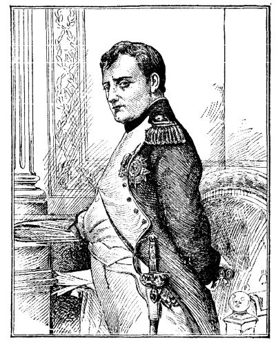

# 나폴레옹 법전 — 같은 법을 쓴다는 것은 모두가 평등하다는 뜻일까

*1804년 민법의 통일과 재산, 가족의 권리와 후대의 변화*

History · Europe

> 출처 대조와 공개 게시 승인을 마친 이야기입니다. 실제 게시 여부는 사이트 배포 상태를 따릅니다.

*James Harvey Robinson, An Introduction to the History of Western Europe, Napoleon · Public Domain. 역사 출판물에 재현된 나폴레옹 도판이며1804년 법전 제정 회의나 당시 사진이 아닙니다.*

[이미지 출처·제작 근거](https://raw.githubusercontent.com/GITenberg/An-Introduction-to-the-History-of-Western-Europe_26042/master/26042-h/images/image84.jpg) · Public Domain · 저작권 만료 작품 및 역사 출판 자료

물건을 사고, 집을 물려주고, 결혼하거나 헤어지는 일에는 전쟁터의 승리와 다른 종류의 규칙이 필요하다. 1804년 제정된 프랑스 민법전은 이런 생활의 관계를 한 체계로 정리하려 했다. 나폴레옹의 이름으로 널리 알려졌지만 그가 혼자 책상에 앉아 쓴 법은 아니다. 혁명의 유산을 보존하면서도 가족 안의 불평등을 남긴 이 법전은, 통일된 규칙과 평등이라는 말이 어떻게 다를 수 있는지 보여 준다.

## 01. 같은 왕국 안에 여러 법이 있었다

혁명 전 프랑스에서는 지역의 관습과 로마법 전통, 왕의 법령 등이 복잡하게 겹쳤다. 사는 곳과 신분, 다루는 문제에 따라 적용할 규칙이 달라질 수 있었다. 프랑스라는 하나의 이름 아래 있다고 거래와 상속의 법까지 하나였던 것은 아니다.

혁명은 신분적 특권을 없애고 재산과 가족 관계를 바꾸는 여러 조치를 내놓았다. 그러나 새로운 법령이 쌓이는 것과 사람들이 한 체계의 규칙을 찾아 쓸 수 있는 것은 별개였다. 기존의 법과 혁명 이후의 변화를 정리하는 작업이 필요했다.

지역마다 규칙이 다르면 거래 상대와 분쟁이 생겼을 때 어떤 근거를 제시할지 예측하기 어렵다. 공통의 법전을 만들려는 요구는 책의 분량을 줄이자는 제안이 아니었다. 서로 다른 법적 관습을 어떤 원칙 아래 묶을지 정하는 국가의 선택이었다.

## 02. 장군 한 사람이 만든 책은 아니다

통일된 민법을 만들려는 시도는 나폴레옹 이전부터 있었다. 집권한 나폴레옹은 법률가들로 이루어진 위원회를 두고 작업을 추진했다. 포르탈리스 등을 비롯한 법률가들의 경험과 논의가 조문을 만드는 기반이 되었다.

초안은 검토와 토론을 거쳤고 나폴레옹도 논의에 관여했다. 그에게는 법을 정비할 정치적 힘과 추진력이 있었지만 오랜 법학 전통과 여러 사람의 작업을 대신할 수는 없었다. 유명한 이름을 가진 제도일수록 그 뒤의 집단적인 노동을 살펴볼 필요가 있다.

## 03. 이 법은 무엇을 다루었을까

민법은 주로 개인과 가족, 재산과 계약의 관계를 다룬다. 범죄에 어떤 형벌을 내릴지 정하는 법이나 군대의 명령 체계와 같은 것이 아니다. 나폴레옹 시대에 여러 법전이 만들어졌다고 모든 내용을 하나의 민법전 안에 넣어 생각하면 혼동이 생긴다.

매매를 약속했을 때 어떤 의무가 생기는지, 소유권을 어떻게 다루는지, 사람이 사망했을 때 재산을 누가 잇는지 같은 질문이 생활의 법을 이룬다. 큰 정치적 구호가 집과 토지, 가족의 구체적인 관계로 내려오는 지점이었다.

하나의 법전을 편찬하면 문서를 찾아보고 가르치는 방식도 달라진다. 법률가와 관리에게 같은 조항을 기준으로 논의할 틀이 생긴다. 다만 책에 조문이 있다는 사실과 모든 주민이 그것을 이해하고 실제 재판을 이용할 수 있다는 사실은 또 다르다.

## 04. 재산의 안정은 혁명의 결과와 연결되었다

혁명기에는 교회와 옛 지배층의 재산이 이동했다. 새롭게 재산을 취득한 사람들에게는 정치가 바뀔 때마다 권리가 뒤집히지 않는다는 확신이 중요했다. 소유권과 계약을 안정적으로 정리하는 일은 사회의 질서와 연결되었다.

신분에 따른 특권 대신 공통의 법을 적용한다는 원칙도 핵심이었다. 그러나 법적인 신분 특권을 없앤다고 재산의 크기와 협상 능력의 차이까지 사라지는 것은 아니다. 같은 계약 규칙 아래에서도 가진 자원에 따라 실제 선택지는 달라질 수 있었다.

## 05. 가족 안에서는 평등이 멈추었다

법전은 부부와 부모·자녀의 관계에서 남편과 아버지의 권위를 강하게 인정했다. 기혼 여성의 법적 활동에는 제약이 있었다. 혁명이 말한 자유와 평등을 모든 가족 구성원이 같은 방식으로 누렸다고 설명할 수 없는 이유다.

여기에는 사회를 안정시키려는 당시의 가족관이 들어 있었다. 국가가 공적인 공간에서 신분의 차이를 줄이는 동시에 집 안의 위계는 강화할 수도 있었다. 제도를 평가할 때 어떤 영역에서 누구의 권리를 넓혔는지 구체적으로 나누어 보아야 한다.

## 06. 군대보다 오래 남은 영향

프랑스의 영향력이 넓어지면서 이 법 체계도 다른 지역으로 전해졌다. 정복과 정치적 압력 아래 도입된 경우가 있었고 후대의 법률가들이 참고하거나 고쳐 받아들인 경우도 있었다. 나폴레옹이 패배했다고 법의 흔적이 모두 사라진 것은 아니다.

그렇다고 오늘날 여러 국가의 민법이 1804년의 문장을 그대로 복사한 것이라고 볼 수는 없다. 각 지역의 관습과 정치, 이후의 개정이 함께 작용했다. 영향을 받았다는 말과 동일한 법을 계속 쓴다는 말은 구분해야 한다.

법률가가 참고하는 원칙은 군대가 떠난 뒤에도 남을 수 있다. 새로운 정부가 들어서도 거래와 상속의 규칙을 매번 모두 바꾸면 혼란이 커지기 때문이다. 정치적 지배의 지속 기간과 제도의 영향이 지속되는 기간이 다를 수 있다는 점이 법전의 확산에서 드러난다.

## 07. 법전의 이름보다 바뀐 조문을 읽기

현재의 프랑스 민법은 1804년 이후 많은 변화를 거쳤다. 특히 가족과 여성의 지위가 옛 조항 그대로 남아 있다고 생각하면 현재와 과거를 모두 오해하게 된다. 오래 지속된 제도라는 말은 한 번도 고치지 않았다는 뜻이 아니다.

나폴레옹 법전이 남긴 질문은 지금도 구체적이다. 규칙을 통일하면 사람들의 다툼을 예측하기 쉬워지지만, 그 규칙 안에 어떤 권력 관계를 담을 것인지는 별도의 선택이다. 같은 법을 가진 사회와 모두가 동등한 권리를 누리는 사회 사이의 거리를 읽는 것이 이 법전의 역사를 살피는 방법이다.

## 이야기의 바탕이 된 자료

- [James Harvey Robinson, An Introduction to the History of Western Europe — The Code Napoléon](https://raw.githubusercontent.com/GITenberg/An-Introduction-to-the-History-of-Western-Europe_26042/master/26042-0.txt) · 확인일 2026-11-08
  - 확인 내용: 구체제/혁명 법률의 정리·위원회/국무원 논의·나폴레옹의 관여·민법전의 지속과 외부 영향·별도의 형사/상법전. 저자의 일괄적인 평등 확산 찬양은 따르지 않고 가족 안의 권리 차이와 후대 개정을 구분

---

[같은 소주제의 이야기](README.md) · [전체 서가](../../README.md)
