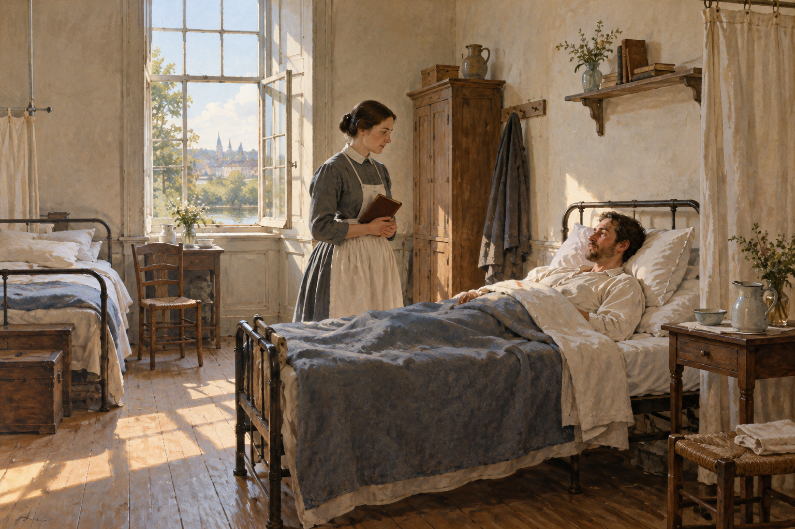

# 나이팅게일 — 등불보다 먼저 병실의 공기를 보다

*간호에 관한 오래된 책이 주목한 빛과 소리, 관찰*

History · Europe

> 자료 대조를 마친 검토용 이야기입니다. 공개 게시 승인은 아직 받지 않았습니다.

*KnowledgeWalk 제작 AI 삽화 · 옛 돌봄과 관찰의 분위기를 상상한 장면 · 실제 나이팅게일·병원 복원도나 오늘의 의료 지침이 아닙니다.*

나이팅게일을 떠올리면 어두운 병실을 돌며 등불을 든 사람이 생각난다. 그런데 그녀의 『간호에 관한 기록』을 펼치면 첫머리에서 만나는 것은 등불보다 공기다. 환자가 숨 쉬는 방의 상태, 추위와 소음, 빛과 식사처럼 너무 익숙해서 지나치기 쉬운 것들이다.

19세기에 쓰인 이 책은 오늘의 의료 지침과 같지 않다. 옛 치료법을 따라 하기보다 저자가 무엇을 관찰의 대상으로 삼았는지 살펴보자. 영웅적인 한 장면 뒤에 평범한 환경을 끊임없이 살피는 일이 있었다는 점이 흥미롭다.

## 1. 환자를 돌본다는 말의 범위

책의 부제는 간호가 무엇이며 무엇이 아닌지를 묻는다. 나이팅게일은 약을 주거나 의료 처치를 하는 일만으로 환자를 돌보는 경험 전체가 설명되지는 않는다고 본다. 사람이 머무는 공간과 하루의 흐름도 몸의 상태와 연결되어 있다고 생각했다.

이 관점에서는 방이 조용한지, 식사를 실제로 먹었는지, 밤에 제대로 쉬었는지 같은 질문이 중요해진다. 멀리서 보기에는 작은 일이지만 환자에게는 하루의 대부분을 차지할 수 있다. 간호는 좋은 마음을 가졌다는 말뿐 아니라 구체적으로 무엇을 살폈는지로 설명되어야 했다.

## 2. 창문을 열었다는 사실만으로 충분할까

환기와 보온을 다루는 장에서 나이팅게일은 공기가 어디에서 들어오는지 묻는다. 다른 방이나 복도의 공기를 들이는 것과 바깥에서 들어오는 공기를 구분한다. 열었다는 동작 하나보다 실제로 어떤 공기가 환자에게 오는지가 관심의 대상이었다.

오늘의 병실에서 창문을 어떻게 다룰지는 시설과 환자 상태, 감염 관리 기준에 따라 달라진다. 이 책의 세부 방법을 현재의 처방으로 옮기려는 것은 아니다. 여기서 볼 점은 조치를 했다는 형식보다 그 결과가 실제로 무엇인지 확인하려는 태도다.

## 3. 신선함과 추위는 같은 문제가 아니었다

저자는 환기를 말하면서 환자를 차갑게 해서는 안 된다는 조건도 함께 강조한다. 한 가지 좋은 목적을 위해 다른 필요를 잊어버리는 상황을 경계한 셈이다. 방의 상태를 바꾸는 일과 그 안의 사람이 어떻게 느끼고 있는지 보는 일은 함께 가야 했다.

이 대목을 읽으면 돌봄이 단순한 동작 목록이 아니라는 점이 보인다. 한 번 창문을 만졌다고 일이 끝나는 것이 아니라 시간과 조건에 따라 다시 살펴야 한다. 환경을 정돈하는 사람의 편리함보다 그 환경 안에 머무는 사람의 경험을 중심에 놓는 질문이다.

## 4. 작은 소리가 밤을 바꿀 수 있다

책은 소음에도 많은 주의를 기울인다. 쉬고 있는 사람 가까이에서 갑자기 나는 소리나 계속될지 알 수 없는 움직임은 부담이 될 수 있다는 관찰이다. 돌보는 쪽에게 사소한 소리가 환자에게도 사소하리라는 보장은 없다.

이것은 모든 소리를 없애야 한다는 오늘의 규칙을 제시하는 말이 아니다. 같은 공간을 사용하는 두 사람이 서로 다른 경험을 한다는 점에 주목하는 것이다. 누워서 오랫동안 쉬는 사람의 자리에서 방을 생각하면 평소에 듣지 않던 것들이 다른 무게로 들어올 수 있다.

## 5. 식사를 차렸다는 것과 먹었다는 것

식사 역시 준비했다는 사실과 실제로 먹은 양을 구분해야 한다. 책은 환자의 식사와 음식이 제공되는 때, 관찰의 필요를 다룬다. 그릇을 갖다 놓았으니 필요한 일을 마쳤다고 생각하면 눈앞에서 놓치는 것이 생긴다.

구체적인 음식이나 분량에 관한 옛 설명을 현재의 영양 처방으로 받아들이지는 말자. 이 글에서 주목하는 것은 제공한 서비스와 그것을 받은 사람의 상태 사이에 차이가 있을 수 있다는 점이다. 한 일이 무엇인지 기록하는 것과 그 일이 어떤 결과를 냈는지 살피는 일은 이어져야 한다.

## 6. 알고 있는 것과 짐작하는 것을 나누기

후반의 관찰에 관한 설명은 환자의 상태를 막연한 인상으로 보고하지 말 것을 요구한다. 직접 살핀 내용과 추측을 구분하고, 필요한 사실을 알아볼 수 있게 전달하는 것이 중요하다는 생각이다. 친절한 설명도 정확하지 않으면 충분한 도움이 되기 어렵다.

좋아 보였다는 말과 잠을 얼마나 잤는지 확인한 말은 다르다. 기록이 사람의 상태를 모두 수치로 바꿀 수는 없지만, 자기 느낌만으로 타인의 경험을 대신하지 않게 도울 수는 있다. 관찰은 무심하게 바라보는 일이 아니라 무엇을 아직 모르는지도 알아차리는 일이다.

## 7. 시대의 한계도 함께 읽는다

이 책에는 당시의 질병 이해와 여성의 역할에 관한 전제가 들어 있다. 모든 내용을 현대 의학이나 오늘의 평등한 돌봄 관계와 같게 읽을 수 없다. 오래된 인물의 기여를 인정하는 일과 그 시대의 설명을 무조건 따르는 일은 다르다.

오히려 무엇이 남고 무엇이 달라졌는지 비교할 때 역사 읽기의 의미가 생긴다. 병원 환경과 교육, 의료 기술이 변해도 환자가 실제로 어떤 경험을 하는지 확인해야 한다는 질문은 계속 생각할 수 있다. 위대한 사람이라는 이름을 외우는 것보다 구체적인 작업을 읽는 편이 가까워진다.

## 8. 돌봄은 눈에 잘 띄지 않는 순간에도 있다

영웅의 전기는 큰 사건을 중심으로 기억되기 쉽다. 그러나 이 책의 많은 부분은 방 안의 평범한 시간에 머문다. 공기가 답답한지, 조용히 쉴 수 있는지, 전해 들은 이야기가 직접 확인한 사실인지 묻는다. 유명한 상징 뒤에 반복되는 주의가 있었다.

함께 실은 그림은 19세기 돌봄의 분위기를 새로 상상한 AI 삽화다. 나이팅게일의 실제 얼굴이나 특정 병원을 복원하지 않았으며 오늘의 병실 관리법을 보여 주는 것도 아니다. 창가의 작은 장면을 통해 돌보는 사람이 무엇을 살피고 있는지 떠올려 보아도 좋다.

## 이야기의 바탕이 된 자료

- [플로렌스 나이팅게일 — Notes on Nursing 원문](https://raw.githubusercontent.com/GITenberg/Notes-on-NursingWhat-It-Is-and-What-It-Is-Not_17366/master/17366-8.txt) · 확인일 2026-10-30
  - 확인 내용: 서문의 간호 범위·환기와 보온·소음·빛·음식과 관찰 / 행동의 형식보다 실제 환경·환자가 먹은 양·추측과 직접 관찰의 구분; 현대 의료 지침으로 사용하지 않음

---

[같은 소주제의 이야기](README.md) · [전체 서가](../../README.md)
