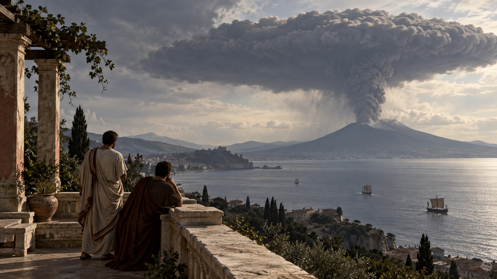

# 베수비오가 어두워진 날 — 플리니우스의 두 편지

*구조하러 떠난 삼촌과 책을 놓지 않던 조카의 서로 다른 기록*

History · Europe

> 자료 대조를 마친 검토용 이야기입니다. 공개 게시 승인은 아직 받지 않았습니다.

*AI 이야기 장면 삽화 · 편지에 묘사된 분화 구름을 떠올린 장면이며 사건 당시의 사진이나 특정 두 인물의 실제 위치·외모를 복원한 자료가 아닙니다.*

산 위에 솟은 구름은 소나무처럼 보였다. 아래에서는 기다란 줄기가 올라가고 높은 곳에서는 가지처럼 퍼졌다. 서기 79년 베수비오 분화를 묘사한 소 플리니우스의 편지는 거대한 재난을 이런 구체적인 모양으로 기억하게 한다.

그의 두 편지에는 삼촌인 대 플리니우스의 마지막 항해와 자신이 어머니와 함께 겪은 피난이 담겨 있다. 두 사람이 같은 장면을 함께 본 것은 아니다. 그 차이를 기억하며 읽으면, 오래된 재난 기록이 어떻게 만들어졌는지도 함께 보인다.

## 편지는 사건 당일의 속보가 아니다

소 플리니우스는 역사가 타키투스의 요청을 받고 삼촌의 죽음을 설명한다. 사건이 한창일 때 급히 보낸 보고가 아니라 시간이 지난 뒤 기억과 전해 들은 사정을 정리한 글이다. 그는 삼촌의 명성이 역사 속에 남기를 바라는 마음도 숨기지 않는다.

이 점은 기록을 버려야 할 이유가 아니라 읽는 기준이 된다. 편지의 글쓴이에게는 선택한 사건과 강조하고 싶은 인물이 있다. 무엇을 보았는지와 그것을 어떻게 이야기하고 싶은지는 완전히 같은 문제가 아니다. 직접 목격과 주변의 증언을 나누려는 그의 설명도 그래서 중요하다.

## 책상에서 바라본 이상한 구름

삼촌은 미세눔에서 함대를 지휘하고 있었다. 학문에도 큰 관심이 있던 그는 특이한 구름을 보고 더 가까이 가 보려 한다. 처음부터 재난 구조를 목표로 출발한 것은 아니었다. 자연 현상을 알아보려는 호기심이 먼저 움직인다.

그는 조카에게 동행할 수 있다고 하지만, 조카는 남아서 공부하겠다고 한다. 이 선택 때문에 두 사람의 경험이 갈라진다. 소 플리니우스는 삼촌의 항해 전체를 자기 눈으로 본 것처럼 쓸 수 없다. 독자 역시 뒤에 이어지는 선상과 해안의 장면이 다른 사람들의 이야기를 거쳐 왔음을 기억해야 한다.

## 관찰의 항해가 구조의 항해로

출발 무렵 도움을 청하는 편지가 도착한다. 위험에 놓인 해안에서 바다를 통한 탈출이 필요하다는 소식이다. 삼촌의 계획은 바뀐다. 현상을 살피려던 배가 사람들을 돕기 위해 위험 쪽으로 향한다. 남들이 벗어나려는 방향으로 들어가는 항해다.

가까워질수록 재와 돌이 배 위로 떨어진다. 바다와 해안의 상황도 항해를 어렵게 한다. 기록은 그가 침착하게 관찰을 계속했다고 전한다. 동시에 이 침착함을 훌륭한 인물의 자질로 보여 주려는 조카의 서술이라는 점도 놓치지 않는 것이 좋다. 용감했다는 평가와 실제 위험의 정도는 따로 살펴야 한다.

## 바람 때문에 떠나지 못한 해안

삼촌은 스타비아이에서 폼포니아누스 일행과 만난다. 바람은 그가 도착하는 데에는 유리했지만 그곳 사람들이 바다로 빠져나가려는 데에는 도움이 되지 않는다. 같은 자연조건이 오는 배와 떠나려는 배에 다른 의미가 된다. 배가 있다는 사실만으로 탈출이 가능한 것은 아니다.

건물은 흔들리고 재와 돌은 쌓인다. 일행은 실내에 남을지 바깥으로 나갈지 고민한다. 나가면서 머리에 베개를 묶어 낙하물을 막으려 한다. 아주 작고 일상적인 물건이 거대한 위험에 맞서는 방어구가 되는 모습은 재난의 크기를 어떤 수식보다 가까이 전한다.

## 삼촌의 마지막과 기록의 한계

해안에서도 상황은 나아지지 않고 대 플리니우스는 결국 쓰러져 죽는다. 조카는 공기와 건강 상태를 들어 원인을 추측한다. 그러나 이 설명을 오늘의 확정된 의학 진단으로 옮길 수는 없다. 편지가 분명히 전하는 것은 생환하지 못했다는 사실과 마지막 순간에 관한 증언이다.

분화의 날짜 역시 오래된 번역본에 적힌 한 날짜만으로 논쟁을 끝낼 수 있는 주제는 아니다. 이 글에서는 서기 79년이라는 연대와 편지 속 경험에 집중한다. 잘 알려진 숫자를 반복하는 일보다 자료가 어디까지 말하는지 밝히는 일이 이 기록을 더 믿을 만하게 읽게 한다.

## 남은 조카는 리비우스를 읽었다

두 번째 편지에서 소 플리니우스는 자신의 경험을 이어 간다. 땅이 흔들리고 어머니가 찾아오는 동안에도 그는 역사책을 읽고 발췌하고 있었다고 쓴다. 자신도 그것이 용기였는지 어리석음이었는지 판단하기 어렵다는 식으로 돌아본다. 공부에 침착했던 영웅으로만 포장하지 않는 대목이다.

주변의 어른은 그런 태도를 꾸짖고 떠날 것을 재촉한다. 익숙한 작은 흔들림을 계속 같은 일로 받아들이다가 상황이 달라졌음을 깨닫는 과정이 드러난다. 후대의 독자가 결과를 안다고 해서 당시 사람들도 처음부터 위험의 크기를 정확히 알았을 것이라 생각할 수는 없다.

## 목소리로 가족을 찾는 한낮

어머니는 자신 때문에 아들의 피난이 늦어진다며 먼저 가라고 하지만, 그는 남겨 두지 않고 함께 움직인다. 재가 떨어지고 마침내 사방이 깊이 어두워진다. 편지의 어둠은 평범한 흐린 날보다 불을 모두 끈 방에 가까운 것으로 묘사된다. 사람들은 얼굴 대신 목소리로 가족을 찾는다.

공포 속에서는 틀린 소문도 퍼진다. 도시 일부가 무너졌거나 불탔다는 말 가운데에는 사실이 아닌 것도 있었다고 그는 적는다. 재난의 기록은 자연이 한 일만이 아니라 사람들이 알지 못한 채 서로 전한 말까지 포함한다. 우리가 지금 읽는 편지도 그 혼란을 지나 정리된 이야기다.

## 다시 빛이 들어왔을 때

어둠이 물러난 뒤 주변은 재에 덮여 다른 장소처럼 보인다. 소 플리니우스와 어머니는 살아남지만, 삼촌의 소식을 알기 전까지 안심할 수 없다. 독자는 끝을 알고 편지를 읽어도 그 기다림의 무게를 느끼게 된다. 한 사람에게 귀환이었던 시간이 다른 사람에게는 마지막 항해였다.

이 두 편지를 읽는 이유는 재난을 생생하게 구경하기 위해서만은 아니다. 직접 본 것과 들은 것, 관찰과 추측, 추모와 역사를 어떻게 구별할지 생각하게 하기 때문이다. 소나무 같은 구름은 그래서 단지 유명한 비유가 아니다. 거대한 사건을 자신이 이해할 수 있는 말로 남기려 했던 사람의 첫 번째 손잡이다.

## 이야기의 바탕이 된 자료

- [Pliny the Younger, Letters of Pliny, William Melmoth 번역 — 이 수록판 LXV / LXVI, To Tacitus](https://raw.githubusercontent.com/GITenberg/Letters-of-Pliny_2811/master/2811-8.txt) · 확인일 2026-11-01
  - 확인 내용: 미세눔의 구름·삼촌의 관찰/구조 항해·렉티나·스타비아이·머리의 베개와 죽음 / 조카의 공부·어머니와 피난·한낮의 어둠·목소리와 거짓 소문·재에 덮인 풍경 / 직접 본 것과 삼촌 일행에게 들은 것의 구별·추모 목적·사인은 편지의 추측이며 현대 확진이 아님

---

[같은 소주제의 이야기](README.md) · [전체 서가](../../README.md)
