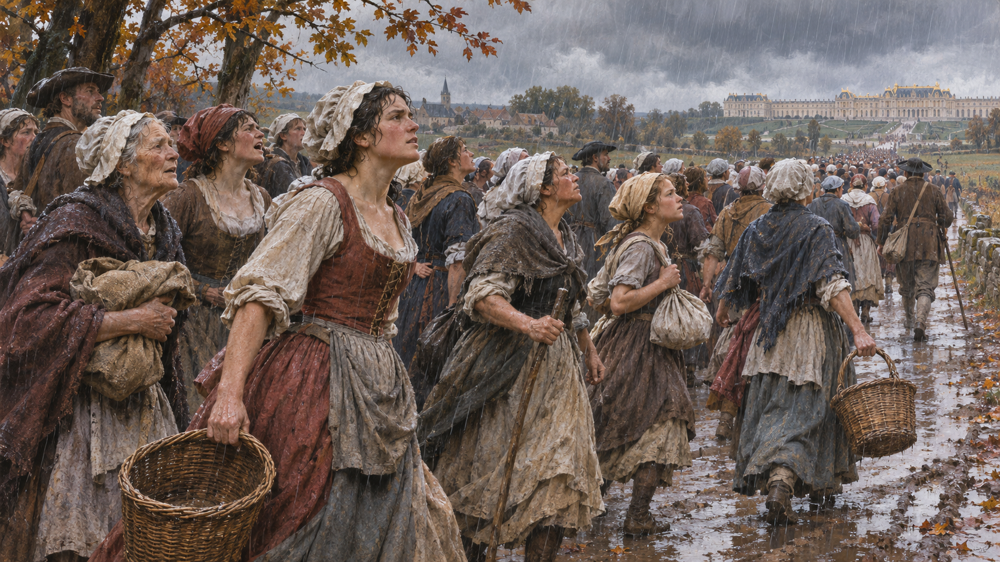

# 베르사유 여성 행진 — 빵을 구하던 사람들이 왕을 움직이다

*식탁의 위기에서 파리로 옮겨 온 왕실까지*

History · Europe

> 출처 대조와 공개 게시 승인을 마친 이야기입니다. 실제 게시 여부는 사이트 배포 상태를 따릅니다.

*AI 역사 이해용 상상 삽화 · 당시 사진이나 실제 인물의 초상, 특정 장면과 건물의 정확한 복원이 아닙니다.*

1789년 프랑스혁명을 떠올리면 바스티유 감옥이나 국민의회가 먼저 생각난다. 그러나 그해 10월에는 파리의 여성들이 베르사유까지 걸어갔다. 빵을 구하려는 절박함은 왕의 거처를 바꾸는 정치적 사건과 연결되었다. 이 행진을 우연히 흥분한 군중의 하루로 줄이지 않고 살펴보자.

## 01. 혁명이 일어나도 식탁은 저절로 채워지지 않았다

1789년 여름의 정치적 변화는 컸다. 그러나 파리의 생활에서는 빵의 부족과 가격이 여전히 절박한 문제였다. 먹을거리를 마련해야 하는 사람들에게 새 제도의 선언과 오늘 장에 나가 살 수 있는 빵은 다른 차원의 일이었다.

당시 도시 가계에서 빵이 차지하는 비중은 컸고 공급이 흔들리면 불안이 퍼졌다. 시장에서 물건을 구하고 가족을 먹이는 여성들은 그 변화를 가까이에서 겪었다. 생활의 문제로 보이던 요구가 정치의 한가운데로 들어올 조건이 생긴 것이다.

시장과 가정에서 음식을 마련하는 일은 오랫동안 사적인 일로 여겨지기 쉽다. 그러나 빵의 공급을 책임질 권력이 누구인가 묻는 순간 그 일은 공공의 문제가 된다. 이 행진은 정치 참여가 공식 직함을 가진 사람의 연설에서만 시작되지 않음을 보여 준다.

## 02. 10월 5일, 시청에서 베르사유로

10월 5일 파리에서 모인 사람들은 시청으로 향했고 이어 베르사유로 가기 시작했다. 여성들이 행렬의 중요한 부분을 이루었지만 참여자를 모두 같은 직업과 생각을 가진 한 집단으로 볼 수는 없다. 남성들도 함께했고 사람들의 요구와 행동도 달랐다.

그들은 비와 진흙길 속에서 긴 거리를 이동했다. 멀리 있는 궁정에 직접 요구를 전달하려는 행위 자체가 중요했다. 원래 정치적 권위를 가진 사람만 공식 통로를 통해 말할 수 있었던 공간에, 일상의 위기를 겪는 사람들이 몸으로 다가간 것이다.

## 03. 궁정의 잔치 소문은 불신을 키웠다

왕실 근위대의 연회와 관련한 소문은 파리의 분노를 자극했다. 궁정은 먹고 마시는데 도시는 굶는다는 대비, 혁명의 상징이 모욕당했다는 이야기가 퍼졌다. 실제 행사와 뒤에 전해진 세부 소문은 구분해서 볼 필요가 있다.

이 사건을 왕비의 사치 한 가지로 설명하면 부족하다. 재정 위기와 곡물 공급, 국왕에 대한 정치적 불신이 얽혀 있었다. 왕비가 빵 대신 과자를 먹으라고 했다는 유명한 말을 이 행진의 확인된 대사처럼 붙이는 것도 올바른 설명이 아니다.

왕이 가까이 오면 문제를 더 잘 알게 될 것이라는 기대와, 가까이 두어야 약속을 지킬 것이라는 불신은 함께 있을 수 있었다. 왕을 파리로 데려오려는 요구에서도 보호받고 싶은 마음과 감시하려는 뜻이 겹쳐진다. 군중의 감정을 한 단어로 묶기 어려운 이유다.

## 04. 빵을 요구하는 목소리가 의회와 왕에게 닿다

베르사유에 도착한 사람들은 국민의회와 왕에게 요구를 전달했다. 빵 문제뿐 아니라 혁명 이후의 정치적 결정에 대한 왕의 태도도 관심의 대상이었다. 생계와 헌정 질서가 완전히 나뉜 주제는 아니었던 셈이다.

일부 대표가 만나 협상했다고 해서 밖의 불안이 모두 사라지지는 않았다. 비를 맞고 오래 기다리는 사람들과 궁전 안의 결정 사이에는 큰 거리가 있었다. 소수 대표의 말, 군중의 기대, 당국의 약속이 서로 다른 속도로 움직였다.

## 05. 국민방위대와 궁전의 밤

라파예트가 이끄는 국민방위대도 베르사유로 왔다. 행진은 처음부터 끝까지 여성들만의 독립된 대열로 유지된 것이 아니라 무장 조직과 의회, 왕실 경비가 얽힌 복잡한 사건이 되었다. 누가 질서를 통제하는지도 불확실했다.

다음 날 아침에는 궁전에 사람들이 들어가고 경비병들이 죽는 폭력이 일어났다. 왕비가 급히 피해야 하는 상황도 생겼다. 이 일을 평화로운 시위로만 미화하거나, 반대로 모든 참여자를 폭력 집단으로 묶는 설명은 둘 다 실제의 여러 층을 지운다.

파리로 향하는 왕실의 이동은 많은 사람이 보는 공개적인 장면이 되었다. 궁정의 결정이 궁전 안에만 머물지 않고 거리의 사람들에게 평가되는 변화였다. 권력의 상징과 실제의 거처, 시민의 시선이 같은 길 위에서 만났다.

## 06. 10월 6일, 왕은 파리로 돌아왔다

결국 루이 16세와 왕실은 파리로 이동했다. 왕과 왕비, 왕세자를 빵을 가져다주는 가족에 빗대어 부른 군중의 표현은 생계와 왕권이 결합해 있었음을 보여 준다. 왕실은 튈르리 궁전에 거처를 두게 되었다.

이 변화는 단순한 이사가 아니었다. 수도의 정치적 압력에서 떨어져 있던 왕이 파리 시민과 무장 세력의 눈앞에 놓였다. 국민의회 역시 뒤에 파리로 옮겼다. 누가 어디에서 권력을 행사하는지가 혁명의 진행에 중요한 조건이 되었다.

## 07. 여성은 사건을 움직였지만 평등을 얻지는 못했다

행진은 여성들이 정치의 수동적인 관객이 아니었음을 보여 준다. 먹을거리를 요구하는 말도 국가와 통치자를 향한 정치적 요구가 될 수 있었다. 그러나 이 행동이 곧 여성의 동등한 정치적 권리 보장으로 이어진 것은 아니다.

또한 10월의 이동으로 왕정이 그날 끝난 것도 아니다. 이후에도 타협과 갈등, 왕의 도주 시도와 전쟁을 거쳐 상황이 달라졌다. 행진의 의미는 혁명의 결말을 미리 실현했다는 데보다, 생활의 위기가 권력의 위치를 실제로 바꿀 수 있음을 드러낸 데 있다.

칼라일의 후대 역사서는 이 장면을 강렬하고 극적인 언어로 그린다. 읽을거리로서의 힘과 사실 확인의 근거를 구분할 필요가 있다. 기록 속 등장인물의 말이 언제나 현장에서 그대로 받아 적은 대사인 것처럼 사용하지 않은 것도 그 때문이다.

## 이야기의 바탕이 된 자료

- [Thomas Carlyle, The French Revolution — The Insurrection of Women / To Versailles / From Versailles](https://raw.githubusercontent.com/GITenberg/The-French-Revolution--A-History_1301/master/1301.txt) · 확인일 2026-11-07
  - 확인 내용: 1789년10월5–6일 빵과 시청·마이야르와 행진·궁정 연회 소문·의회/왕과 접촉·국민방위대/라파예트·궁전 침입과 왕실의 파리 이동. 문학적 대사와 여성에 대한 고정관념을 사실로 전재하지 않음

---

[같은 소주제의 이야기](README.md) · [전체 서가](../../README.md)
