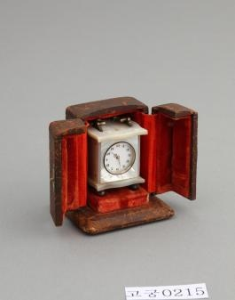

# 시계에도 작은 문이 달린 집이 있었다

*문을 열면 시간이 보이는 보관함*

History · Korea

> 출처 대조와 공개 게시 승인을 마친 이야기입니다. 실제 게시 여부는 사이트 배포 상태를 따릅니다.

*시계 · 국립고궁박물관 소장·제공. 전체 사진을 자르지 않고 사용했습니다.*

[이미지 출처·제작 근거](https://www.gogung.go.kr/gogung/pgm/psgudMng/view.do?menuNo=800065&psgudSn=367612) · 공공누리 제1유형(출처표시)

사진 속 작은 문이 양쪽으로 열려 있다. 그 안에는 시계가 앉아 있다. 시계를 넣는 상자가 아니라 시계만을 위해 지은 작은 집처럼 보인다.

국립고궁박물관의 소장품 이름은 간단히 시계다. 시계와 보관 케이스가 한 조를 이룬다고 설명한다. 전시장에서 시계의 바늘만 확인하고 지나갔다면, 이번에는 바깥의 집까지 천천히 보자.

## 1. 열두 시만 다른 색

시계 앞면의 숫자는 우리에게 익숙한 아라비아 숫자다. 그중 12만 붉고 나머지는 검다고 박물관은 설명한다. 똑같은 숫자판 안에서 위쪽 한 자리에만 색을 달리 준 것이다.

왜 그 숫자만 붉게 했는지는 이 자료에 적혀 있지 않다. 특별한 의미를 붙이기보다 먼저 실제 차이를 눈으로 찾아보면 좋다. 설명을 읽기 전에는 지나쳤을 작은 선택이 시계의 얼굴을 바꾼다.

## 2. 겉은 가죽, 안은 벨벳

보관 케이스의 바깥에는 갈색 가죽이 씌워져 있고 안에는 붉은 벨벳이 있다. 시계가 들어가는 공간도 크기에 꼭 맞도록 만들어졌다고 한다. 문은 좌우로 활짝 열 수 있는 구조다.

보관할 때와 들여다볼 때의 모양이 다른 물건이다. 오늘의 이어폰 케이스를 떠올려 볼 수도 있지만, 이것이 여행용이었다거나 충격을 막기 위해 만들어졌다고까지 단정할 근거는 없다. 맞춤 공간과 여닫이문 자체가 보여 주는 재미를 즐기면 충분하다.

## 3. 시간을 알리는 물건과 담아 두는 물건

시계는 시간을 보여 주고 케이스는 그 시계를 넣을 자리를 만든다. 한 조로 남아 있다는 설명을 읽으면 두 물건을 따로 보았을 때와 다른 관계가 드러난다. 도구가 작동하는 면뿐 아니라 보관하고 꺼내 보는 방식도 생활의 일부였다는 점이다. 시계의 몸체만으로 전체 사용 경험을 설명할 수는 없다.

그렇다고 이 케이스를 오늘의 여행용 보호함과 같은 목적이라고 바로 정하지는 않는다. 실제로 어떤 이동을 했는지와 누구의 방에 놓였는지는 남은 자료가 필요한 문제다. 지금 확인되는 맞춤 공간과 여닫이문을 먼저 보자. 특정한 물건을 위해 마련한 형태라는 점만으로도 시계를 대하던 손의 행동을 떠올릴 수 있다.

## 4. 가죽 바깥과 벨벳 안쪽의 차이

갈색 가죽은 케이스의 외형을 이루고 붉은 벨벳은 안쪽의 다른 표정을 만든다. 같은 물건을 닫아 놓았을 때와 열었을 때의 시각적 경험이 달라진다. 박물관 설명은 재료를 구분해 알려 주므로 단순히 갈색 상자라는 인상에서 한 걸음 더 들어갈 수 있다. 외부와 내부가 서로 다른 역할과 감상을 만든다.

다만 현재 보이는 색을 처음 제작 순간의 색과 완전히 같다고 생각할 필요는 없다. 보존 상태와 사진의 조건이 영향을 줄 수 있기 때문이다. 재료의 종류는 해설을 통해 확인하고 화면에서는 배치와 관계를 살펴볼 수 있다. 케이스도 시계를 담은 배경에 그치지 않고 따로 관찰할 면과 문을 가진 물건이었다.

## 5. 숫자판의 작은 차이가 시선을 이끈다

12만 붉고 다른 숫자는 검다는 정보는 사진을 다시 보게 한다. 전부 같은 숫자라고 생각하고 지나쳤다면 한 자리의 차이가 새롭게 드러난다. 같은 표면에서 색을 달리 준 선택은 어떤 지점을 구분하는 효과를 낼 수 있다. 그러나 그 효과와 제작자의 확인된 목적은 같은 것이 아니다.

특별한 기념일이나 소유자의 취향을 근거 없이 붙이는 대신 실제로 어느 부분이 다르게 처리되었는지 보아도 좋다. 작은 차이를 아는 것만으로 물건의 얼굴이 덜 익명적으로 느껴진다. 시각을 읽는 숫자판에서 시계를 구경하는 사람의 시선도 함께 움직인다. 쓰는 일과 감상하는 일이 겹치는 자리다.

## 6. 없는 부분도 현재 상태의 일부다

자료는 잠금장치가 남아 있지 않다는 사실과 연대가 분명하지 않다는 점을 알려 준다. 물건이 잘 보인다고 그 이력까지 모두 확실한 것은 아니다. 남은 케이스의 형태와 빠진 장치, 확인되지 않은 제작 시기를 함께 읽어야 한다. 그 빈칸을 특정한 왕실 인물의 소지품이라는 이야기로 채울 필요는 없다.

작은 문이 있다는 사실에서 출발해 시계를 두는 공간과 다시 들여다보는 행동을 생각해 보자. 물건을 보존한 사람들은 기능뿐 아니라 함께 쓰인 부속물도 남겼다. 덕분에 우리는 숫자판 하나를 넘어 시간을 만나는 방식의 일부를 구경할 수 있다. 시계의 작은 집이라는 비유가 구체적인 형태를 얻는 순간이다.

## 7. 사라진 장치도 설명에 남는다

케이스 문의 가운데에는 원래 붙었던 잠금장치가 없어졌고, 고정하던 작은 금속판만 남았다고 한다. 오래된 물건은 갖추어진 부분뿐 아니라 빠진 부분으로도 자기 상태를 알려 준다.

제작 연대는 박물관 정보에서도 미상이다. 누구의 책상에 언제 놓였는지 상상으로 채우기보다 지금 확인할 수 있는 문과 숫자, 가죽과 벨벳을 보자. 시간을 알려 주던 물건에 보관하는 시간까지 함께 들어 있다는 느낌이 든다.

## 이야기의 바탕이 된 자료

- [국립고궁박물관 — 시계](https://www.gogung.go.kr/gogung/pgm/psgudMng/view.do?menuNo=800065&psgudSn=367612) · 확인일 2026-10-28
  - 확인 내용: 시계와 보관 케이스 한 조 / 12만 붉은 숫자판 / 갈색 가죽 외부·붉은 벨벳 내부·맞춤 공간·여닫이문 / 잠금장치 결실과 연대 미상

---

[같은 소주제의 이야기](README.md) · [전체 서가](../../README.md)
