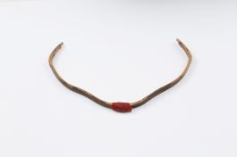

# 시위 없는 옛 활에서는 무엇을 볼 수 있을까

*각궁의 굽은 몸체에 남아 있는 재료와 홈*

History · Korea

> 출처 대조와 공개 게시 승인을 마친 이야기입니다. 실제 게시 여부는 사이트 배포 상태를 따릅니다.

*각궁, 창덕26703 · 국립고궁박물관 소장·제공*

[이미지 출처와 소장품 안내](https://www.gogung.go.kr/gogung/pgm/psgudMng/view.do?menuNo=800065&psgudSn=370166) · 공공누리 제1유형(출처표시)

활을 떠올리면 팽팽한 줄과 화살을 당기는 모습부터 생각난다. 그런데 박물관에 놓인 활에 줄이 없다면 어디를 보아야 할까.

국립고궁박물관의 각궁 한 점은 활시위 없이 남아 있다. 사진 속에서는 굽은 몸체가 먼저 눈에 들어온다. 설명을 읽으면 그 곡선을 따라 작은 단서들이 하나씩 보이기 시작한다.

## 이름 안에 들어 있는 뿔

각궁의 ‘각’은 뿔을 뜻한다. 박물관은 우리나라의 대표적인 실전용 활이라고 소개하며, 탄성을 높이기 위해 물소의 뿔을 주재료로 사용했다고 설명한다.

멀리서는 가늘고 굽은 물건 하나지만, 그 안에는 재료를 고른 이유가 있다. 그저 단단하기만 한 물건을 만드는 것이 아니라 휘어지는 성질도 생각해야 했던 것이다.

이 유물의 시대는 조선으로 소개되어 있다. 오늘 경기장에서 보는 활의 모습과 곧바로 겹쳐 놓기보다, 당시의 물건에 어떤 재료를 썼는지부터 살펴보는 편이 이해하기 쉽다.

## 줄이 없어도 줄의 자리는 남는다

남아 있는 활에는 시위가 없다. 그렇다고 줄과 관계된 부분까지 모두 사라진 것은 아니다. 박물관은 양 끝에 줄을 맬 수 있도록 홈이 파여 있다고 설명한다.

활의 가운데에는 손잡이 부분도 있다. 양 끝의 홈과 가운데의 손잡이를 나누어 보면, 길게 굽은 몸체가 어디에서 손에 잡히고 어디에서 줄과 만났는지 조금씩 읽힌다.

사진에서 완성된 사용 장면이 보이지 않더라도 흔적은 역할을 알려준다. 빠진 부분을 마음대로 채워 넣기보다, 남은 자리를 차례로 보는 것만으로 물건과 가까워질 수 있다.

## 완전하지 않은 물건을 구경하는 법

박물관에는 처음 만들어진 상태 그대로인 물건만 있는 것은 아니다. 어떤 부분은 남고 어떤 부분은 없어지기도 한다. 이때 없는 부분만 아쉬워하면 남은 부분의 재미를 놓치기 쉽다.

각궁에서는 곡선과 재료, 손잡이와 홈을 볼 수 있다. 누가 언제 이 한 점을 당겼는지까지 설명이 알려주지는 않는다. 대신 손을 대던 자리와 줄이 닿던 자리라는 구체적인 단서가 있다.

다음에 옛 도구를 만났는데 한 부분이 비어 있다면, 남아 있는 것부터 천천히 살펴보자. 줄이 없는 활도 아무 말 없는 곡선만은 아니다. 작은 홈 하나가 원래의 쓰임을 생각하게 해 준다.

## 이야기의 바탕이 된 자료

- [국립고궁박물관 — 각궁(창덕26703)](https://www.gogung.go.kr/gogung/pgm/psgudMng/view.do?menuNo=800065&psgudSn=370166) · 확인일 2026-10-27
  - 확인 내용: 조선의 대표 실전용 활로 소개한 설명 / 탄성을 위해 사용한 물소 뿔 / 시위가 없고 양 끝 홈·가운데 손잡이가 남은 상태

---

[같은 소주제의 이야기](README.md) · [전체 서가](../../README.md)
