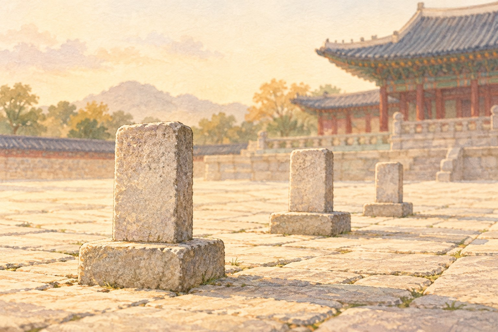

# 궁궐 마당에도 줄 서는 자리가 있었다

*돌에 새긴 품계가 알려주는 조선의 자리 배치*

History · Korea

> 편집 검토용 이야기입니다. 게시 전 출처 확인이 남아 있습니다.

*AI 설명용 삽화 · 특정 유물·제품·장소의 실제 모습을 재현한 사진이 아닙니다.*

궁궐을 구경하다 보면 시선은 대개 지붕으로 올라간다. 처마 끝은 어떻게 휘었는지, 단청은 얼마나 화려한지 보게 된다. 그런데 정전 앞마당에서는 잠깐 아래를 내려다보아도 좋다.

사람 키보다 훨씬 작은 돌들이 줄을 맞추어 서 있다. 앞면에는 글자도 새겨져 있다. 누군가의 무덤을 표시하는 것도, 건물을 세운 기념비도 아니다. 이 돌의 이름은 품계석이다.

한마디로 말하면, 중요한 행사가 열릴 때 신하들이 어디에 서야 하는지 알려주는 표지다. 궁궐 마당에도 자리 안내가 있었던 셈이다.

## 이름 대신 등급을 적어 둔 자리

조선의 관리에게는 맡은 일인 관직과, 지위의 등급인 품계가 있었다. 두 말은 비슷해 보여도 같은 뜻은 아니다. 무슨 일을 하는 사람인지와 어느 등급에 속하는 사람인지를 나누어 생각하면 조금 쉬워진다.

품계석에 적힌 것은 개인의 이름이 아니라 그 품계다. 그래서 누군가가 물러나고 다른 사람이 와도 돌을 새로 만들 필요는 없었다. 오늘의 주인공이 바뀌어도 자리의 기준은 남았다.

정전에서 공식 의례가 열리면 관리들은 그 기준에 따라 자리를 잡았다. 아무 데나 먼저 가서 선다고 앞자리를 차지할 수 있는 구조가 아니었다. 좋은 자리를 잡으려고 아침 일찍 줄을 서는 방법도 여기서는 통하지 않았을 것이다.

물론 품계석을 조선 관리들의 일상적인 출근 표지로 생각하면 곤란하다. 매일 모든 관리가 이 돌 앞에서 조회를 했다고 상상할 필요는 없다. 정전과 그 앞마당은 국가의 격식 있는 행사를 치르는 공간이었다.

## 넓은 마당을 쓰는 방법

아무도 없는 궁궐 마당은 제법 넓어 보인다. 비슷한 돌이 반복되니 장식처럼 느껴질 수도 있다. 하지만 사람들이 들어와 자리를 채우는 모습을 떠올리면 돌의 역할이 달라진다.

누가 어느 줄에 설지 정해져 있으면 여러 사람이 모여도 배치가 흐트러지지 않는다. 돌 하나가 한 사람의 의자라기보다, 일정한 지위에 있는 사람들이 설 구역을 알려주는 기준에 가깝다.

우리에게 익숙한 공연장의 좌석표와 닮은 점도 있다. 다만 공연장에서는 관객이 무대를 바라보지만, 궁궐의 의례에서는 줄지어 선 사람들도 장면의 일부였다. 건물만으로 행사가 완성되는 것은 아니었다. 그 앞에 서는 사람들의 위치까지 공간을 만들었다.

옛 그림에서 궁중 행사를 볼 기회가 있다면 지붕이나 옷차림만 보지 말고 사람들의 줄도 살펴보자. 실물의 돌과 그림 속의 사람이 서로 연결되는 순간, 텅 비어 있던 마당이 조금 다르게 보일 수 있다.

## 작은 돌부터 구경해도 괜찮다

품계석은 가까이에서 관찰하기 좋은 물건이다. 눈에 보이는 돌의 높이와 글자, 줄의 간격을 차분히 따라가면 된다. 궁궐마다 남아 있는 상태와 배치가 다를 수 있으니, 현장의 안내와 함께 보는 편이 좋다.

글자를 전부 읽지 못해도 괜찮다. 어느 돌이 앞에 있고 어느 돌이 뒤에 있는지, 정전과는 얼마나 떨어져 있는지만 보아도 이 마당이 아무렇게나 비워 둔 공간은 아니라는 것을 알 수 있다.

여행 사진에는 웅장한 건물을 담고 싶어진다. 품계석은 그에 비하면 소박한 피사체다. 그러나 그 돌이 무엇인지 알고 나면, 건물 앞에 서 있던 사람들까지 상상하게 된다.

다음에 궁궐에 간다면 처마를 올려다보기 전에 마당의 작은 돌 하나를 먼저 찾아보자. 조선의 큰 행사를 이해하는 입구가 의외로 낮은 곳에 서 있다.

아직 대조하지 못한 내용이 남아 있습니다. 위 자료가 모든 문장의 확인 완료를 뜻하지는 않습니다.

## 검토할 참고 자료 후보

아래는 원문 대조 전 후보입니다. 사실 확인 완료를 뜻하지 않습니다.

- [궁능유적본부 — 품계석 관련 자료 확인 후보](https://royal.khs.go.kr/)
- [국가유산포털 — 품계석 관련 추가 조사 후보](https://www.heritage.go.kr/)

---

[같은 소주제의 이야기](README.md) · [전체 서가](../../README.md)
