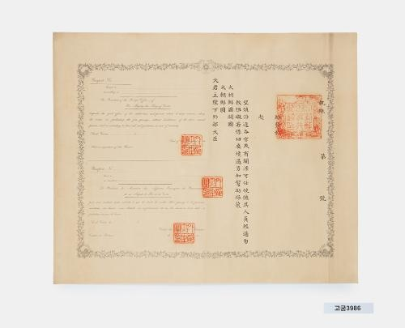

# 옛 여권 한 장에 세 언어가 모였다

*책자 대신 커다란 종이로 만나는 여행 문서*

History · Korea

> 출처 대조와 공개 게시 승인을 마친 이야기입니다. 실제 게시 여부는 사이트 배포 상태를 따릅니다.

*대조선국 여권 양식 · 국립고궁박물관 소장·제공. 전체 사진을 자르지 않고 사용했습니다.*

[이미지 출처·제작 근거](https://www.gogung.go.kr/gogung/pgm/psgudMng/view.do?menuNo=800065&psgudSn=437344) · 공공누리 제1유형(출처표시)

여권을 떠올리면 손바닥만 한 책자를 생각하게 된다. 그런데 국립고궁박물관의 대조선국 여권 양식은 한 장의 넓은 종이다. 사진을 보면 가운데를 경계로 글줄의 모습도 달라진다.

읽을 수 있는 글자를 먼저 찾아도 좋고, 문장이 놓인 방향부터 살펴보아도 좋다. 한 장의 종이가 서로 다른 독자를 만날 준비를 하고 있다는 사실이 조금씩 보인다.

## 오른쪽과 왼쪽의 다른 글줄

박물관은 오른쪽에는 한문, 왼쪽에는 영어와 프랑스어로 내용을 인쇄했다고 설명한다. 세 언어가 서로 다른 문서에 흩어진 것이 아니라 같은 종이 위에 모였다.

해외에서 쓰는 문서라는 것을 모양만으로도 실감하게 된다. 지금의 여행자가 휴대전화 번역 화면을 꺼내듯, 이 종이도 언어가 다른 사람에게 내용을 전달할 자리를 갖추고 있었던 것이다. 이는 오늘의 경험에 빗대어 보는 방법이다.

## 테두리에도 표지가 있다

글자만 있는 것은 아니다. 바깥에는 배꽃과 덩굴을 엮은 무늬가 둘러져 있고, 가운데 위쪽에는 배꽃무늬, 네 귀퉁이에는 태극무늬가 배치되어 있다. 박물관은 찍힌 도장의 이름과 위치도 함께 소개한다.

멀리서 보면 장식처럼 보이는 부분들이 문서를 알아보게 하는 얼굴을 만든다. 글을 모두 읽기 어려워도 테두리와 도장을 따라가면 단순한 메모지와는 다른 성격의 종이라는 것을 느끼게 된다.

## 언제 만들었는지를 찾는 실마리

박물관은 이 양식에 쓰인 연호와 외교 담당 관청의 명칭을 근거로 작성 시기를 1895년으로 추정한다. 날짜 하나를 말하는 데도 문서 안의 단서들을 함께 읽는 과정이 필요한 것이다.

이 소장품은 특정 여행자의 여정을 소개하는 글이 아니라 여권 양식을 보는 자료다. 누구의 짐가방에 들어 있었을지 상상하기에 앞서, 한 종이에 세 언어를 나란히 놓았다는 선택부터 기억해 두자. 국경을 넘을 준비가 문장 배치에도 남아 있다.

## 이야기의 바탕이 된 자료

- [국립고궁박물관 — 대조선국 여권 양식](https://www.gogung.go.kr/gogung/pgm/psgudMng/view.do?menuNo=800065&psgudSn=437344) · 확인일 2026-10-28
  - 확인 내용: 한문·영어·프랑스어 배치 / 이화당초문 테두리·이화문·태극문·도장 / 개국 연호와 외부 명칭을 근거로 한 1895년 작성 추정

---

[같은 소주제의 이야기](README.md) · [전체 서가](../../README.md)
