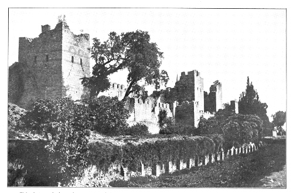

# 콘스탄티노폴리스 1453 — 성벽을 넘은 뒤에도 도시는 이어졌다

*육지와 바다의 포위전, 함락과 새 수도의 운영*

History · Middle East

> 자료 대조를 마친 검토용 이야기입니다. 공개 게시 승인은 아직 받지 않았습니다.

*Edwin Pears, The Destruction of the Greek Empire, Landward Walls · Public Domain. 출판 당시의 성벽 역사 사진이며1453년 포위전 촬영이 아닙니다.*

[이미지 출처·제작 근거](https://raw.githubusercontent.com/GITenberg/The-Destruction-of-the-Greek-Empire-and-the-Story-of-the-Capture-of-Constantinople-by-the-Tur__58119/master/58119-h/images/i_240b.jpg) · Public Domain · 저작권 만료 작품 및 역사 출판 자료

1453년 콘스탄티노폴리스의 함락은 동로마 제국의 끝을 상징한다. 그러나 그날을 중세 전체가 종료되거나 동서 무역이 완전히 끊긴 순간으로 말하면 많은 역사가 사라진다. 메흐메트 2세의 포위와 도시의 방어, 함락 뒤 새 수도가 만들어진 과정을 나누어 살펴보자.

## 01. 성벽 안의 도시는 옛 제국 전체가 아니었다

한때 넓은 지중해 세계를 다스렸던 동로마 제국은 15세기에 크게 줄어들어 있었다. 수도의 위엄과 실제로 동원할 수 있는 사람과 자원 사이에는 차이가 컸다. 오래된 성벽이 있어도 그것을 지키고 고칠 병력과 물자가 충분해야 했다.

도시는 이미 1204년 제4차 십자군의 점령과 이후의 회복을 겪었다. 1453년만이 처음 맞는 충격은 아니었던 것이다. 로마의 계승을 주장한 제국의 긴 역사와 마지막 단계의 약해진 통치 범위를 함께 보아야 포위전의 조건이 드러난다.

성벽의 유명함과 실제 방어력을 같은 것으로 볼 수는 없다. 긴 구간을 감시하고 적의 접근을 막으려면 충분한 인원과 지속적인 물자가 필요했다. 오래된 구조물은 중요한 자산이지만 그것을 움직이는 조직과 사람을 대신할 수는 없었다.

## 02. 메흐메트 2세는 육지와 바다를 함께 압박했다

오스만의 젊은 술탄 메흐메트 2세는 도시를 정복하려 했다. 그의 군대는 육상 성벽을 공격하고 바다 쪽의 접근도 통제하려 했다. 포위는 성벽 앞에서 벌어진 단일한 결투가 아니라 여러 방향의 보급과 이동을 다투는 작전이었다.

해협과 항구의 위치는 도시의 힘이면서 약점이기도 했다. 밖에서 도움이 들어올 길을 유지하는지, 오스만이 그것을 어느 정도 막는지에 따라 방어의 조건이 달라졌다. 지도에서 성벽의 선만 보는 것보다 물길과 항구를 함께 살펴야 한다.

## 03. 대포는 중요했지만 혼자 승리하지 않았다

오스만은 대형 대포로 성벽을 두드렸다. 새로운 화력은 중요한 요소였지만 한 번 쏘아 거대한 벽이 곧바로 무너지는 장면으로 생각하면 곤란하다. 포격과 수리, 성벽 앞 지형과 공격, 방어자의 노동이 오랫동안 맞물렸다.

부서진 곳을 보강하고 공격을 막는 일은 계속 필요했다. 대포의 성능만 알면 결과를 모두 설명할 수 있는 전쟁은 아니었다. 숫자로 잘 남지 않는 야간의 수리와 보급, 지친 병력의 교대도 도시가 버티는 데 중요한 조건이었다.

항구에 들어오는 도움은 물자뿐 아니라 방어자들의 기대에도 영향을 줄 수 있었다. 반대로 봉쇄가 강해지면 성벽 안의 시간도 줄어든다. 포위전을 공격과 수비의 순간만 모아 설명하기보다 어느 쪽이 더 오래 버틸 조건을 가졌는지 물을 필요가 있다.

## 04. 금각만의 사슬과 옮겨진 배

도시 쪽은 금각만 입구의 사슬 등으로 항구 접근을 막으려 했다. 역사서가 전하는 오스만 선박의 육상 이동은 그 장애물을 우회한 행동으로 유명하다. 배를 물에서만 움직이는 물건으로 생각하지 않은 작전이라는 점에서 강한 인상을 남긴다.

그러나 이 일 하나가 함락의 모든 원인을 설명하지는 않는다. 이동한 선박과 새로운 압박은 육지와 바다의 여러 전황 가운데 한 요소였다. 유명한 묘책을 나머지 상황에서 떼어 내면 지휘관의 영감만으로 성벽과 사람이 사라진 것처럼 보이게 된다.

## 05. 5월 29일, 함락은 사람들에게 서로 다른 일이었다

1453년 5월 29일 도시는 함락되었고 마지막 황제 콘스탄티노스 11세도 전투 속에서 죽었다. 이후의 약탈과 포로화는 주민들에게 큰 고통을 남겼다. 정복자의 승리라는 말만으로 그날을 설명하면 도시 안의 사람들이 보이지 않는다.

사람들은 같은 상황에서도 재산과 신분, 머물던 장소에 따라 다른 일을 겪었다. 종교 건축과 예술품, 기록도 타격을 받거나 다른 용도로 바뀌었다. 전쟁의 결과는 왕조의 이름이 바뀌는 표 한 칸보다 훨씬 넓었다.

옛 유럽 역사서는 함락을 문명과 야만의 대결로 그리는 경우가 있다. 그런 가치 판단을 따르지 않고 전쟁의 피해와 정복 이후의 도시 운영을 나누어 살폈다. 어느 국가의 승리로 분류하더라도 주민이 겪은 일과 이후 삶의 지속을 함께 설명해야 한다.

## 06. 함락된 도시는 새로운 수도가 되었다

메흐메트는 도시를 오스만의 수도로 만들고 인구와 상업, 행정과 종교 조직을 다시 세워야 했다. 사람을 이주시켜 채우는 정책과 기존 주민·공동체의 재편이 이어졌다. 정복은 도시 운영의 끝이 아니라 또 다른 통치 과제의 시작이었다.

아야 소피아가 모스크로 전환된 일은 변화의 강한 상징이지만 그 건물 하나로 도시 전체를 설명할 수는 없다. 여러 신앙 공동체와 상인, 관리와 장인이 함께한 도시의 새로운 생활을 보아야 함락 뒤의 시간을 읽을 수 있다.

## 07. 하루를 시대 전체의 끝으로 만들지 않기

1453년은 중요한 연대이지만 유럽과 지중해의 중세가 그날 동시에 끝났다고 말할 수는 없다. 무역과 정보의 통로도 모양을 바꾸며 이어졌다. 오스만이 길을 완전히 막아 유럽의 바닷길 탐험이 시작되었다는 단순한 인과 역시 주의해야 한다.

여기에 실은 이미지는 수백 년 뒤 촬영한 육상 성벽의 역사 사진이며 포위전 현장 사진이 아니다. 벽을 바라보며 무엇이 무너졌는지뿐 아니라 누가 다시 들어와 무엇을 이어 갔는지도 물어보자. 제국의 마지막 날과 도시의 마지막 날은 같은 말이 아니었다.

## 이야기의 바탕이 된 자료

- [Edwin Pears, The Destruction of the Greek Empire and the Story of the Capture of Constantinople by the Turks](https://raw.githubusercontent.com/GITenberg/The-Destruction-of-the-Greek-Empire-and-the-Story-of-the-Capture-of-Constantinople-by-the-Tur__58119/master/58119-0.txt) · 확인일 2026-11-07
  - 확인 내용: 1453포위/육상성벽/화포와수리/금각만사슬/선박이동/5월29일함락/콘스탄티노스11세/약탈/새수도재건·후대 성벽사진. 문명/야만의 대결이나 함락즉시무역단절·중세종료라는 틀은 사용하지 않음

---

[같은 소주제의 이야기](README.md) · [전체 서가](../../README.md)
