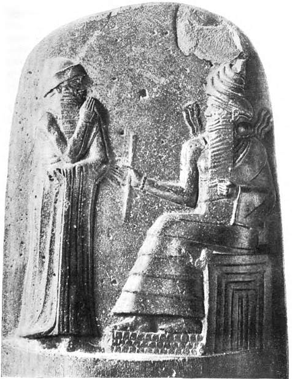

# 함무라비 법전 — 돌에 새긴 정의는 누구에게 같았을까

*기원전18세기의 계약과 신분, 왕의 정의와 실제 재판의 거리*

History · Middle East

> 출처 대조와 공개 게시 승인을 마친 이야기입니다. 실제 게시 여부는 사이트 배포 상태를 따릅니다.

*Leonard W. King, A History of Babylon, Hammurabi receiving laws from the Sun-god, after Délégation en Perse, Mém.IV, pl.3 · Public Domain. 실제 비석 부조의 역사 출판 재현입니다.*

[이미지 출처·제작 근거](https://raw.githubusercontent.com/GITenberg/A-History-of-Babylon-From-the-Foundation-of-the-Monarchy-to-the-Persian-Conquest-History-of-B__56667/master/56667-h/images/king_plate_11_144.jpg) · Public Domain · 저작권 만료 작품 및 역사 출판 자료

누군가 다른 사람에게 상처를 입혔다. 같은 상처라면 처벌도 같을까. 함무라비 법전에 담긴 조항들을 읽으면 피해자와 가해자의 지위에 따라 답이 달라진다. 눈에는 눈이라는 짧은 말로 유명한 이 비석은 고대 사회가 거래와 가족, 노동과 책임을 어떻게 구분했는지 보여 주는 기록이다. 동시에 정의로운 왕이라는 이미지를 오래 남기려 한 권력의 기념물이기도 하다.

## 01. 바빌로니아의 왕이 남긴 돌

함무라비는 기원전 18세기 바빌로니아를 다스린 왕이다. 그의 통치 아래 남부 메소포타미아의 여러 지역이 통합되었다. 오늘날 이라크에 해당하는 이 지역에서는 도시와 농경지, 운하를 둘러싼 복잡한 경제생활이 오래전부터 이루어지고 있었다.

그러므로 함무라비가 인류 최초로 법을 발명했다고 설명할 수는 없다. 그보다 앞선 법 관련 기록과 관습이 있었다. 이 비석의 중요성은 무에서 법을 만들었다는 데 있지 않고 왕의 정의를 내세운 긴 글과 여러 구체적 분쟁의 규정이 함께 전해진다는 데 있다.

## 02. 왕 위에 놓인 신의 권위

비석 윗부분의 부조에는 왕이 앉아 있는 신 앞에 선 장면이 표현되어 있다. 신은 일반적으로 태양과 정의의 신 샤마시로 해석된다. 이 장면은 아래의 글을 읽기 전부터 왕의 판단이 신성한 권위와 연결된다는 메시지를 전한다.

본문 앞뒤의 글도 정의로운 통치자라는 왕의 모습을 강조한다. 약한 사람을 보호하고 질서를 세운다는 주장은 실제 법 조항의 내용과 함께 읽어야 한다. 통치자가 자신을 어떻게 설명하는가와 통치 아래의 사람들이 모두 같은 대우를 받았는가는 별개의 질문이기 때문이다.

## 03. 눈에는 눈이라는 말의 조건

신체에 가한 손상을 같은 방식으로 되갚는 규정은 유명하다. 그러나 모든 경우에 똑같이 적용된 것은 아니었다. 당사자의 지위에 따라 신체형과 금전 배상이 달라지는 조항들이 있다. 노예의 신체 손상도 자유인의 경우와 같은 방식으로 취급되지 않았다.

이 차이를 빼고 복수의 법이라고만 부르면 사회의 구조가 보이지 않는다. 법은 보복의 정도를 규정하는 동시에 사람의 지위를 구분했다. 오늘날의 법 앞의 평등이라는 원칙을 그대로 과거에 대입하거나, 이 비석에 이미 완성되어 있었다고 말할 수 없는 이유다.

## 04. 계약과 증언이 필요한 세상

조항들은 살인이나 상해만 다루지 않는다. 빌린 돈과 맡긴 물건, 매매와 임대, 혼인과 상속 같은 생활의 문제도 등장한다. 사건을 입증할 증인과 계약 기록의 역할은 도시 사회에서 낯선 사람 사이의 거래가 얼마나 중요했는지 보여 준다.

어떤 주장이 참인지 가리는 문제는 형벌의 크기만큼 중요했다. 고발과 증거, 판단을 내리는 사람의 책임이 규정에 들어 있다. 오래된 법문을 읽으며 잔혹한 처벌에만 놀라기보다, 다툼이 생겼을 때 누가 무엇을 보여 주어야 했는지도 살펴볼 만하다.

문서를 남길 수 있는 사람과 그렇지 못한 사람의 차이도 생각해 볼 수 있다. 거래를 글로 적으려면 서기관과 증인, 기록을 보관하는 환경이 필요했다. 법 조항에 계약이 등장한다는 사실은 개인의 약속을 사회적으로 확인해 주는 여러 역할이 이미 존재했음을 뜻한다.

## 05. 운하와 집에는 다른 책임이 붙었다

농경을 지탱한 물길은 이웃의 생계와 연결되어 있었다. 제방과 관개 시설을 제대로 관리하지 않아 피해가 생기는 상황도 법이 다루었다. 개인의 부주의를 개인의 사정으로만 둘 수 없는 환경이었다. 물은 공동의 기반이면서 분쟁의 원인이었다.

집을 지은 사람의 책임에 관한 엄격한 조항도 널리 알려져 있다. 다만 고대의 처벌을 오늘날 건축 안전의 모범으로 곧바로 칭찬해서는 안 된다. 위험을 누가 부담했는지를 보여 주는 자료로 읽고, 가족과 신분에 따른 책임 전가까지 함께 살펴야 한다.

## 06. 돌에 적힌 규정과 실제 재판

비석의 문장들이 모든 재판에서 빠짐없이 문자 그대로 집행되었다고 단정할 수는 없다. 왕의 규범 선언과 실제 분쟁 해결의 관계를 밝히려면 당시의 계약 문서와 재판 기록 등도 함께 보아야 한다. 하나의 유명한 유물이 생활 전체를 대신할 수는 없다.

오늘날 조항에 붙이는 번호 역시 내용을 찾기 위한 현대 연구의 구분이다. 돌에 새겨진 글을 현대의 법률집과 같은 형태로 상상하면 원래 기념물의 성격을 놓치게 된다. 글과 부조, 왕의 긴 자기 설명이 결합된 물건으로 보아야 한다.

오래된 번역에서 어떤 지위를 가난한 사람으로 옮겼다고 해서 오늘날의 소득 계층과 그대로 같다고 볼 수는 없다. 법적 지위와 경제적 형편은 관련되지만 같은 개념은 아니다. 익숙한 번역어 하나가 고대 사회의 차이를 가릴 수 있다는 점도 주의해서 읽어야 한다.

## 07. 이라크의 역사와 이란에서의 발견

비석은 20세기 초 오늘날 이란의 수사에서 발견되었다. 바빌로니아의 법이 담긴 유물이 왜 다른 지역에서 나왔는지 묻는 순간, 물건이 정복과 이동을 겪어 온 역사도 드러난다. 발견 장소와 그 글이 다루는 통치 영역은 같지 않다.

함께 실은 것은 실제 비석 윗부분을 재현한 역사 출판 도판이다. 상상으로 만든 왕의 초상이 아니다. 오래된 번역서에 실린 함무라비의 연대는 지금의 연구와 다르므로 그대로 사용하지 않았다. 돌에 남은 글을 읽는 일도 후대의 번역과 해석을 다시 검토하는 작업을 필요로 한다.

## 이야기의 바탕이 된 자료

- [C. H. W. Johns, The Oldest Code of Laws in the World — translation of Hammurabi provisions](https://raw.githubusercontent.com/GITenberg/The-Oldest-Code-of-Laws-in-the-WorldB.C.-2285-2242_17150/master/17150.txt) · 확인일 2026-11-08
  - 확인 내용: 왕권의 서문/결문·상해와 신분에 따른 처벌·계약/증언·관개/건축 책임. 책 제목의 옛 연대와 인류 최초라는 주장, 현대 소득 계층과 동일시하는 지위 번역을 따르지 않음
- [Leonard W. King, A History of Babylon — Hammurabi and the stele](https://raw.githubusercontent.com/GITenberg/A-History-of-Babylon-From-the-Foundation-of-the-Monarchy-to-the-Persian-Conquest-History-of-B__56667/master/56667-0.txt) · 확인일 2026-11-08
  - 확인 내용: 함무라비 통치·법전 비석과 수사 발견·샤마시 앞의 왕 부조 도판. 옛 연대표를 현재 연대로 사용하지 않음

---

[같은 소주제의 이야기](README.md) · [전체 서가](../../README.md)
