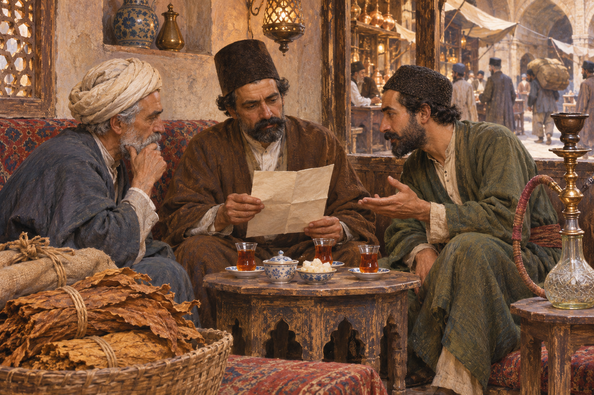

# 이란 담배 불매운동 — 피우지 않는 행동은 어떻게 왕의 계약을 바꾸었을까

*1891~1892년 독점권과 일상의 거부, 취소 뒤의 배상과 차입*

History · Middle East

> 출처 대조와 공개 게시 승인을 마친 이야기입니다. 실제 게시 여부는 사이트 배포 상태를 따릅니다.

*AI 역사 이해용 상상 삽화 · 당시 사진이나 실제 인물의 초상, 특정 장면과 건물의 정확한 복원이 아닙니다.*

가게와 찻집에서 담배를 피우지 않기 시작했다.1891~1892년 이란의 담배 불매운동은 평범한 소비와 거래가 정치적 힘이 될 수 있음을 보여 준다. 국왕이 외국 세력에 부여한 독점권은 상인과 재배자, 소비자와 종교 지도자의 서로 다른 걱정을 한데 모았다. 계약을 취소하게 만든 거부의 힘과 취소 뒤에 남은 비용을 함께 살펴보자.

## 01. 국왕이 내준 것은 물건 한 상자의 권리가 아니었다

카자르 왕조의 나세르 앗딘 샤는 외국 자본에 여러 사업의 권리를 부여했다. 국가 재정과 새로운 사업에 대한 기대가 있었지만, 어떤 조건으로 얼마만큼의 권한을 주는지가 문제였다. 수입을 얻는 일과 국내 경제의 통제권을 넘기는 일이 함께 걸려 있었다.

담배 관련 특허는 한 상인의 수출 계약보다 넓은 독점권을 담았다. 재배와 매입, 유통과 판매에 영향을 주는 체계가 생기면 기존의 거래 관계는 크게 달라질 수 있었다. 왕의 계약은 궁정 바깥의 일상적인 장사에 직접 닿았다.

특허권이 국가에 돈을 가져온다면 그 수입만을 성과로 내세우기 쉽다. 그러나 계약의 조건이 국내 거래를 얼마나 제한하는지도 계산해야 한다. 당장의 재정 수입과 장기적인 경제 권한이 서로 다른 방향으로 움직일 수 있었던 것이다.

## 02. 상인과 재배자, 소비자의 걱정은 달랐다

상인은 거래의 자율성과 수입을 잃을 수 있다고 보았다. 생산자는 누구에게 어떤 조건으로 팔게 될지 걱정해야 했다. 소비자에게는 가격이 오르고 익숙한 물건을 구하기 어려워질 수 있다는 불안이 있었다.

모두가 같은 경제적 처지에 있던 것은 아니다. 외국 회사와의 거래에서 이익을 기대한 사람도 있을 수 있었다. 운동이 넓게 퍼졌다는 결과만으로 모든 참가자의 동기까지 하나였다고 설명해서는 안 된다. 다른 걱정이 같은 독점권에 대한 반대로 만났다.

가격이 실제로 얼마나 달라졌는지와 사람들이 앞으로 오를 것이라고 예상했는지는 구분할 필요가 있다. 불안은 기존의 거래 방식이 바뀐다는 소식만으로도 커질 수 있다. 운동의 확대를 이미 확인된 가격 인상 하나의 반응으로만 설명하기 어렵다.

## 03. 종교적 권위가 거래의 거부를 연결했다

성직자와 상인들의 관계, 지역 사이에 소식이 오가는 경로는 저항을 넓히는 데 중요했다. 담배 사용을 금지하는 종교적 판단은 개인의 선택을 공동의 행동으로 묶는 힘이 되었다. 종교의 언어와 경제적 요구가 같은 운동 안에 들어 있었다.

다만 옛 외국인 기록의 극적인 설명을 그대로 사실로 옮길 필요는 없다. 지도자의 이름과 거처, 궁정의 일화가 단순하게 정리되기도 한다. 누가 어떤 문장을 처음 말했는지 확정하기보다 불매가 어떤 관계를 통해 확대되었는지 살피는 편이 중요하다.

당시의 종교 지도자들은 지역과 국경을 넘는 관계를 가지고 있었다. 거래의 피해에 대한 요구가 더 넓은 정당성을 얻으려면 그런 연결이 중요했다. 시장의 계약과 종교적 판단을 완전히 별개의 영역으로 나누면 저항이 퍼진 방식을 놓치게 된다.

## 04. 사지 않고 팔지 않는 행동이 압박이 되다

담배의 거래와 사용을 멈추면 독점권으로 예상했던 이익이 흔들린다. 광산이나 철도 같은 시설을 직접 부수지 않아도 시장의 작동을 멈추는 방식으로 힘을 행사할 수 있었다. 찻집과 시장, 가정이 정치적 행동의 장소가 되었다.

그러나 자발적인 참여와 공동체의 압력이 언제나 분리되어 있었던 것은 아니다. 불매에 따르도록 요구하는 행동도 있었다. 저항을 평화로운 단결의 그림 하나로만 그리기보다 서로 다른 방식의 동원과 통제를 함께 보아야 한다.

## 05. 왕권에 맞선 연합은 영구적인 한편이 아니었다

국왕의 계약에 반대하는 세력들이 모였다고 이후의 통치에 대해서도 모두 같은 구상을 가진 것은 아니다. 상인과 성직자, 지역의 유력자와 일반 소비자는 서로 다른 기대를 가질 수 있었다. 공동의 목표가 일시적인 협력을 가능하게 했다.

이 점은 운동의 힘을 줄이는 설명이 아니다. 다양한 집단이 자신들의 이유로 참여했기 때문에 넓은 압박이 가능했음을 보여 준다. 동시에 계약이 취소된 뒤에는 무엇을 함께 결정할지 다시 조정해야 하는 관계였다.

## 06. 취소에도 돈이 필요했다

결국 독점권은 취소되었다. 하지만 국왕이 계약을 거두어들인다고 재정적 부담까지 사라지지는 않았다. 외국 회사에 대한 배상과 그것을 마련할 차입이 뒤따랐다. 성공한 저항 뒤에도 국가의 재정과 대외 의존이라는 문제가 남았다.

따라서 독점권의 부여와 폐기를 모두 한 사람의 단순한 승패로 읽기 어렵다. 누구의 계약을 취소하고 어떤 돈으로 보상하며 그 부담이 어디에 남는지 살펴야 한다. 경제적 주권은 반대할 힘뿐 아니라 이후를 운영할 자원과도 연결되어 있었다.

배상금을 지급하려고 새 빚을 지면 계약 취소의 성과와 별개로 미래의 수입이 묶일 수 있다. 무엇을 거부했는지뿐 아니라 거부의 비용을 누가 감당하는지도 정치의 문제였다. 불매의 성공 뒤에도 국가와 외국 자본의 관계는 새로운 형태로 이어졌다.

## 07. 담배를 멈춘 경험이 남긴 정치

이 운동은 여러 집단이 통치자의 경제적 결정을 제한할 수 있음을 보여 준 경험이었다. 이후 이란의 입헌운동을 생각할 때에도 중요한 앞선 사례로 읽힌다. 다만 뒤의 헌정 변화를 이미 완성된 계획처럼 품고 있었다고 설명할 수는 없다.

담배 불매운동의 흥미는 거대한 무기 대신 반복되는 일상의 행동이 힘을 냈다는 데 있다. 누구와 거래하고 무엇을 쓰지 않을지의 선택이 왕의 권한과 국제 계약을 흔들었다. 그리고 그 성과 뒤에 남은 빚은 정치적 승리와 경제적 해결이 언제나 같은 순간에 오지는 않음을 보여 준다.

## 이야기의 바탕이 된 자료

- [Thomas Edward Gordon, Persia Revisited — Tobacco Régie](https://raw.githubusercontent.com/GITenberg/Persia-Revisited_13064/master/13064-8.txt) · 확인일 2026-11-08
  - 확인 내용: 1891담배독점/생산자와상인/소비의 우려·불매/종교적 권위·취소와 배상 차입. 영국 사업 중심의 안타까움과 성직자 일반화, 지도자의 거처/궁정 일화를 검증된 사실로 옮기지 않음

---

[같은 소주제의 이야기](README.md) · [전체 서가](../../README.md)
