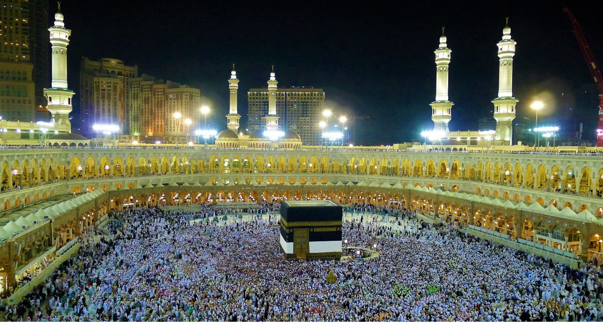

# 메카와 순례 — 같은 방향으로 모이는 길의 역사

*카바와 하지의 의미를 따라 읽는 성지·이동·공동체*

History · Middle East

> 출처 대조와 공개 게시 승인을 마친 이야기입니다. 실제 게시 여부는 사이트 배포 상태를 따릅니다.

*Konevi / Pxhere · CC0 1.0 원본 사진, OpenStax 수록본.*

[이미지 출처·제작 근거](https://raw.githubusercontent.com/openstax/osbooks-world-history/main/media/OSX_WorldHist_A11_01_Hajj.png) · CC0 1.0

세계 여러 지역에 사는 무슬림은 기도할 때 같은 방향을 향한다. 그 중심에는 메카의 카바가 있다. 멀리 떨어진 사람들이 하나의 장소를 기억하고, 많은 이가 실제로 그곳을 향해 떠난다. 메카의 역사는 도시의 건물뿐 아니라 도시로 이어지는 길의 역사이기도 하다.

오늘의 메카는 사우디아라비아에 있지만 이슬람 초기의 아라비아를 지금의 국가 체제와 같다고 보아서는 안 된다. 시대를 구분하면서 성지와 순례가 어떤 의미를 가졌는지 살펴보면 낯선 종교의 풍경을 단순한 군중 사진 이상으로 이해할 수 있다.

## 01. 물과 길이 중요했던 아라비아의 도시

이슬람이 등장하기 전 아라비아반도에는 지역마다 다른 생활 조건과 공동체가 있었다. 사막이라는 한 단어만으로 모두 설명하기 어렵다. 물을 얻을 수 있는 장소와 교역의 경로, 정착지와 이동하는 집단의 관계가 중요했다. 메카도 이런 아라비아의 역사 안에서 보아야 한다.

도시가 성장하려면 건물만 필요한 것이 아니다. 사람들이 머물고 왕래할 이유가 있어야 한다. 메카에는 교역과 성소를 중심으로 한 만남의 조건이 있었다. 경제와 신앙을 서로 완전히 분리된 두 세계로 생각하면 이 도시가 가진 오래된 성격을 이해하기 어렵다.

## 02. 카바를 건물의 형태만으로 이해할 수 있을까

카바는 메카의 신성한 모스크 중심에 있는 건물이다. 검은 천으로 덮인 형태가 널리 알려져 있지만, 무슬림에게 중요한 것은 외관의 특이함만이 아니다. 이슬람의 전승에서 아브라함과 이스마엘에 연결되는 성소이며 신앙의 중심을 나타낸다.

이 설명에서는 믿음의 전승과 역사학의 확인 방식을 구별할 필요가 있다. 아브라함이 카바와 맺는 관계는 무슬림의 신앙과 전통에서 중요한 의미를 갖는다. 그 의미를 존중해 소개하는 일과 모든 세부를 현대의 문서 기록으로 입증된 사건처럼 서술하는 일은 다르다.

## 03. 무함마드의 메카와 공동체의 변화

무함마드는 메카에서 활동하며 유일신 신앙의 메시지를 전했다. 그 메시지는 기존의 종교 관행과 공동체 질서에 변화를 요구했고 갈등도 일어났다. 이후 메디나에서 공동체가 형성되고 메카와의 관계가 달라지는 과정은 이슬람 초기 역사의 중요한 흐름이다.

이때의 공동체를 오늘의 사우디아라비아와 그대로 겹쳐 보지 않는 것이 좋다. 현재의 국가는 훨씬 뒤에 형성되었다. 국가별 읽을거리로 메카를 소개하더라도, 당시 사람들의 세계를 현재의 국경 안에만 가두지 않아야 역사의 시간 차이가 살아난다.

## 04. 하지는 누구에게 요구되는 순례인가

메카로 가는 하지 순례는 이슬람의 다섯 기둥 가운데 하나다. 능력이 되는 무슬림에게 평생 한 번 수행하도록 요구되는 종교적 의무다. 누구나 어떤 형편에서도 무조건 같은 여행을 해야 한다는 뜻으로 단순화해서는 안 된다. 수행할 수 있는 조건이 함께 고려된다.

또한 메카를 방문하는 모든 행위를 같은 이름의 행사로 묶는 것도 정확하지 않다. 하지는 이슬람력의 정해진 시기에 이루어지는 순례다. 성지를 찾는다는 넓은 행위 안에서도 시기와 절차에 따라 구분이 있다. 독자는 먼저 이 기본적인 차이를 알면 복잡한 설명을 따라가기 쉬워진다.

## 05. 한 건물을 보는 행사보다 넓은 의례

순례의 대표적인 모습은 카바 주위를 도는 군중이다. 그러나 하지는 유명한 건물을 가까이에서 보고 돌아오는 관광과 같지 않다. 아브라함과 그 가족에 관한 신앙의 기억을 되새기는 여러 의례와 장소가 연결된다. 걷는 행위에도 이미 전해진 이야기와 종교적 의미가 들어 있다.

밖에서 보는 사람에게는 움직임과 인파가 먼저 보이지만 참여자는 기도와 의무, 공동체의 경험 속에 있다. 같은 장면을 이해하려면 보는 사람의 관심만으로 설명하지 않는 태도가 필요하다. 무엇을 하고 있는지에 앞서 왜 그 행동을 하는지 묻는 것이다.

## 06. 먼 길을 떠나는 사람과 맞이하는 도시

여러 지역에서 순례자가 모이면 그들의 이동과 체류를 가능하게 하는 조건도 필요하다. 물과 식사, 머물 곳과 안전한 길은 종교적 목적을 실제의 여행으로 바꾸는 문제다. 성지의 역사는 신앙의 교리뿐 아니라 사람들이 목적지까지 도달하는 생활의 역사와도 연결된다.

시대에 따라 교통수단과 이동 시간은 달라졌겠지만 멀리 있는 이들이 하나의 장소로 모인다는 구조는 이어진다. 그래서 순례를 메카 안에서만 일어나는 사건으로 보기 어렵다. 출발한 마을과 이동 경로, 도착한 도시가 긴 하나의 경험을 이룬다.

## 07. 국가의 도시이면서 국경을 넘는 성지

메카는 오늘의 사우디아라비아 지도 안에 있지만 그 종교적 의미는 한 국가의 주민에게만 한정되지 않는다. 서로 다른 언어와 생활 배경을 가진 무슬림들이 같은 성지를 향한다. 국가별로 도시를 읽으면서도 그 도시가 국경을 넘는 이유를 함께 알아야 하는 사례다.

순례의 역사를 설명할 때에는 참여자의 믿음을 낯선 풍습으로만 다루지 않는 것이 좋다. 의례의 이름과 뜻을 먼저 알아보면 반복되는 행동에도 이유가 있음을 이해할 수 있다. 지식을 얻는 일은 다른 삶을 판단하기 전에 그 맥락을 배우는 일이기도 하다.

카바를 둘러싼 사진을 다시 볼 때에는 군중의 크기만 세지 말고 각 사람이 출발한 먼 곳과 공유하는 기억을 떠올려 보자. 메카는 하나의 도시이면서 많은 길이 모이는 중심이다. 신앙이 사람을 움직이고 그 이동이 도시의 역사를 만든다는 사실이 그 풍경 안에 담겨 있다.

## 이야기의 바탕이 된 자료

- [OpenStax World History — The Rise and Message of Islam](https://raw.githubusercontent.com/openstax/osbooks-world-history/main/modules/m00092/index.cnxml) · 확인일 2026-11-05
  - 확인 내용: 이슬람 전후 아라비아와 메카·무함마드·카바 전승·다섯 기둥·가능한 사람의 평생 한 번 하지·정해진 이슬람력 시기·아브라함 가족 관련 의례

---

[같은 소주제의 이야기](README.md) · [전체 서가](../../README.md)
