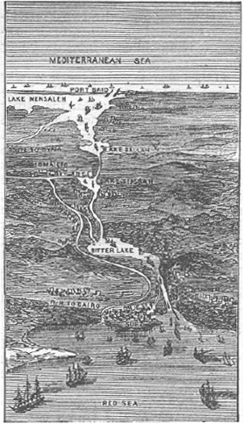

# 수에즈 운하 — 지름길은 어떻게 제국의 길이 되었을까

*1869년 열린 물길과 이집트의 주식·부채·주권*

History · Middle East

> 출처 대조와 공개 게시 승인을 마친 이야기입니다. 실제 게시 여부는 사이트 배포 상태를 따릅니다.

*Young Persons’ Cyclopedia of Persons and Places의 1881년 수에즈 운하 도판 / Wikimedia Commons · OpenStax 수록 · Public Domain. 당시의 경로 표현이며 현재 항로·시설의 정밀 지도는 아닙니다.*

[이미지 출처·제작 근거](https://raw.githubusercontent.com/openstax/osbooks-world-history/main/media/OSX_WorldHist_B09_03_SuezCanal.jpg) · Public Domain

배가 유럽에서 아시아로 가려면 아프리카 남쪽을 크게 돌아야 했다. 지중해와 홍해 사이를 가로지르는 물길이 열린다면 항로의 모양은 크게 달라질 수 있었다. 지도 위의 짧은 선 하나가 세계의 배가 움직이는 방식을 바꾸는 셈이다.

1869년 수에즈 운하가 개통했다. 하지만 새로운 길을 만든 역사는 배가 편리해졌다는 이야기로만 끝나지 않는다. 이집트의 노동과 정부의 빚, 운하 회사의 지분과 유럽 강대국의 이해관계가 같은 물길에 모였다.

## 1. 땅으로 가로막혀 있던 두 바다

수에즈 지협은 지중해와 홍해 사이를 나누고 있었다. 이곳에 운하를 만들면 배는 아프리카 남단을 돌아가지 않고 인도양 방향으로 나아갈 수 있다. 교재는 이런 연결이 남아시아와 동아시아로 가는 무역을 크게 쉽게 할 수 있었다고 설명한다.

다만 지도에서 선이 짧아 보인다고 공사까지 간단한 것은 아니었다. 물길을 실제로 파고 운영하려면 허가와 자금, 기술과 노동을 마련해야 했다. 지리적인 가능성을 현실의 길로 만드는 과정에는 여러 종류의 결정이 필요했다.

## 2. 레셉스가 이집트 통치자를 찾아가다

1854년 프랑스의 외교관이자 사업가 페르디낭 드 레셉스는 이집트의 사이드 파샤에게 운하 건설 허가를 요청했다. 허가를 얻은 뒤 사업을 추진했고 1859년 공사가 시작되었다. 국제적인 기술과 자금의 관심이 이집트 영토 위에서 구체적인 사업이 된 것이다.

여기에는 유럽인의 계획만 있었던 것이 아니다. 이집트 통치자의 승인과 국가의 자원, 현장에서 일할 사람들이 필요했다. 운하를 유명한 설계자 한 사람의 작품처럼 읽으면 그 길이 어떤 정치적 관계와 노동 위에 만들어졌는지 놓치기 쉽다.

## 3. 물길 아래에 남은 노동의 시간

교재는 수에즈 운하 일부의 건설에 이집트의 강제 동원 노동이 사용되었다고 설명한다. 세계의 교통을 편리하게 만드는 공사였지만 그 편리함을 만든 사람들의 경험까지 가벼웠던 것은 아니다. 배의 이동 시간이 줄어드는 효과와 현장의 부담은 다른 자리에서 나타났다.

이번 글은 확인하지 않은 사망자 수나 특정 노동자의 하루를 창작하지 않는다. 다만 강제로 일을 해야 했던 사람들이 있었다는 사실은 건설의 중요한 부분이다. 기념비적인 기술의 역사를 읽을 때 누가 어떤 조건으로 그것을 만들었는지 함께 물어야 한다.

## 4. 1869년, 열린 운하를 보는 영국의 시선

운하는 1869년 선박 통행에 열렸다. 교재에 따르면 영국은 처음부터 이 사업을 반기기만 한 것은 아니었다. 아프리카 남단을 지나는 기존 항로에서의 우위와, 인도에 접근하는 길이 달라지는 문제가 있었기 때문이다.

새 길은 모두에게 같은 의미가 아니었다. 누군가에게는 이동의 효율이지만 다른 세력에게는 기존의 우위가 흔들릴 가능성이었다. 운하가 기술적으로 가능한가와 누가 그 길을 유리하게 이용하는가는 다른 질문이었다. 물길이 열리는 순간에도 경쟁의 지도는 함께 그려지고 있었다.

## 5. 빚을 갚기 위해 지분을 팔다

사이드의 뒤를 이은 이스마일 파샤는 유럽의 채권자들에게 큰 빚을 지게 되었다. 1875년 그는 이집트가 가진 운하 회사의 지분을 영국에 팔았다. 교재는 부채가 이집트 정부에 대한 유럽의 영향력을 키우는 조건이 되었다고 설명한다.

이때 운하의 물리적인 소유와 회사 주식, 정부의 주권을 한 가지로 섞지 않는 것이 중요하다. 지분을 샀다는 사실이 곧 그날 이집트 전체를 영토로 얻었다는 뜻은 아니다. 다만 회사와 국가의 재정 관계가 정치적 개입의 길을 넓혔다. 모든 빚이 운하 하나 때문에 생겼다고 단정할 수도 없다.

## 6. 재정 관리가 정치의 문제로 바뀌다

영국과 프랑스의 관리들이 이집트의 재정에 관여했고 외세의 영향에 반발하는 움직임도 커졌다. 교재는 아흐메드 우라비가 이끈 반발과 통치자를 둘러싼 갈등, 1882년 영국의 군사 개입으로 이어진 과정을 설명한다.

이 사건들을 운하를 샀으니 전쟁도 자동으로 따라왔다는 한 줄로 줄일 필요는 없다. 국내 정치와 대외 관계, 재정과 군사의 여러 이해관계가 얽혔다. 다만 세계를 잇는 물길과 이집트의 돈 문제가 통치의 문제로 깊이 연결되었다는 흐름은 분명히 볼 수 있다.

## 7. 1881년 도판을 읽는 순서

함께 실은 실제 도판은 1881년 백과사전에 나온 수에즈 운하의 경로다. 위쪽 지중해에서 아래쪽 홍해로 이어지는 선을 따라가 보자. 사람과 배보다 경로의 연결을 한눈에 보게 만드는 그림이다. 현재의 운하 시설이나 최신 항로 안내를 보여 주는 지도는 아니다.

그림이 제작된 시점은 개통 뒤이면서 영국의 1882년 개입보다는 앞선 때다. 한 장의 지리 자료도 어느 시간에 만들어졌는지 알면 다른 역사적 자리에 놓인다. 단순한 지름길처럼 보이는 선 위에서 그 무렵 어떤 선택들이 진행되고 있었는지 생각하게 된다.

## 8. 길은 거리를 줄이고 관계를 바꾸었다

수에즈 운하는 바다 사이의 거리를 줄였지만 그 이익과 부담을 같은 방식으로 나누지는 않았다. 항로가 짧아진 배와 강제로 동원된 노동자, 재정을 마련하려던 정부와 영향력을 넓힌 강대국은 같은 공사를 서로 다르게 겪었다.

다음에 운하와 철도 같은 큰 길을 보면 얼마나 빨라졌는지와 함께 누가 만들고 누가 통제했는지도 살펴보자. 수에즈의 물길은 기술의 성공과 금융의 연결, 정치적 힘이 한 지도 위에 놓이는 과정을 보여 준다. 그때 지름길의 역사는 세계를 이해하는 훨씬 긴 이야기가 된다.

## 이야기의 바탕이 된 자료

- [OpenStax World History — 이집트와 수에즈 운하](https://raw.githubusercontent.com/openstax/osbooks-world-history/main/modules/m00070/index.cnxml) · 확인일 2026-10-31
  - 확인 내용: 1854년 허가 요청·1859년 공사·1869년 개통 / 처음의 영국 반대·이집트 정부의 부채·1875년 지분 매각 / 우라비의 반발과 1882년 영국 개입·1881년 도판
- [OpenStax World History — 제국주의와 식민지의 노동](https://raw.githubusercontent.com/openstax/osbooks-world-history/main/modules/m00071/index.cnxml) · 확인일 2026-10-31
  - 확인 내용: 수에즈 운하 일부 건설의 이집트 강제 동원 노동

---

[같은 소주제의 이야기](README.md) · [전체 서가](../../README.md)
