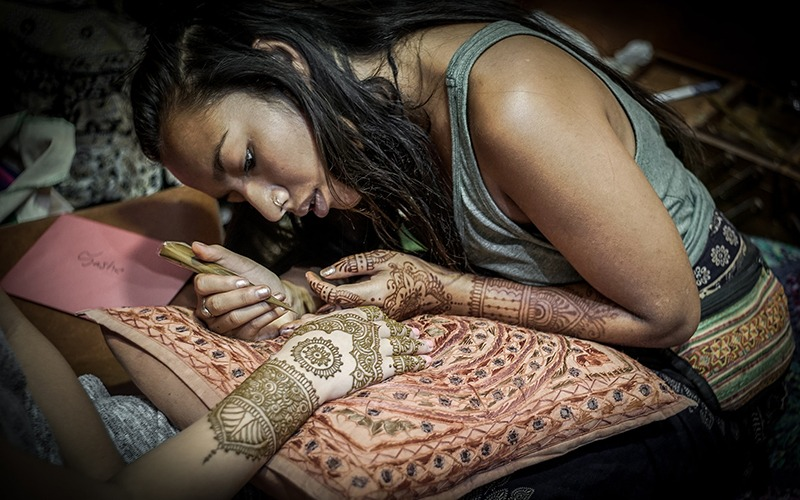

# 피부 위의 무늬는 씻어 낸 뒤에도 남는다

*헤나가 그려지는 순간과 남겨지는 색*

Life · Clothing

> 출처 대조와 공개 게시 승인을 마친 이야기입니다. 실제 게시 여부는 사이트 배포 상태를 따릅니다.

*“Henna” by Rovich/500px/Wikimedia Commons, CC BY 3.0 · OpenStax 수록본. 원본 전체 사진을 자르지 않고 사용했습니다.*

[이미지 출처·제작 근거](https://raw.githubusercontent.com/openstax/osbooks-introduction-anthropology/main/media/ANTHRO_Figure_16_01_012.jpg) · CC BY 3.0

사진 속에서는 한 사람이 다른 사람의 팔에 작은 선을 더하고 있다. 손과 팔에 복잡한 무늬가 이어진다. 헤나를 바르는 장면이다. 우리가 완성된 장식이라고 보는 모습 앞에는 재료를 얹는 시간이 있다.

OpenStax 교재는 헤나 잎을 빻고 고르게 만든 재료를 피부에 무늬로 바르는 과정을 설명한다. 그 재료를 걷어 낸 뒤에도 피부에는 붉거나 주황빛의 색이 남는다.

## 표면의 재료와 남은 색

그래서 헤나는 바른 순간의 모습과 재료를 제거한 뒤의 모습이 다를 수 있다. 피부 위에 올라온 부분만이 무늬의 전부는 아니다. 그 아래에 남은 색도 장식이 된다.

사진을 볼 때 짙게 보이는 선과 그린 사람의 손을 함께 살펴보자. 이미 완성된 결과만 보는 대신 선을 더하는 작업을 읽게 된다. 이 이미지 한 장이 모든 단계의 같은 팔을 연속 촬영한 것이라고 생각할 필요는 없다.

## 특별한 날의 몸 꾸밈

교재는 헤나를 인도 아대륙과 북아프리카 등 여러 지역에서 사용하는 몸 꾸밈의 예로 소개한다. 혼례나 종교적 기념일 같은 특별한 때 손이나 발을 장식하기도 한다.

그렇다고 지역마다 똑같은 무늬에 같은 뜻을 붙인다는 말은 아니다. 같은 재료라도 누가 언제 어떤 관계 속에서 사용하는지에 따라 읽는 맥락이 달라질 수 있다. 무늬의 이름을 하나로 묶어 버리기보다 사용되는 자리를 함께 보면 좋다.

## 몸도 장식의 자리가 된다

이 사진의 장소를 확인 없이 특정 나라나 도시로 정하지는 않는다. 여기서 실제로 볼 수 있는 것은 피부 위에 무늬를 더하는 작업이며, 문화적 쓰임은 교재의 설명으로 따로 읽는 부분이다.

몸을 꾸미는 일에는 옷과 보석만 있는 것이 아니다. 선을 긋고 재료를 기다린 뒤 색을 남기는 방법도 있다. 헤나의 장면은 장식이 무엇으로 만들어지고 언제 완성되는지를 조금 다르게 생각하게 한다.

## 이야기의 바탕이 된 자료

- [OpenStax — Introduction to Anthropology: Anthropology of the Arts](https://raw.githubusercontent.com/openstax/osbooks-introduction-anthropology/main/modules/m00096/index.cnxml) · 확인일 2026-10-29
  - 확인 내용: 헤나 잎을 분쇄·체질한 재료와 피부 적용·제거 후 붉거나 주황빛 착색 / 혼례·기념일과 손·발 장식의 여러 지역 사례 / 실제 사진의 헤나 작업 장면 및 캡션상 페이스트와 착색 구분

---

[같은 소주제의 이야기](README.md) · [전체 서가](../../README.md)
