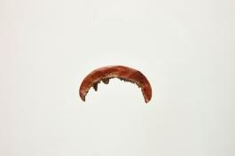

# 작은 반달은 머리를 빗는 도구였다

*화협옹주의 빗에서 발견하는 일상의 모양*

Life · Clothing

> 출처 대조와 공개 게시 승인을 마친 이야기입니다. 실제 게시 여부는 사이트 배포 상태를 따릅니다.

*얼레빗 · 국립고궁박물관 소장·제공. 전체 사진을 자르지 않고 사용했습니다.*

[이미지 출처·제작 근거](https://www.gogung.go.kr/gogung/pgm/psgudMng/view.do?menuNo=800065&psgudSn=372004) · 공공누리 제1유형(출처표시)

작은 갈색 조각이 반달처럼 굽어 있다. 아래쪽의 빗살을 보기 전에는 무슨 물건인지 잠깐 고개를 기울이게 된다. 이름은 얼레빗이다.

궁중 유물이라고 하면 먼저 커다란 왕관이나 화려한 의복을 떠올리지만, 머리를 정돈하는 작은 도구도 남아 있다. 이 빗은 화협옹주의 묘에서 출토된 것으로 국립고궁박물관이 소개한다.

## 1. 한쪽에만 난 빗살

박물관 설명은 형태를 평평한 반달 모양이라고 하고, 빗살은 한쪽으로만 나 있다고 적는다. 사진을 보면 둥근 등과 빗살이 있는 가장자리가 서로 다른 선을 만든다.

이 빗의 재료는 나무다. 붉은 칠을 뜻하는 주칠은 등마루에 했다고 한다. 사진 전체가 붉은색으로 선명하지 않더라도, 현재 모습과 설명에 남은 제작 특징을 함께 읽으면 놓치기 쉬운 부분을 발견할 수 있다.

## 2. 이름보다 가까운 물건

화협옹주는 1733년에 태어나 1752년에 세상을 떠난 인물이다. 박물관이 알려 주는 생몰년과 출토 장소가 이 작은 빗을 특정한 인물의 흔적과 이어 준다.

그렇다고 실제로 어느 날 어떤 머리를 빗었는지까지 재현할 수는 없다. 묘에서 나왔다는 사실과 생전의 사용 장면은 구분해야 한다. 상상의 대화를 붙이지 않아도, 우리가 아는 빗이라는 물건만으로 낯선 사람과의 거리가 조금 줄어든다.

## 3. 손바닥의 크기로 돌아오는 왕실의 물건

가로 4.9센티미터라는 수치는 작은 물건의 실감을 준다. 왕실 인물과 관계된 유물이라고 언제나 거대하고 화려한 것은 아니다. 손에 들고 머리를 정리하는 도구의 크기에서 그 생활을 만날 수도 있다. 다만 우리가 익숙하게 사용하는 빗과 쓰는 방식이 모든 점에서 같았다고 단정하지는 않는다.

사진은 확대되어 보이기 때문에 크기 표기를 함께 읽는 일이 도움이 된다. 화면을 가득 채운 유물이 실제로는 손 안에 들어오는 물건일 수 있다. 둥근 등과 촘촘한 빗살을 본 뒤 숫자를 돌아보면 같은 이미지의 인상이 달라진다. 모양과 치수는 서로 다른 정보를 보태 준다.

## 4. 반달의 두 가장자리는 다른 일을 한다

둥근 등마루와 빗살이 난 쪽은 같은 윤곽 안에서 다른 기능을 갖는다. 손으로 잡는 부분과 머리카락을 정리하는 부분을 나누어 생각하면 형태가 추상적인 장식에서 도구로 바뀐다. 왜 어떤 가장자리는 매끈하고 다른 쪽은 나뉘어 있는지 질문할 수 있다. 익숙한 물건의 구조를 다시 보는 방법이다.

박물관이 등마루의 주칠을 따로 설명하는 점도 이런 구분과 연결된다. 전체를 한 가지 색의 물건으로만 기억하지 말고 칠한 자리와 빗살의 관계를 살펴보면 된다. 사진의 현재 색과 제작 당시의 상태가 완전히 같으리라고 가정할 필요는 없다. 기록된 기법이 관찰을 돕고 관찰은 그 설명을 구체적으로 만든다.

## 5. 출토 장소는 사람과 물건을 연결한다

화협옹주의 묘에서 나왔다는 정보는 이름 없는 빗을 특정한 역사적 인물의 자료와 이어 준다. 생몰년을 함께 알면 물건이 놓인 시간의 맥락도 생긴다. 그러나 묘에 있었다는 사실과 살아 있을 때 어느 날 직접 사용했다는 장면은 다르다. 발견의 관계와 구체적인 생활의 재구성을 구분해야 한다.

그래서 이 글에서는 머리를 빗어 주는 대화나 당시 방의 모습을 새로 만들지 않는다. 그런 장면이 없어도 사람들이 몸을 가꾸며 쓰던 도구라는 점이 거리를 줄여 준다. 왕실의 이름을 모르던 독자에게도 빗이라는 물건은 친숙하다. 익숙한 기능이 낯선 사람을 만나는 작은 입구가 된다.

## 6. 남은 상태를 보는 것도 시간 읽기다

목재에 빗살을 만든 물건은 단단한 금속 덩어리와 다른 구조를 가진다. 작은 부분들이 반복되면서 하나의 쓰임을 이룬다. 다만 사진을 보고 모든 손상의 원인이나 땅속에서의 변화를 새로 판정할 수는 없다. 재료와 형태를 알아보는 일과 보존 과정을 설명하는 일은 다른 근거를 요구한다.

현재 남은 모습을 충분히 보는 것만으로도 질문은 늘어난다. 왜 이 정도 크기로 만들었을지, 어느 쪽을 쥐게 되는지, 칠은 어디에 놓였는지 살펴볼 수 있다. 모든 질문에 확정된 답을 붙이지 않아도 좋다. 작은 반달은 화려한 왕실의 이미지 옆에 몸과 손의 일상이라는 또 다른 시간을 놓아 준다.

## 7. 손에 쥐었을 크기를 생각하며

소장품 정보의 가로 길이는 4.9센티미터다. 숫자를 읽고 사진을 다시 보면 처음에 짐작했던 것보다 더 작은 물건으로 느껴질 수 있다. 화면에서 크게 본다고 실제 물건도 커지는 것은 아니다.

이 빗에서 특별한 비밀을 찾으려고 애쓸 필요는 없다. 나무를 다듬고 한쪽에 빗살을 내고 등에 붉은 칠을 했다는 것. 그런 구체적인 모습이 오래전의 생활을 떠올릴 출발점이 된다. 반달 모양 하나가 인물의 긴 설명보다 오래 기억될 때도 있다.

## 이야기의 바탕이 된 자료

- [국립고궁박물관 — 얼레빗](https://www.gogung.go.kr/gogung/pgm/psgudMng/view.do?menuNo=800065&psgudSn=372004) · 확인일 2026-10-28
  - 확인 내용: 화협옹주 생몰년과 묘 출토 / 목재·반달 형태·한쪽 빗살·등마루 주칠 / 가로 4.9cm

---

[같은 소주제의 이야기](README.md) · [전체 서가](../../README.md)
