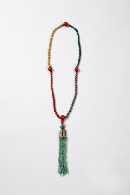

# 이 목걸이 같은 장식은 치마 속에 숨었다

*눈보다 코가 먼저 만나는 노리개*

Life · Clothing

> 자료 대조를 마친 검토용 이야기입니다. 공개 게시 승인은 아직 받지 않았습니다.

*줄향노리개 · 국립고궁박물관 소장·제공. 전체 사진을 자르지 않고 사용했습니다.*

[이미지 출처와 소장품 안내](https://www.gogung.go.kr/gogung/pgm/psgudMng/view.do?menuNo=800065&psgudSn=367850) · 공공누리 제1유형(출처표시)

사진 속 물건은 긴 목걸이처럼 보인다. 색이 다른 작은 알들이 줄을 따라 이어지고, 아래에는 술이 달렸다. 그런데 이름은 목걸이가 아니라 줄향노리개다.

장신구라면 남에게 보여 주는 물건이라고 생각하기 쉽다. 이 노리개는 조금 다르다. 박물관 설명에는 은은한 향기를 풍기도록 치마 속에 찼다고 적혀 있다. 눈에 잘 보이지 않는 자리에도 꾸밈이 있었던 셈이다.

## 구슬처럼 만든 향

국립고궁박물관은 줄향을 향으로 만든 둥근 알을 이어 놓은 것으로 설명한다. 향을 구슬 모양으로 빚어 색을 칠하거나 천으로 싸서, 염주처럼 연결하는 방식이다.

이 소장품의 설명에는 붉은색과 황색, 녹색, 흰색이 등장한다. 사진에서 색을 찾다 보면 처음에는 그저 예쁜 구슬이라고 여겼던 부분을 다시 보게 된다. 모양뿐 아니라 향기를 함께 생각해야 하는 물건이다.

## 옷에 달아 두는 향기

노리개는 저고리 고름이나 치마허리 끈에 차는 장신구다. 줄향노리개 역시 옷과 함께 쓰였지만, 박물관은 치마 속에 차는 쓰임을 따로 소개한다. 겉으로 드러나는 장식과 향기를 가까이 두는 일은 꼭 같을 필요가 없었다.

오늘날 향수를 뿌리는 일과 나란히 떠올릴 수는 있다. 다만 이 물건에 어떤 향 재료가 들어갔는지, 향이 얼마나 오래갔는지까지 확인된 것은 아니다. 사진만 보고 꽃향기였을 것이라고 정해 버리면 이야기가 물건보다 앞서 나간다.

## 보이지 않아도 남는 꾸밈

이 노리개의 재미는 쓰임을 알고 나서 모습이 달라 보인다는 데 있다. 길게 이어진 알들은 색을 나누는 장식인 동시에 향을 간직하는 부분이었다.

지금 사진에서는 향기를 맡을 수 없다. 그래도 치마 속에 달았다는 짧은 설명 덕분에, 오래된 장신구가 유리장 안의 반짝이는 물건에서 일상 가까이로 내려온다. 옛사람도 자신의 몸 가까이에 기분 좋은 무엇을 두고 싶었던 모양이다.

## 이야기의 바탕이 된 자료

- [국립고궁박물관 — 줄향노리개](https://www.gogung.go.kr/gogung/pgm/psgudMng/view.do?menuNo=800065&psgudSn=367850) · 확인일 2026-10-28
  - 확인 내용: 노리개를 다는 위치 / 줄향의 구슬형 제작과 네 가지 색 / 은은한 향기를 위해 치마 속에 차던 쓰임

---

[같은 소주제의 이야기](README.md) · [전체 서가](../../README.md)
