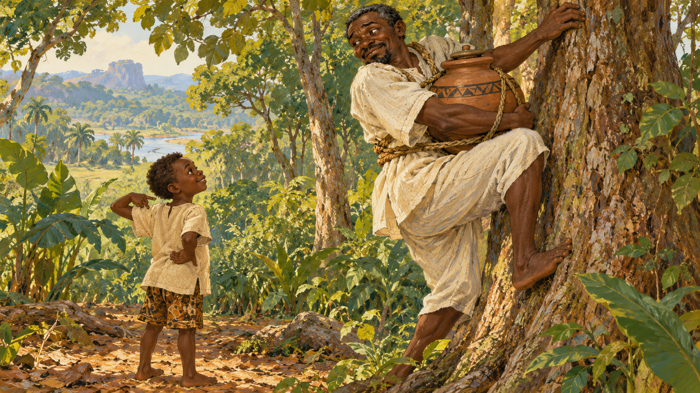

# 아난시 — 지혜를 항아리에 숨기려던 날

*아들의 한마디가 세상의 지혜를 바깥으로 꺼내다*

Life · Folks

> 출처 대조와 공개 게시 승인을 마친 이야기입니다. 실제 게시 여부는 사이트 배포 상태를 따릅니다.

*AI 전승 장면 삽화 · 이 판본의 사람 모습 아버지와 아들을 그렸습니다. 판티 지역의 실제 의상·생활을 고증한 민속 사진이 아닙니다.*

세상의 지혜를 모두 항아리에 넣었다면 걱정할 일이 없을까. 아난시는 그렇게 생각한 듯하다. 아무도 닿지 못하는 높은 나무에 숨기면 다시는 다른 사람에게 나누어 주지 않아도 될 것이다. 그런데 나무에 오르는 아주 작은 일이 뜻대로 되지 않는다.

서아프리카의 아난시 이야기에는 재치와 욕심, 뜻밖의 실패가 자주 등장한다. 이 글은 바커와 싱클레어가 펴낸 『서아프리카 민담』의 「지혜가 인류의 것이 된 까닭」을 따라 읽는다.

## 1. 사람들은 아난시에게 물으러 왔다

이 판본의 아난시는 지혜를 가진 아버지로 나온다. 사람들은 날마다 그에게 조언과 도움을 구한다. 많은 아난시 전승에서 거미의 모습이 친숙하지만 여기서는 사람처럼 행동하는 아버지와 아들이 이야기를 이끈다.

그의 지혜는 혼자 알고 있는 비밀만은 아니었다. 이미 다른 사람들에게 건넨 것도 있었다. 누군가 묻고 답을 듣는 관계 속에서 그의 힘이 드러난다. 이야기의 출발에는 지식을 나누는 장면이 놓여 있다.

## 2. 화가 나자 지혜를 거두어들였다

어느 날 사람들이 아난시의 마음을 상하게 한다. 그는 벌을 주려고 자기가 알려 준 지혜를 다시 거두기로 한다. 얼마나 심한 일이 있었는지보다 그가 택한 대응이 이야기의 관심이다. 남들이 쓰지 못하게 만들겠다는 것이다.

그는 지혜를 모아 큰 항아리에 담고 단단히 봉한다. 손에 잡히지 않는 지혜를 담을 수 있는 물건처럼 다루는 상상이 시작된다. 항아리를 누가 가지고 있느냐가 곧 지혜를 누가 가지느냐라는 계산이다.

## 3. 아들은 아버지의 비밀을 지켜보았다

아들 크웨쿠 친은 아버지가 무언가를 꾸미는 것을 눈치챈다. 다음 날 아난시가 항아리를 가지고 나가자 조용히 뒤따라간다. 아버지는 마을에서 멀리 떨어진 숲으로 들어간다.

아들은 처음부터 계획을 망치려는 강한 적으로 등장하지 않는다. 지켜보고 알아차리는 사람이 될 뿐이다. 누구도 모르게 감추려는 일에 가까운 사람이 목격자로 따라붙으면서 뜻밖의 장면이 준비된다.

## 4. 항아리를 앞으로 매달면 생기는 일

아난시는 아주 높은 나무를 골라 오르기 시작한다. 항아리는 목에 걸어 가슴 앞으로 매달았다. 손과 몸을 나무에 붙여야 하는데 무거운 항아리가 그 사이에서 자꾸 걸린다.

높이 숨길 장소를 고르는 지혜는 있었지만 그곳까지 어떻게 운반할지는 해결하지 못했다. 다시 오르려 할 때마다 같은 장애물이 생긴다. 이야기의 큰 자랑이 몸 앞의 항아리 하나에 막히는 장면이다.

## 5. 아들이 내놓은 쉬운 방법

한동안 바라보던 아들이 말한다. 항아리를 등 쪽으로 돌려 매면 더 쉽게 올라갈 수 있지 않겠느냐는 조언이다. 특별한 주문도 새 물건도 필요 없다. 매달린 위치를 바꾸어 보는 생각이다.

이 한마디가 아난시의 계획 전체를 흔든다. 지혜를 모두 모았다고 믿었는데 자기가 떠올리지 못한 방법을 아들이 알고 있다. 문제는 더 이상 나무를 얼마나 높이 오를 수 있느냐가 아니다. 항아리에 정말 모든 지혜가 들어 있느냐가 된다.

## 6. 화가 난 아버지는 항아리를 던졌다

아난시는 자기보다 아들이 더 나은 답을 냈다는 사실에 화가 난다. 항아리를 아래로 던지고, 바위에 부딪힌 항아리는 깨진다. 안에 있던 지혜가 바깥으로 흘러나와 세상에 퍼진다.

그가 마음을 고쳐먹고 모두에게 나누어 주기로 한 결말과는 다르다. 독점하려던 계획이 실패하면서 나눔의 결과가 생긴 것이다. 동기를 살펴보면 이 이야기는 훌륭한 어른의 교훈보다 욕심이 엉뚱한 결과를 낳는 익살에 가깝다.

## 7. 항아리 밖에도 이미 지혜가 있었다

지혜가 퍼지는 마지막보다 먼저 중요한 일이 일어났다. 아직 항아리가 깨지기 전인데 아들은 좋은 방법을 알아냈다. 지혜가 전부 그 안에만 있다는 아버지의 생각은 이미 사실이 아니었다.

그래서 항아리는 지혜 자체이면서 지혜를 독점할 수 있다는 믿음의 상징으로도 읽힌다. 물건을 자기 손에 쥐었다고 모든 판단까지 혼자 가질 수는 없었다. 눈앞의 작은 일을 새롭게 보는 사람은 다른 곳에도 있었다.

## 8. 어느 지역의 아난시를 읽는가

이 책의 이야기는 판티 지역을 배경으로 소개된다. 아난시 전승은 더 넓은 아칸 문화권과 다른 지역에도 이어져 있다. 같은 이름이 나온다고 인물의 모습과 아들의 이름, 깨지는 이유가 언제나 같지는 않다.

오래된 영문 수집본에는 당시 수집가의 시선도 담겨 있다. 그 설명을 오늘의 사람들 전체에 대한 평가로 받아들이지 않았다. 이 글에서는 해당 이야기의 사건을 중심으로 쓰고 다른 판본을 표시 없이 섞지 않았다.

## 9. 높은 곳보다 가까운 말을 듣기

다시 항아리를 상상해 보자. 아난시는 남들이 닿지 못할 높이를 찾느라 바로 곁의 아들이 무엇을 볼 수 있는지 놓쳤다. 큰 비밀을 가진 사람보다 밖에서 지켜본 사람이 쉬운 길을 발견한다.

이것을 어른은 어리석고 아이는 언제나 옳다는 규칙으로 바꿀 필요는 없다. 누가 답을 가졌는지 미리 정해 두면 가까운 조언을 못 들을 수 있다는 익살로 읽어도 충분하다. 세상의 지혜는 항아리 하나보다 넓다는 말이 웃음 속에 남는다.

## 이야기의 바탕이 된 자료

- [W. H. Barker / Cecilia Sinclair, West African Folk-Tales — How Wisdom Became the Property of the Human Race](https://raw.githubusercontent.com/GITenberg/West-African-Folk-Tales_66923/master/66923-0.txt) · 확인일 2026-10-31
  - 확인 내용: 판티 지역을 배경으로 한 아버지 아난시와 아들 Kweku Tsin / 분노한 아난시가 지혜를 회수해 봉한 항아리·앞으로 매달아 나무를 못 오름 / 아들의 뒤로 매라는 조언·화가 나 던져 깨진 항아리·지혜의 확산. 자발적 나눔으로 결말을 바꾸지 않음

---

[같은 소주제의 이야기](README.md) · [전체 서가](../../README.md)
