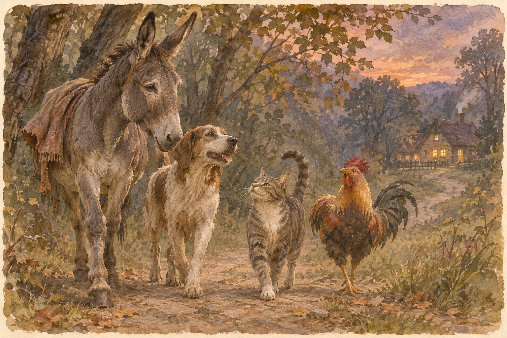

# 브레멘 음악대 — 네 동물은 왜 목적지에 도착하지 않았을까

*그림 형제의 원작을 따라 읽는 늙음·협력·새로운 거처*

Life · Folks

> 자료 대조를 마친 검토용 이야기입니다. 공개 게시 승인은 아직 받지 않았습니다.

*AI 이야기 장면 삽화 · 작품·역사적 상황을 떠올리기 위한 그림이며 실제 사진이나 정확한 복원이 아닙니다.*

당나귀 위에 개, 그 위에 고양이, 맨 위에 수탉. 『브레멘 음악대』를 읽지 않은 사람도 네 동물이 차례로 올라선 모습은 본 적이 있을 것이다. 제목을 들으면 브레멘에서 연주회를 여는 이야기처럼 느껴지지만, 실제 결말은 조금 다르다.

그림 형제의 동화에서 동물들은 브레멘까지 가지 않는다. 도중에 새로운 삶의 자리를 찾고 그곳에 남는다. 이 짧은 줄거리를 처음부터 따라가 보면 귀여운 동물 그림 뒤에 늙음과 쓸모, 동료와 집에 관한 이야기가 숨어 있다는 사실을 발견하게 된다.

## 01. 오래 일한 당나귀가 길을 나서다

주인을 위해 오랫동안 곡식 자루를 나르던 당나귀는 힘이 약해진다. 더는 예전처럼 일하지 못하자 주인이 자신을 계속 먹여 살리지 않을 것 같다고 느낀다. 당나귀는 그곳을 떠나 브레멘으로 가서 도시의 음악가가 되겠다는 계획을 세운다.

출발의 이유가 음악에 대한 순수한 꿈만은 아니라는 점이 중요하다. 당나귀는 먼저 살아남을 길을 찾아야 한다. 오래 일한 장소가 더는 안전한 집이 되지 못하는 상황이다. 동화는 어려운 제도를 설명하지 않으면서도, 쓸모가 줄었다고 여겨지는 존재의 두려움을 곧바로 보여 준다.

## 02. 개와 고양이, 수탉에게도 사정이 있다

길에서 당나귀는 사냥을 잘하지 못하게 된 개와 쥐를 잡기 어려워진 고양이를 만난다. 둘 다 이전의 일을 계속할 수 없어 위험에 놓였다. 수탉은 조금 다르다. 손님에게 대접할 음식이 될 처지다. 네 동물의 구체적인 사정은 같지 않지만 머물던 곳에서 생명을 지키기 어렵다는 점이 닮았다.

당나귀는 동료들에게 함께 음악가가 되자고 권한다. 한 동물에게는 짖는 소리가 있고 다른 동물에게는 울음소리가 있다. 주인이 원하던 일을 못한다고 해서 가진 능력이 전부 없어진 것은 아니다. 동화는 무엇을 잘하는지 판단하는 자리가 달라질 수 있음을 보여 준다.

## 03. 목적지보다 먼저 찾아온 밤

네 동물은 하루 만에 브레멘까지 갈 수 없었다. 숲에서 밤을 보내려는데 높은 곳에 올라간 수탉이 멀리 불빛을 발견한다. 그 빛을 따라간 곳에는 도둑들이 음식을 차려 놓고 있는 집이 있다. 추위와 허기에 지친 동물들에게 불빛은 음악가의 명예보다 더 급한 가능성이다.

이 장면에서 이야기의 목표가 조용히 바뀐다. 처음에는 브레멘이라는 도시와 새로운 직업이 있었다. 이제는 오늘 밤 먹을 것과 안전하게 잠들 자리가 필요하다. 큰 꿈을 이루는 과정에서 작은 휴식이 등장한 것 같지만, 결국 바로 그 쉼터가 새로운 삶의 중심이 된다.

## 04. 네 가지 소리가 하나의 사건을 만든다

동물들은 힘을 합쳐 도둑을 몰아낼 계획을 세운다. 당나귀가 창가에 서고 그 위로 개와 고양이, 수탉이 차례로 올라간다. 그런 다음 동시에 울부짖으며 안으로 뛰어든다. 놀란 도둑들은 무서운 존재가 나타났다고 여기고 달아난다.

이것이 동화에서 처음 이루어지는 합동 공연인 셈이다. 아름다운 화음은 아니지만 네 동물의 소리는 분명한 일을 해낸다. 혼자일 때는 약한 동물이 함께 있을 때 예상하지 못한 힘을 만든다. 몸을 포개는 유명한 모습은 단순한 장난이 아니라 이 협력을 눈에 보이게 하는 장면이다.

## 05. 돌아온 도둑은 무엇을 보았을까

밤중에 도둑 한 명이 집을 살피러 돌아온다. 어둠 속에서 고양이에게 할퀴이고 개에게 물리며 당나귀에게 차이고 수탉의 소리까지 듣는다. 그는 실제 동물들을 제대로 파악하지 못한 채 집 안에 무시무시한 존재들이 있다고 동료들에게 설명한다.

독자는 무슨 일이 일어났는지 알지만 도둑은 모른다. 바로 이 차이가 웃음을 만든다. 처음의 소동만으로 이야기가 끝나지 않고, 두 번째 방문에서 오해가 더 커지는 구성도 재미있다. 거대한 힘을 얻은 동물들이 아니라 각자의 자리에 누워 있던 동물들이 두려움의 대상을 만들어 낸다.

## 06. 브레멘에 가지 않은 결말

도둑들이 떠난 뒤 동물들은 그 집에서 계속 살기로 한다. 제목에 있는 도시로 가서 공식 음악대가 되는 장면은 나오지 않는다. 원래의 계획을 달성하지 못했는데도 결말이 실패처럼 느껴지지 않는 이유는 무엇일까. 출발 당시 부족했던 것들을 이미 얻었기 때문이다.

그들에게 필요한 것은 살아남을 수 있는 장소와 함께할 동료였다. 브레멘은 그 가능성을 상상하게 한 이름이지만 유일한 답은 아니었다. 목적지를 바꾸는 일과 삶을 포기하는 일은 다르다. 이 동화의 마지막은 성공의 모양을 출발할 때 정한 직업 하나로 묶어 두지 않는다.

## 07. 어린이의 웃음과 어른의 질문이 만나다

네 동물이 도둑을 놀라게 하는 장면은 어린 독자에게도 즐겁다. 하지만 나이가 든 독자는 처음에 버려질 위기에 놓인 동물들을 더 오래 생각할 수 있다. 같은 이야기 안에서 웃음의 장면과 불안의 장면이 이어지는 것이 이 동화가 오래 읽히는 이유 가운데 하나다.

네 동물에게 새 집을 준 것은 다시 젊어지는 마법이 아니다. 몸은 여전히 이전과 같지만 동료와 공간이 달라진다. 늙음을 없앤 뒤에 행복해지는 결말이 아니라는 점이 이 이야기의 위안을 더욱 특별하게 만든다.

이것을 현실의 모든 문제를 해결하는 처방으로 바꿀 필요는 없다. 다만 더는 예전처럼 일하지 못하는 존재에게도 새로운 관계와 자리가 가능하다는 상상은 남는다. 『브레멘 음악대』는 도시에 도착한 이야기가 아니라, 길에서 만난 이들이 함께 집을 얻는 이야기로 읽을 때 더욱 따뜻해진다.

## 이야기의 바탕이 된 자료

- [Brothers Grimm, Household Tales, no. 27 The Bremen Town-Musicians](https://raw.githubusercontent.com/GITenberg/Household-Tales-by-Brothers-Grimm_5314/master/5314-8.txt) · 확인일 2026-11-05
  - 확인 내용: 동물 네 마리의 출발 사정, 숲의 불빛·도둑집, 두 번의 소동, 브레멘에 도착하지 않고 집에 남는 원작 결말

---

[같은 소주제의 이야기](README.md) · [전체 서가](../../README.md)
