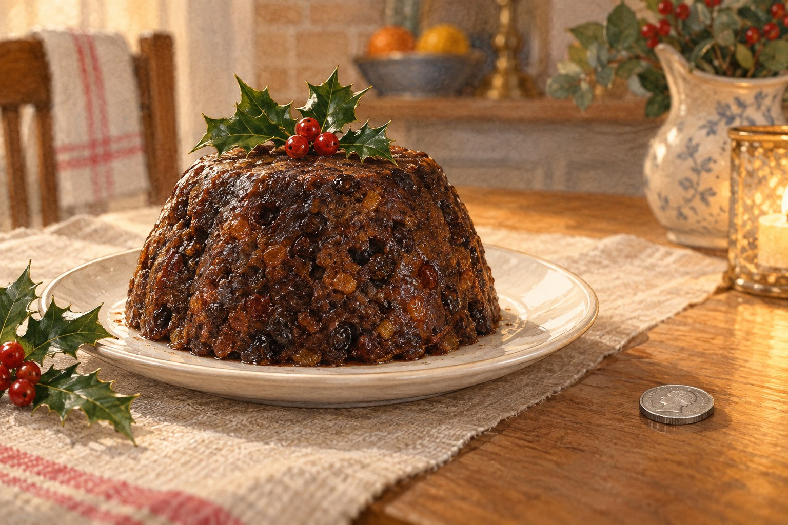

# 크리스마스 푸딩에는 왜 동전 이야기가 따라올까

*작은 식스펜스에 담아 두었던 새해의 바람*

Life · Folks

> 출처 대조와 공개 게시 승인을 마친 이야기입니다. 실제 게시 여부는 사이트 배포 상태를 따릅니다.

*KnowledgeWalk 제작 · AI 설명용 삽화. 실제 유물·제품·연주 기구·동물의 생김새를 정확하게 재현한 자료나 실험 결과가 아닙니다.*

크리스마스 푸딩 사진을 보면 둥근 디저트 옆에 작은 은빛 동전이 놓여 있기도 하다. 후식 값을 미리 계산해 둔 것일까.

그 동전은 영국의 식스펜스와 관련된 풍습을 떠올리게 한다. 푸딩 속에 동전을 숨기고, 그것을 찾은 사람에게 다음 해의 좋은 운이 오기를 바랐다는 이야기다. 동전이 돈을 내는 자리에서 잠깐 벗어나 소원을 담는 물건이 된다.

## 함께 젓고 각자의 소원을 생각하다

왕립조폐국은 2024년 보도자료에서 ‘스털업 선데이’라는 풍습을 소개했다. 대림절이 시작되기 전 마지막 일요일, 가족과 친구가 모여 크리스마스 푸딩을 준비하는 날이다.

자료에 소개된 음식사 연구자 애니 그레이는 사람들이 반죽을 번갈아 저으며 소원을 빌던 전통을 설명한다. 크리스마스 당일만 기다리는 것이 아니라, 미리 모여 준비하는 시간에도 의미를 두었던 셈이다.

이 이름에는 ‘저어 섞다’라는 뜻과 연결되는 말장난도 있다. 그레이는 교회의 기도문에 나오는 표현이 푸딩 준비를 떠올리는 계기로 쓰였다고 소개한다. 길고 어려운 설명보다, 익숙한 말을 연말의 할 일과 엮어 기억한 모습이 재미있다.

## 동전 한 개가 바꾸는 후식의 이야기

같은 자료는 더 오래된 트웰프스 케이크에 표식을 숨기던 풍습도 이야기한다. 이후의 푸딩 전통에서는 작은 동전을 찾은 사람에게 부와 건강, 행복을 기원했다는 것이다.

동전을 찾았다고 실제로 미래가 달라진다는 뜻은 아니다. 중요한 것은 한 해를 마무리하는 자리에 다음 해의 바람을 얹었다는 점이다. 평범한 후식에 작은 뜻밖의 일이 더해진다.

그래서 이 이야기에서 동전의 액면은 주인공이 아니다. 사람들이 함께 준비하고, 누군가 좋은 것을 발견하기를 기대했다는 기억이 동전 주변에 남는다.

## 모두가 똑같이 지키는 풍습은 아니다

왕립조폐국이 이 자료를 낸 것은 전통을 되살리려는 상품 홍보와도 관련이 있다. 그러니 오늘의 영국 가정이 모두 같은 푸딩을 만들고 같은 풍습을 지킨다고 생각할 필요는 없다.

그 점을 알고 읽어도 작은 이야기는 남는다. 특별한 날의 음식에는 맛과 재료만 들어가는 것이 아니다. 준비하는 순서, 함께하는 사람, 좋은 운을 바라던 마음도 붙어 있다.

다음에 푸딩 옆의 은빛 동전을 보게 된다면 후식 값 대신 누군가의 소원을 떠올려 보자. 이번 삽화처럼 동전을 접시 밖에 나란히 놓아두어도, 그 작은 물건이 들려주는 연말 이야기는 충분히 전해진다.

## 이야기의 바탕이 된 자료

- [The Royal Mint — Save the Christmas Pud! Recovered Silver Sixpence Released to Revive Stir-Up Sunday Tradition](https://www.royalmint.com/aboutus/press-centre/save-the-christmas-pud-recovered-silver-sixpence-released-to-revive-stir-up-sunday-tradition/) · 확인일 2026-10-27
  - 확인 내용: 대림절 전 마지막 일요일의 푸딩 준비 풍습 / 음식사 연구자 애니 그레이가 설명한 소원·동전 전통 / 트웰프스 케이크와 연결한 설명 / 전통 부활과 상품 홍보를 목적으로 한 자료의 성격

---

[같은 소주제의 이야기](README.md) · [전체 서가](../../README.md)
