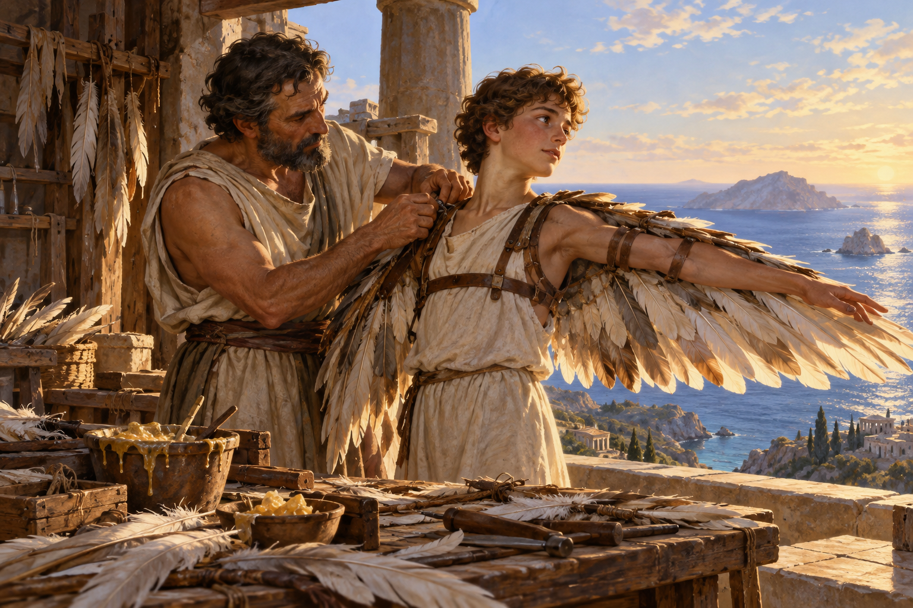

# 이카로스 — 날개가 생겼을 때 가장 어려웠던 일

*아버지가 만든 탈출의 도구가 다른 꿈으로 바뀌다*

Life · Folks

> 자료 대조를 마친 검토용 이야기입니다. 공개 게시 승인은 아직 받지 않았습니다.

*AI 이야기 장면 삽화 · 신화의 날개 제작을 상상한 그림이며 실제 고대 유물·비행 사건이나 제작 가능한 항공 장치의 도해가 아닙니다.*

## 소제목 바로가기

- [01. 땅과 바다가 막혀 있을 때](#user-content-part-1)
- [02. 아들에게는 아직 놀이처럼 보인다](#user-content-part-2)
- [03. 너무 높아도 너무 낮아도 안 된다](#user-content-part-3)
- [04. 땅의 사람들은 신을 본 줄 안다](#user-content-part-4)
- [05. 따라가는 비행에서 혼자 오르는 비행으로](#user-content-part-5)
- [06. 아버지는 자기 기술을 원망한다](#user-content-part-6)
- [07. 뛰어난 제자를 질투했던 기술자](#user-content-part-7)
- [08. 날개의 이야기에서 돌아오기](#user-content-part-8)

날개가 생긴다면 어디까지 날고 싶을까. 이카로스에게 하늘은 아직 가 보지 못한 공간이었다. 아버지 다이달로스에게는 떠날 수 없는 섬에서 빠져나갈 길이었다. 같은 날개가 두 사람에게 똑같은 뜻을 갖지는 않았다.

이 글은 오비디우스의 『변신 이야기』 제8권에 실린 전승을 따른다. 익숙한 추락의 장면뿐 아니라 날개를 만들던 시간과 그 뒤에 이어지는 다이달로스의 과거까지 소개한다. 꿈을 크게 가지라는 말이나 부모 말을 잘 들으라는 말 하나로는 다 담기지 않는 이야기다.

## 01. 땅과 바다가 막혀 있을 때

다이달로스는 뛰어난 기술자지만 크레타섬을 마음대로 떠나지 못한다. 미노스가 땅과 바다의 길을 막고 있다면 아직 남은 곳이 하늘이라고 생각한다. 사람에게 없던 날개를 만들겠다는 계획은 처음부터 더 높은 명예를 얻으려는 놀이가 아니라 탈출의 방법이다.

그는 깃털을 크기에 맞게 배열하고 실과 밀랍으로 연결한다. 새의 날개를 살피며 곡선도 만든다. 시는 기술을 단순히 천재의 번쩍이는 생각으로만 그리지 않는다. 순서를 정하고 재료를 묶고 몸에 맞추는 손일이 있다. 자연을 떠올린 모양과 사람이 다룰 수 있는 재료가 만나 새로운 도구가 된다.

## 02. 아들에게는 아직 놀이처럼 보인다

곁의 이카로스는 흩날리는 깃털을 잡고 밀랍을 손으로 만진다. 독자는 그 밀랍이 나중에 어떤 역할을 할지 알고 있어 평범한 손동작에도 불안을 느끼게 된다. 아이에게는 즐거운 준비가 읽는 사람에게는 앞으로의 위험을 보여 주는 장면이 된다.

작품이 흥미로운 것은 이카로스를 처음부터 오만한 악인으로 소개하지 않는다는 점이다. 그는 아직 자기가 만지는 것이 어떤 결과를 낳을지 충분히 모른다. 아버지는 알고 있어 설명하지만, 설명을 들었다는 사실이 몸으로 위험을 이해했다는 뜻은 아니다. 두 사람 사이에 경험의 차이가 놓여 있다.

## 03. 너무 높아도 너무 낮아도 안 된다

다이달로스는 가운데 길을 따르라고 말한다. 너무 낮으면 바닷물이 날개를 무겁게 하고, 너무 높으면 태양의 열이 날개를 해칠 수 있다. 경고는 단순히 높이 오르지 말라는 말보다 구체적이다. 그들이 만든 도구에는 다룰 수 있는 조건과 넘지 말아야 할 한계가 있다.

그는 아들에게 날개를 달아 주며 눈물을 흘리고 손을 떤다. 기술을 성공시킨 사람이라고 위험 앞에서 확신만 가진 것은 아니다. 새끼 새를 둥지 밖으로 이끄는 새처럼 먼저 날며 뒤를 살핀다. 날개는 아들에게 자유를 주지만 아버지에게는 통제할 수 없는 걱정을 함께 준다.

## 04. 땅의 사람들은 신을 본 줄 안다

낚시꾼과 목동, 밭을 가는 사람은 하늘을 가르는 두 사람을 보고 놀란다. 사람에게 불가능해 보였던 일이 눈앞에 있으니 신이라고 여긴다. 독자는 그들이 누구이고 어떤 재료로 날고 있는지 안다. 멀리서 보는 놀라움과 가까이 아는 불안이 한 장면에 겹친다.

이것은 고대에 실제 유인 비행이 이루어졌다는 기록이 아니다. 서사시는 기술로 경계를 넘는 상상을 자연스럽게 펼친다. 신화의 재료를 항공 실험의 설명서처럼 읽기보다, 사람의 능력이 갑자기 커졌을 때 무엇을 느끼는지 보여 주는 장면으로 읽으면 더 가까워진다.

## 05. 따라가는 비행에서 혼자 오르는 비행으로

이카로스는 날 수 있다는 기쁨에 더 대담해진다. 아버지를 따르던 길에서 벗어나 높이 오른다. 탈출을 위해 마련한 능력이 어느 순간 다른 욕망을 만든다. 위험이 사라져서가 아니라, 위험보다 지금의 가능성이 더 크게 느껴지는 순간이다.

오비디우스는 태양의 열이 밀랍을 부드럽게 하고 깃털이 떨어지는 과정을 보여 준다. 이카로스는 팔을 움직이지만 더는 공기를 붙잡을 수 없다. 마지막에 아버지의 이름을 부르며 바다로 떨어진다. 소년의 추락은 비행의 해방감과 너무 가까이 놓여 있어 더 갑작스럽고 아프게 다가온다.

## 06. 아버지는 자기 기술을 원망한다

다이달로스는 아들을 찾다가 물 위의 날개를 본다. 그가 쏟았던 손일과 기대가 상실의 흔적으로 돌아온다. 그는 자신의 기술을 저주하고 아들을 묻는다. 누구의 잘못인가 한 줄로 판정하려는 마음보다 먼저, 도구를 만든 사람과 남은 부모의 슬픔이 보인다.

하지만 시는 그를 모든 면에서 죄 없는 아버지로만 남겨 두지 않는다. 곁에서 울리는 새의 소리가 다른 과거를 열어 보인다. 이카로스 이야기만 따로 떼어 기억할 때에는 자주 빠지는 부분이다. 같은 장인의 능력과 마음을 다른 관계에서도 살펴보게 한다.

## 07. 뛰어난 제자를 질투했던 기술자

전승에서 다이달로스는 재주 많은 조카를 가르친 적이 있다. 소년은 물고기 뼈의 모양에서 톱의 생각을 얻는 등 새로운 도구를 만든다. 다이달로스는 그 재능을 질투해 높은 곳에서 떨어뜨리려 한다. 여신은 소년을 새로 바꾸어 살린다. 아들의 추락 앞에서 이 과거가 다시 나타난다.

이 대목을 곧바로 아들이 대신 벌받은 것이라고 정리할 필요는 없다. 시가 두 추락을 나란히 놓았다는 점을 보는 것이 먼저다. 자기 기술을 아들에게는 선물하고 조카에게서는 두려워했던 인물. 뛰어난 능력이 언제나 타인의 재능을 받아들일 넓은 마음과 함께하지는 않는다는 복잡함이 남는다.

## 08. 날개의 이야기에서 돌아오기

이카로스를 단지 꿈꾸다 실패한 사람으로 읽을 수도, 한계를 잊은 사람으로 읽을 수도 있다. 다만 꿈은 위험하니 처음부터 날지 말라는 결론은 출발의 막힌 길을 잊게 한다. 그들에게 비행은 필요한 가능성이었다. 문제는 능력이 생긴 뒤 그 가능성을 어떻게 다루느냐였다.

작업대 위의 밀랍으로 돌아가 보면 이야기는 조금 달라진다. 아들은 장난치고 아버지는 묶으며, 아직 둘 다 떠나지 않았다. 같은 도구에 실린 서로 다른 마음을 독자만 조금 더 멀리서 본다. 그 짧고 평범한 준비가 있어 이카로스의 날개는 추락의 상징이기 전에 누군가 함께 살아 나가려 만들었던 물건으로 남는다.

## 이야기의 바탕이 된 자료

- [Ovid, Metamorphoses — Books VIII & X, Henry T. Riley 번역](https://raw.githubusercontent.com/GITenberg/The-Metamorphoses-of-Ovid-Books-VIII-XV_26073/master/26073-0.txt) · 확인일 2026-11-01
  - 확인 내용: VIII의 다이달로스/이카로스: 실·밀랍·너무 낮음/높음의 위험·추락·조카 Perdix의 재능/질투/새 변신 / X의 피그말리온: 여성 불신·상아·선물·축제의 간접 청원·감촉과 온기·혼인/후대. 해당 여인에게 Galatea 이름을 주지 않음

---

[같은 소주제의 이야기](README.md) · [전체 서가](../../README.md)
