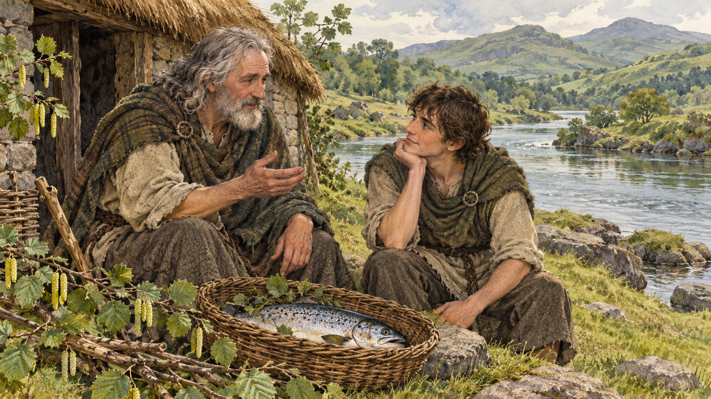

# 피온 — 지혜의 연어는 누구의 몫이었을까

*불에 덴 엄지손가락과 시인이 감추어 둔 예언*

Life · Folks

> 자료 대조를 마친 검토용 이야기입니다. 공개 게시 승인은 아직 받지 않았습니다.

*AI 전승 장면 삽화 · 스티븐스의 재화 속 대화를 떠올린 삽화이며 아서 래컴의 기존 삽화·실제 인물·고대 의상을 재현한 자료가 아닙니다.*

연어를 굽다가 껍질이 부푸는 것을 보았다. 손가락으로 눌렀더니 뜨거워서 무심코 입에 넣었다. 대단한 모험이라고 부르기 어려운 이 작은 동작이 지혜의 주인을 바꾸는 사건이 된다.

아일랜드의 피온에게는 지혜의 연어 이야기가 따라온다. 이 글은 제임스 스티븐스의 『아일랜드 옛이야기』 가운데 「피온의 소년 시절」을 읽는다. 특히 스승 피네가스의 마음과 말이 자세하게 그려지는 판본이다.

## 1. 몸을 배운 소년이 시인을 만났다

피온은 어릴 때부터 몸을 움직이고 살아갈 기술을 배웠다. 이후에는 시인 피네가스를 만나 새로운 공부를 한다. 재빠른 다리와 팔만큼 질문하고 생각하는 힘도 중요해지는 시기다.

그는 스승의 집안일을 맡고 물을 길어 오며 이야기를 듣는다. 배움은 책상 앞의 한 시간으로만 구분되지 않는다. 식사를 준비하고 쉬는 동안에도 들은 말을 떠올린다. 지혜의 연어가 나타나기 전부터 소년의 하루는 배움으로 차 있다.

## 2. 물고기가 아는 것은 어디서 왔을까

피네가스는 보인강에서 특별한 연어를 잡게 되리라는 예언을 말한다. 그 연어를 먹으면 큰 지식을 얻을 수 있다. 피온은 물고기의 살에 어떻게 지혜가 들어가는지 궁금해한다.

스승은 신성한 개암나무의 열매가 물에 떨어지고 연어가 그것을 먹는다고 설명한다. 소년은 그러면 열매를 바로 찾아 먹으면 어떠냐고 묻는다. 멋진 이야기를 들은 뒤에도 쉬운 다른 방법을 생각해 보는 아이의 질문이 재미있다.

## 3. 좋은 질문에도 연습이 필요했다

피네가스는 질문을 던지는 것으로만 만족하게 두지 않는다. 소년이 자기 생각으로 답해 보게 하고 어느 부분이 어긋났는지 짚어 준다. 피온은 묻는 법과 설명하는 법을 함께 익힌다.

이 장면은 나중에 연어를 먹는 사건과 나란히 놓고 볼 만하다. 모든 지혜가 신비한 한 입으로만 들어왔다면 앞의 긴 공부는 필요 없었을 것이다. 스티븐스의 재화는 놀라운 사건을 기다리는 시간에도 배움이 있었다고 그린다.

## 4. 바구니 안에 마침내 그 연어가

어느 날 스승이 물고기 든 바구니를 가지고 돌아온다. 피온은 특별한 연어를 잡았다는 말에 기뻐한다. 그런데 스승의 표정에는 승리감과 함께 슬픔 같은 것도 있다. 소년은 그 마음의 까닭을 아직 모른다.

피네가스는 자기가 돌아올 때까지 연어를 구워 두라고 맡긴다. 먹지 않겠느냐고 묻고 소년은 약속한다. 독자는 맛있는 물고기를 앞에 둔 유혹을 예상하지만 이야기의 작은 실수는 다른 방향에서 생긴다.

## 5. 먹으려던 것이 아니었다

피온은 연어를 굽다가 껍질의 부푼 곳을 엄지로 누른다. 데인 손을 입에 넣는 바람에 생선의 맛을 보게 된다. 스승의 음식을 몰래 훔쳐 먹으려고 계획한 것은 아니다. 일하다 생긴 무심한 반응이다.

피네가스가 돌아왔을 때 피온은 그 일을 숨기지 않고 말한다. 물고기의 맛이 손가락에 묻은 것처럼 좋다면 아주 맛있겠다고 웃기까지 한다. 심각한 비밀이 있는 어른과 아직 그것을 모르는 아이의 대화가 어긋난다.

## 6. 스승이 숨겨 둔 예언의 나머지

피네가스는 소년의 이름을 확인하고 예언의 나머지를 털어놓는다. 연어를 잡는 사람은 자신이지만 먹을 사람은 피온으로 정해져 있었다. 앞서 그 사실을 모두 말하지 않았던 것이다.

이 판본에서 스승은 단순히 우연히 자기 몫을 빼앗긴 사람이 아니다. 무엇이 옳은지 알고도 마음이 흔들린 사람이다. 그가 물고기를 잡으며 치른 싸움은 연어를 끌어올리는 힘겨루기 외에 자기 욕망과의 다툼이기도 했다.

## 7. 물고기를 내놓는 선택

피온은 스승에게 반을 주겠다고 한다. 하지만 피네가스는 자신이 먹지 않겠다며 소년에게 연어를 먹게 한다. 좋은 것을 자기 곁에 두고 싶었던 마음을 내려놓는 순간이다.

연어를 먹은 뒤 스승의 마음에는 기쁨과 평온이 돌아온다. 소년이 얻은 지혜만이 결말의 선물이 아니다. 스승도 옳다고 아는 일을 선택한 뒤 새로운 마음을 얻는다. 두 사람 모두의 변화가 있어서 장면이 따뜻하게 남는다.

## 8. 영웅이 되기 전의 작은 집

이후 피온은 배운 것을 더 넓은 세계에서 시험하러 떠난다. 잘 알려진 영웅의 이름을 먼저 생각하면 이 작은 집과 물고기 바구니는 잠깐 지나갈 수 있다. 그러나 그곳에서 그는 질문과 정직함, 주고받는 관계를 배웠다.

연어의 지혜는 인간관계와 떨어진 신비한 능력만으로 그려지지 않는다. 가르쳐 준 사람과 배우는 사람이 서로를 아끼고 때로는 자기 마음을 고쳐야 했다. 이야기의 큰 힘이 조용한 살림 속에 머문다.

## 9. 어느 쪽의 지혜를 기억할까

스티븐스의 책은 오래된 아일랜드 이야기들을 20세기에 문학적으로 다시 쓴 것이다. 오늘 읽은 대화와 인물의 마음을 고대의 현장 기록처럼 받아들이지는 않았다. 전승이 새 작가의 목소리를 만나 풍성해지는 사례로 읽을 수 있다.

다시 연어를 떠올릴 때 피온의 엄지손가락과 함께 피네가스의 선택도 기억해 보자. 지혜를 얻는 일과 지혜롭게 행동하는 일은 서로 다른 장면에서 드러난다. 물고기를 먹지 않은 스승에게도 이야기가 남는 이유다.

## 이야기의 바탕이 된 자료

- [James Stephens, Irish Fairy Tales — The Boyhood of Fionn, IX~XI장](https://raw.githubusercontent.com/GITenberg/Irish-Fairy-Tales_2892/master/2892-0.txt) · 확인일 2026-10-31
  - 확인 내용: 피네가스의 교육과 질문·개암나무와 연어 설명 / 연어 바구니·피온의 우연한 엄지 화상과 맛봄·정직한 설명 / 스승이 감춘 예언의 나머지·피온이 연어를 먹게 함·스승의 자기 절제. 고대 구전의 속기록이 아니라 문학적 재화

---

[같은 소주제의 이야기](README.md) · [전체 서가](../../README.md)
