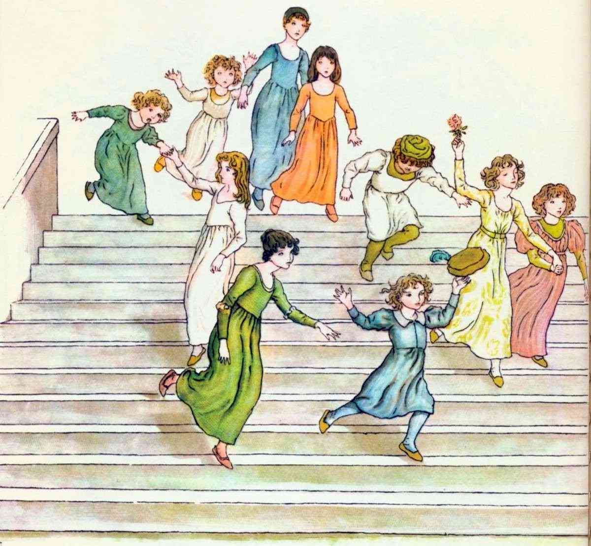

# 하멜른의 피리 부는 사나이 — 쥐를 없앤 뒤 벌어진 일

*값을 깎으려던 어른들의 말이 무서운 전설로 남았다*

Life · Folks

> 출처 대조와 공개 게시 승인을 마친 이야기입니다. 실제 게시 여부는 사이트 배포 상태를 따릅니다.

*Kate Greenaway (1846–1901), Robert Browning의 The Pied Piper of Hamelin 수록 삽화, 30쪽 · Project Gutenberg · Public Domain. 전승을 그린 그림이며 실제 실종 현장의 기록이 아닙니다.*

[이미지 출처·제작 근거](https://raw.githubusercontent.com/GITenberg/The-Pied-Piper-of-Hamelin_18343/master/18343-h/images/img30.jpg) · Public Domain

쥐가 사라졌으니 이제 수고비를 덜 주어도 되지 않을까. 하멜른의 어른들이 이런 계산을 시작했을 때, 피리 부는 사나이의 이야기는 전혀 다른 방향으로 움직인다. 처음에는 유쾌한 소동처럼 보이지만 끝까지 웃으며 읽기는 어려운 전설이다.

이 글은 로버트 브라우닝의 시 「하멜른의 피리 부는 사나이」를 기준으로 줄거리와 결말을 소개한다. 케이트 그리너웨이의 옛 삽화도 함께 실었다. 여러 지역의 전승을 하나의 실제 사건 기록처럼 합치지는 않는다.

## 01. 도시를 점령한 작은 주민들

시의 첫머리에서 쥐는 구석에 얌전히 숨은 동물이 아니다. 음식을 먹어 치우고 집 안을 헤집으며 사람들의 생활을 뒤집어 놓는다. 주민들은 더는 견딜 수 없다고 시청으로 몰려간다. 시장과 시의원들에게는 도시를 다스리는 능력을 증명해야 하는 순간이다.

쥐의 소동은 과장되고 우스꽝스럽게 그려진다. 덕분에 독자는 곧장 이야기 안으로 들어간다. 동시에 중요한 대비도 만들어진다. 작은 쥐 하나 제대로 다루지 못하는 권력자들이 나중에는 낯선 해결사를 얕잡아 보게 되기 때문이다. 큰소리와 실력이 처음부터 어긋나 있다.

## 02. 빨강과 노랑 옷을 입은 손님

그때 눈에 띄는 옷차림의 사나이가 나타난다. 그가 내세우는 도구는 덫이나 독약이 아니라 피리다. 자신의 음악으로 골칫거리를 없애 주겠다며 천 길더의 보수를 요구한다. 시장과 의원들은 문제가 해결된다면 훨씬 더 큰돈도 아깝지 않다는 듯 흥분한다.

여기서 액수를 헷갈리면 이야기의 중심도 흐려진다. 시에는 오만 길더라는 외침도 나오지만, 피리 부는 사나이가 뒤에 요구하는 약속의 보수는 천 길더다. 어른들의 호들갑스러운 말과 실제로 지켜야 할 약속을 나누어 읽으면 풍자가 더 선명해진다.

## 03. 음악을 따라간 쥐들

피리가 울리자 도시 곳곳의 쥐들이 밖으로 나온다. 크기도 모양도 다른 쥐들이 줄을 이루어 사나이를 따라가고, 마침내 베저강으로 들어간다. 시는 쥐들이 그 음악에서 기막힌 음식의 유혹을 들은 것처럼 묘사한다. 사람에게 들리는 선율과 쥐가 상상한 잔치가 겹친다.

작가는 단순히 쥐가 없어졌다고 보고하지 않는다. 분주한 움직임과 쏟아지는 소리를 늘어놓아 장면을 눈앞에 만든다. 운문으로 쓰인 이유도 여기에 있다. 뜻만 전달하는 문장이 아니라 입으로 읽을 때의 리듬 자체가 피리 뒤를 따라가는 행렬처럼 작동한다.

## 04. 일이 끝나자 달라진 계산

이제 도시는 기뻐한다. 종을 울리고 쥐구멍을 막을 궁리를 한다. 하지만 보수를 청하러 온 사나이에게 시장이 내놓는 것은 약속한 천 길더가 아니라 오십 길더다. 이미 쥐가 죽었으니 예전의 위협은 돌아오지 못할 것이라는 생각도 그 말 뒤에 깔려 있다.

이 장면은 무서운 괴물보다 익숙한 사람의 태도로 불편해진다. 도움이 절실할 때는 무슨 약속이든 하고, 해결된 뒤에는 상대가 내미는 청구서를 부담스러워한다. 사나이가 낯선 떠돌이라는 점도 만만하게 여기는 이유가 된다. 힘이 없어 보이는 사람에게 계약을 지킬 필요가 있느냐는 오만이다.

## 05. 두 번째 피리에는 아이들이 모인다

사나이는 다시 피리를 분다. 이번에 집에서 뛰어나오는 것은 쥐가 아니라 아이들이다. 아이들은 즐겁게 그를 따라 도시를 떠난다. 어른들은 막지 못한다. 산에 이르자 길이 열리고, 행렬이 안으로 들어간 뒤 다시 닫힌다. 첫 행렬을 보고 웃던 독자는 같은 음악의 구조 앞에서 멈칫하게 된다.

쥐가 사라질 때 어른들이 좋아했던 힘이 이제 자신들의 가장 소중한 존재를 데려간다. 하지만 아이들은 계약을 어긴 당사자가 아니다. 그래서 이 장면을 약속을 안 지키면 벌을 받는다는 깔끔한 교훈으로만 마무리할 수 없다. 어른의 잘못을 아이가 감당하는 결말은 부당하고 잔혹하다.

## 06. 뒤에 남은 소년이 들려주는 말

브라우닝의 시에는 다리가 불편해 행렬을 따라가지 못한 소년이 남는다. 그는 다른 아이들을 단순히 구출해야 할 대상이라고 설명하지 않는다. 음악이 약속한 아름다운 세계, 자신의 불편함도 사라질 듯했던 장소를 그리워한다. 독자는 그의 생존을 기뻐하면서도 그 외로움을 듣게 된다.

이 대목에서 이야기는 더욱 복잡해진다. 아이들이 어디로 갔는지는 확실히 보여 주지 않는데, 남은 소년의 마음에는 잃어버린 낙원이 생긴다. 다른 판본의 눈먼 아이나 귀가 들리지 않는 아이를 덧붙일 필요도 없다. 한 사람의 목소리만으로 이미 충분히 쓸쓸하다.

## 07. 전설은 결산서가 아니다

이 시에 등장하는 날짜나 도시의 흔적을 곧바로 실종 사건의 증거로 삼기는 어렵다. 브라우닝의 작품은 오랜 하멜른 전승을 문학으로 다시 들려준 이야기다. 옛 시에 숫자가 적혀 있다는 이유만으로 당시의 행정 기록과 같은 자리에 둘 수는 없다.

다 읽은 뒤 남는 것은 피리의 정체보다 시장의 말이다. 일이 끝난 사람에게도 약속은 유효한가. 낯선 사람에게도 같은 기준을 적용하는가. 하멜른의 전설은 그 질문을 재미있게 시작해 무섭게 끝낸다. 도시가 아끼려 했던 돈보다 훨씬 큰 빈자리를 남긴 채로.

## 이야기의 바탕이 된 자료

- [Robert Browning, The Pied Piper of Hamelin — Kate Greenaway 삽화 수록판](https://raw.githubusercontent.com/GITenberg/The-Pied-Piper-of-Hamelin_18343/master/18343-8.txt) · 확인일 2026-11-01
  - 확인 내용: 쥐의 재앙·천 길더 요구와 오만 길더 외침·베저강·오십 길더 제안 / 아이들의 행렬과 산의 입구·다리가 불편해 남은 소년·시 속 날짜는 실증된 사건 연대로 쓰지 않음

---

[같은 소주제의 이야기](README.md) · [전체 서가](../../README.md)
