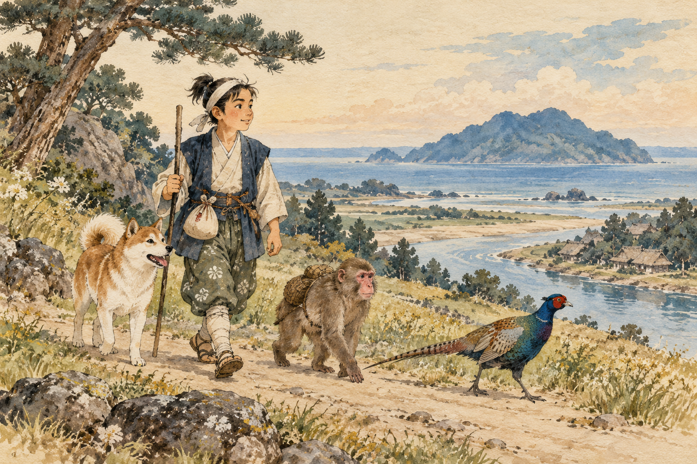

# 모모타로 — 복숭아에서 나온 소년에게 동료가 필요했던 이유

*개와 원숭이와 꿩, 먹을 것을 나누며 시작된 모험*

Life · Folks

> 자료 대조를 마친 검토용 이야기입니다. 공개 게시 승인은 아직 받지 않았습니다.

*AI 이야기 장면 삽화 · 본문의 분위기를 돕는 해석적 그림이며 실제 장소·유물의 사진이나 정확한 역사 복원이 아닙니다.*

큰 복숭아를 갈랐더니 아이가 나온다. 여기까지만 들어도 보통의 출생 이야기는 아니다. 일본의 옛이야기 모모타로는 강에서 건진 복숭아와 아이를 바라던 노부부에게서 시작한다. 훗날 모험을 떠나는 소년의 이름도 이 복숭아와 이어진다.

우리는 흔히 도깨비를 물리친 영웅으로 그를 기억한다. 그러나 이야기의 가운데를 천천히 읽어 보면 소년 혼자 힘을 쓰는 장면만 있지는 않다. 먹을 것을 나누고, 서로 다투는 동물들을 이끌고, 다른 능력을 가진 동료와 함께 움직이는 과정이 있다. 주요 줄거리와 결말을 함께 살펴본다.

## 01. 강에서 건진 선물

오자키 예이 데오도라의 영어 재서술에서는 할머니가 강에서 빨래를 하다가 커다란 복숭아를 발견한다. 집에 돌아온 노부부가 그 복숭아를 대하자 아이가 나타난다. 아이는 외로웠던 두 사람에게 아들로 왔다고 말하고, 모모타로라는 이름을 얻는다.

현실의 출생 기록이 아니라 민담의 시작이다. 돌볼 아이가 없던 노부부의 바람이 뜻밖의 선물로 응답받는 장면으로 읽을 수 있다. 다른 전승의 세부가 이 판본과 늘 같지는 않다. 하나의 이야기에는 여러 입구가 있을 수 있다는 사실을 처음부터 기억해 두면 좋다.

## 02. 자란다는 것은 집 밖으로 나갈 때를 맞는 일

모모타로는 힘과 용기를 갖춘 소년으로 자란다. 그리고 사람들을 괴롭히는 도깨비들의 섬으로 가겠다고 말한다. 자신을 키워 준 노부부에게 감사하면서도 안전한 집을 떠나는 선택이다. 민담은 소년이 힘을 얻었다는 설명에서 그 힘을 어디에 사용할지로 넘어간다.

그를 보내는 사람들은 먹을 것을 마련해 준다. 널리 알려진 전승에서는 기비당고가 유명하지만, 여기서 참고한 영어 판본은 길에서 나눌 떡과 과자를 중심으로 서술한다. 서로 다른 판본의 표현을 한 문장에 모아 유일한 정답처럼 만들지는 않는 편이 좋다.

## 03. 먹을 것을 나누자 길동무가 생긴다

길에서 소년은 개와 원숭이, 꿩을 차례로 만난다. 먹을 것을 나누는 장면과 동행의 약속이 연결된다. 배낭 속 음식은 허기를 달래는 준비물이면서 관계를 만드는 계기도 된다. 큰 모험을 시작한 뒤에도 아주 일상적인 필요가 사라지지 않는다.

음식 하나로 친구를 산다는 교훈으로 줄일 필요는 없다. 이 장면의 재미는 전혀 다른 존재들이 같은 길을 가기 시작한다는 데 있다. 처음부터 친밀했던 팀이 아니라, 만남과 대화를 거쳐 함께 움직이게 된 팀이다. 영웅의 힘 옆에 관계를 만드는 능력이 놓인다.

## 04. 함께 간다고 처음부터 사이좋지는 않다

참고 판본에서는 동물들 사이의 다툼과 견제도 나온다. 개는 새 동료를 반기기만 하지 않고, 소년은 그 갈등을 조정해야 한다. 동료가 늘어난다는 것은 힘이 늘어나는 일이면서 서로 다른 성격을 감당하는 일이기도 하다.

이 대목 덕분에 이야기는 단순한 동물 명단보다 살아 있게 느껴진다. 협력은 아무 문제도 없는 사람끼리 모이는 것만을 뜻하지 않는다. 같은 목적을 향해 갈 때 무엇을 멈추고 어떤 약속을 지킬지 정하는 과정이 필요하다. 옛이야기의 익숙한 행렬에도 작은 긴장이 들어 있다.

## 05. 섬에서는 서로 다른 능력이 쓰인다

도깨비의 섬에 도착하면 동물들은 각자의 방식으로 모험에 참여한다. 날 수 있는 새와 땅에서 움직이는 동물은 같은 일을 하지 않는다. 소년의 용감함만으로 설명되지 않는 협력의 장면이다. 함께 간 동료들이 이야기의 장식이 아닌 이유가 드러난다.

다만 폭력을 신나는 승리로만 읽지 않을 여지도 있다. 이 판본은 도깨비들을 사람을 괴롭히고 재물을 빼앗은 존재로 제시한다. 우리는 그 서사의 장치를 이해하면서도, 현실에서 낯선 집단을 도깨비처럼 부르는 태도까지 받아들일 필요는 없다. 민담의 적과 실제 사람은 다르다.

## 06. 신기한 출생만큼 중요한 양육의 시간

복숭아에서 아이가 나오는 순간은 아주 짧지만 그를 키우는 노부부의 시간은 길다. 참고 판본에서 모모타로는 성장한 뒤 자신을 돌봐 준 이들에게 감사를 말한다. 태어날 때부터 특별한 존재였다는 사실과 누군가의 돌봄 속에서 자랐다는 사실은 서로 모순되지 않는다. 민담은 기적 뒤의 관계를 완전히 지워 버리지 않는다.

그 점을 기억하면 마지막 귀환도 달리 보인다. 떠날 때의 집은 뒤로 버린 과거가 아니라 돌아가 결과를 나눌 자리였다. 소년의 모험을 용기의 시험으로 읽으면서 동시에 돌봄에 대한 응답으로 읽을 수도 있다. 신기한 출생의 이야기가 평범한 감사의 마음과 이어지는 대목이, 이 옛이야기를 너무 멀지 않게 느끼게 한다.

## 07. 돌아온 영웅 뒤에 남은 사람들

모모타로는 승리하고 돌아온다. 참고 판본에서는 빼앗긴 사람들의 귀환과 노부부의 기쁨도 함께 서술된다. 집을 떠나기 전의 관계가 결말에서 다시 나타난다. 모험은 멀리 갔다 왔다는 사실만으로 끝나지 않고, 그 결과를 누구와 나누는지로 마무리된다.

다시 제목을 떠올려 보자. 복숭아에서 나온 소년이라는 신기한 출생이 이야기를 시작했지만, 끝까지 따라오게 하는 것은 그 혼자만의 특별함이 아니다. 길에서 만난 다른 존재들과 어떻게 한 방향으로 움직였는지가 남는다. 작은 먹을거리 하나가 긴 모험의 한가운데 있었던 셈이다.

다음에 이 이야기를 다시 듣는다면 동물의 순서와 먹을 것을 건네는 대화를 살펴보자. 익숙한 줄거리에 조금 다른 세부가 있을 수 있다. 판본마다 달라지는 작은 장면을 발견하는 것도 옛이야기를 읽는 즐거움이다.

## 이야기의 바탕이 된 자료

- [Yei Theodora Ozaki, Japanese Fairy Tales — Momotaro / Urashima Taro](https://raw.githubusercontent.com/GITenberg/Japanese-Fairy-Tales_4018/master/4018.txt) · 확인일 2026-11-01
  - 확인 내용: 모모타로의 복숭아 출생·양육·원정과 개·원숭이·꿩, 먹을 것과 동행·갈등·협력·귀환 / 우라시마의 거북 구조·바닷속 공주와 체류, 귀향과 수백 년의 시간 차이, 상자를 열고 늙어 죽는 해당 판본의 결말 / 여러 전승 가운데 오자키의 영어 재서술 판본을 기준으로 줄거리와 현대의 독해를 구분

---

[같은 소주제의 이야기](README.md) · [전체 서가](../../README.md)
