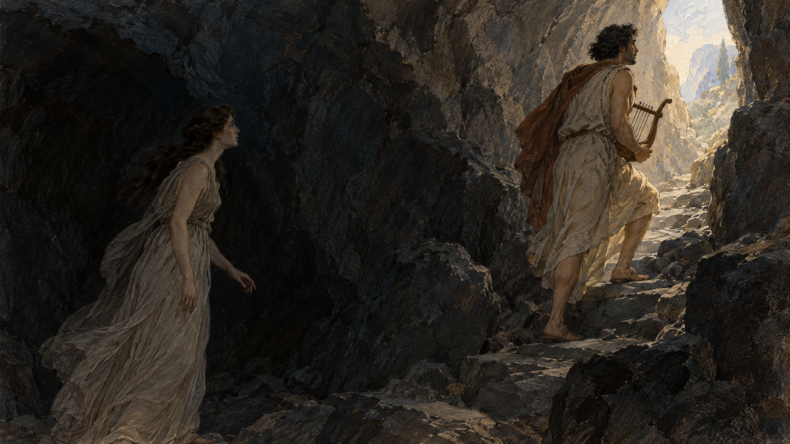

# 오르페우스는 왜 뒤를 돌아보았을까

*거의 다 왔을 때, 사랑은 가장 어려운 시험을 만났다*

Life · Folks

> 출처 대조와 공개 게시 승인을 마친 이야기입니다. 실제 게시 여부는 사이트 배포 상태를 따릅니다.

*AI 이야기 장면 삽화 · 『변신 이야기』의 귀환 장면을 떠올린 독립 삽화이며 실제 고대 미술이나 기존 명화의 복제가 아닙니다.*

지상으로 올라가는 길이었다. 앞에는 오르페우스가, 뒤에는 죽음의 세계에서 돌아오는 에우리디케가 있었다. 이제 조금만 더 걸으면 된다. 그런데 그는 바로 그 순간 뒤를 돌아본다.

그리스 신화를 대표하는 이 장면은 흔히 약속을 지키지 못한 사람의 이야기로 소개된다. 하지만 사정을 알면 그렇게 간단히 꾸짖기 어렵다. 여기서는 로마 시인 오비디우스의 『변신 이야기』 제10권에 실린 전승을 따라가 본다. 결말을 포함한다.

그 한 번의 시선 앞에서 노래의 힘과 사람의 마음이 엇갈린다.

## 행복한 출발부터 어긋난 결혼식

오르페우스는 리라를 켜며 노래하는 사람이었다. 그의 음악은 인간의 마음을 움직이는 데 그치지 않았다. 신화 속에서는 평소 움직이지 않는 존재들마저 귀를 기울인다. 그만큼 놀라운 재능을 가진 음악가에게도 막을 수 없는 일이 생겼다.

에우리디케와의 혼례에는 불길한 기운이 감돈다. 이어 그녀가 다른 요정들과 풀밭을 걷다가 뱀에게 물려 죽는다. 오래도록 함께 살아갈 줄 알았던 두 사람은 결혼한 지 얼마 되지 않아 갈라진다. 이 판본에는 다른 남자의 추격을 피해 달렸다는 사연이 나오지 않는다.

## 음악가가 찾아간 가장 먼 공연장

오르페우스는 슬픔을 노래하는 데서 멈추지 않는다. 죽은 이들이 머무는 저승으로 내려가 그곳의 지배자들 앞에 선다. 여기서 저승은 기독교의 지옥과 똑같은 공간이 아니다. 에우리디케 역시 죄를 지어 벌을 받으러 간 인물이 아니다.

그의 청은 죽음을 영원히 없애 달라는 요구가 아니다. 사랑하는 사람이 너무 일찍 떠났으니 함께할 시간을 조금 더 허락해 달라는 부탁에 가깝다. 언젠가 두 사람 모두 죽음의 세계로 돌아올 것이라는 사실까지 인정한다. 불가능한 요구를 낮은 목소리의 간청으로 바꾼 셈이다.

## 형벌도 잠시 멈추는 노래

노래가 울리자 저승의 일상에 틈이 생긴다. 끝없는 형벌에 시달리던 존재들이 잠시 하던 일을 멈추고, 무서운 복수의 여신들까지 눈물을 보인다. 한 사람의 슬픔을 듣느라 거대한 죽음의 질서가 잠깐 멈칫하는 장면이다.

실제 음악의 효능을 설명하는 대목은 물론 아니다. 시는 평소라면 결코 움직이지 않을 존재들을 차례로 멈추게 하여 그 노래의 힘을 보여준다. 무슨 선율이었는지 악보 한 줄 남기지 않고도, 독자는 얼마나 간절한 노래였을지 상상하게 된다.

## 단 하나의 조건

마침내 에우리디케를 데려가도 좋다는 허락이 내려진다. 다만 지하 세계를 완전히 벗어날 때까지 뒤를 돌아보아서는 안 된다. 오르페우스는 앞장서고, 에우리디케는 그를 따라 올라가야 한다. 잃었던 사람을 돌려받는 기쁨에 아주 작은 금지가 붙는다.

작은 조건처럼 보여도, 걸어가는 동안에는 만만치 않았을 것이다. 그는 곁에서 손을 잡고 걷는 대신 앞서 가야 한다. 아내가 정말 오는지 눈으로 확인할 수 없다. 독자에게는 쉽게 지키라고 말할 수 있는 약속이 당사자에게는 긴 기다림이 된다. 이것은 장면에서 읽어낼 수 있는 해석이지 시가 기록한 실제 심리 검사는 아니다.

## 돌아본 이유는 호기심만이 아니었다

두 사람은 어둡고 가파른 길을 오른다. 지상의 경계가 가까워졌을 때, 오르페우스는 에우리디케가 지쳤을까 걱정하고 그녀를 보고 싶은 마음을 이기지 못한다. 오비디우스의 서술은 이 순간을 단순한 장난이나 싫증으로 처리하지 않는다.

그가 고개를 돌리자 에우리디케는 다시 미끄러져 내려간다. 두 사람이 서로를 향해 팔을 뻗지만 붙잡는 것은 허공뿐이다. 그녀의 희미한 작별이 들리고, 어렵게 얻었던 귀환은 끝난다. 문턱까지 왔기 때문에 이 실패는 출발조차 하지 못한 경우보다 더 아프게 남는다.

## 두 번째 상실이 남긴 빈자리

오르페우스는 다시 저승으로 들어가려 하지만 같은 길은 열리지 않는다. 뛰어난 음악도, 앞선 성공도 되풀이를 보장해 주지 않는다. 신화는 처음에는 예술이 죽음마저 이길 수 있을 것처럼 길을 열어 놓고, 마지막에는 그 힘에도 경계가 있음을 보여준다.

에우리디케에게도 시선을 돌릴 필요가 있다. 그녀는 돌아오는 길에서 거의 말하지 못하고 다시 사라진다. 이 조용함을 아내의 잘못으로 채워 넣거나 오르페우스를 시험하려 한 행동으로 상상할 근거는 없다. 독자가 더 듣고 싶어 하는 바로 그 목소리가 비어 있어 장면은 오래 남는다.

## 사랑의 이야기인가, 기다림의 이야기인가

이 신화를 사랑 때문에 규칙을 어긴 이야기로 읽을 수도 있고, 눈앞의 확인 없이는 믿기 어려운 인간의 이야기로 읽을 수도 있다. 어떤 독자는 음악의 한계를, 다른 독자는 너무 성급한 마지막 순간을 먼저 떠올릴 것이다. 하나만 정답으로 고를 필요는 없다.

다만 실제로 누군가를 잃은 사람에게 더 참았어야 했다는 교훈을 들이밀 이야기는 아니다. 오르페우스의 노래가 붙잡으려 한 것은 누구에게나 주어질 수 없는 두 번째 시간이다. 그래서 우리는 그가 돌아볼 것을 알면서도 매번 같은 길을 따라간다. 이번만큼은 조금 더 걸어 주기를 바라면서.

## 이야기의 바탕이 된 자료

- [Ovid, Metamorphoses, Henry T. Riley 번역 — Book X, Fable I (1–85행)](https://raw.githubusercontent.com/GITenberg/The-Metamorphoses-of-Ovid-Books-VIII-XV_26073/master/26073-0.txt) · 확인일 2026-11-01
  - 확인 내용: 혼례의 불길함·뱀에 물린 에우리디케·저승에서의 청원과 노래 / 돌아보지 말라는 조건·지쳤을까 두려워하고 보고 싶어 돌아봄·두 번째 이별·재입장 거부

---

[같은 소주제의 이야기](README.md) · [전체 서가](../../README.md)
