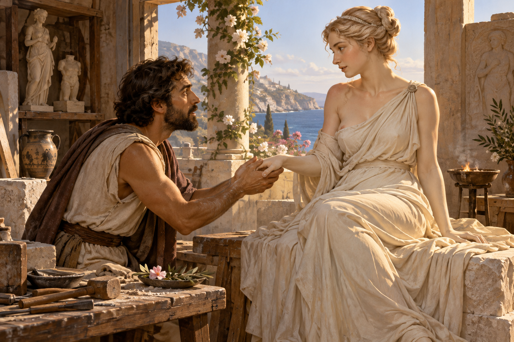

# 피그말리온 — 조각이 따뜻해진 순간

*자신이 만든 아름다움과 살아 있는 타인은 같은 것일까*

Life · Folks

> 자료 대조를 마친 검토용 이야기입니다. 공개 게시 승인은 아직 받지 않았습니다.

*AI 이야기 장면 삽화 · 상아와 생명의 경계를 떠올린 독립 삽화이며 특정 명화·조각의 복제나 실제 조각의 변화를 촬영한 자료가 아닙니다.*

## 소제목 바로가기

- [01. 사람 대신 만들기를 택한 조각가](#user-content-part-1)
- [02. 재료라는 사실을 잊고 싶어진다](#user-content-part-2)
- [03. 선물을 받지만 대답하지 않는 존재](#user-content-part-3)
- [04. 축제에서 끝까지 말하지 못한 소원](#user-content-part-4)
- [05. 상아가 밀랍처럼 부드러워진다](#user-content-part-5)
- [06. 눈을 뜬 뒤에는 다른 이야기가 시작된다](#user-content-part-6)
- [07. 갈라테이아라는 이름은 어디에 있을까](#user-content-part-7)
- [08. 기대가 생명을 만드는 실험은 아니다](#user-content-part-8)

조각가가 자신이 만든 조각을 사랑한다. 차가운 상아에 손을 대고 살아 있는 몸이기를 바란다. 그러다 어느 날 그 표면이 따뜻해진다. 피그말리온의 이야기는 예술과 생명의 경계를 건드리는 짧고도 강한 장면으로 기억된다.

여기서는 오비디우스의 『변신 이야기』 제10권에 실린 전승을 따른다. 주요 줄거리와 결말을 함께 읽되, 후대의 익숙한 이름이나 현대의 심리학 용어를 처음부터 고대 시 안에 넣지는 않는다. 사랑의 기적이라는 표현 곁에 다른 질문도 놓아 보자.

## 01. 사람 대신 만들기를 택한 조각가

피그말리온은 주변 여성들의 생활을 보고 결혼하지 않기로 한다. 시의 서술에는 여성 전체의 성향을 낮게 보는 표현이 들어 있다. 오늘의 독자가 그 평가를 그대로 받아들일 필요는 없다. 이야기의 출발이 조각가의 여성에 대한 불신과 떨어져 있지 않다는 사실은 기억할 만하다.

그는 상아를 깎아 이상적인 여인의 모습을 만든다. 실제로 만난 한 사람을 이해하기보다 자신이 원하는 모습을 재료 위에 구현한 셈이다. 신화는 그 솜씨가 대단해 마치 살아 있는 사람처럼 보였다고 말한다. 뛰어난 기술과 조각가 자신의 욕망이 같은 작업 안에 들어간다.

## 02. 재료라는 사실을 잊고 싶어진다

피그말리온은 자기가 만든 것을 바라보고 만지며 상아인지 몸인지 확인하려 한다. 차갑고 단단한 재료를 알고 있으면서도 그렇지 않기를 바란다. 예술의 힘은 여기서 단순히 눈을 속이는 데 그치지 않는다. 만든 사람 자신도 자신이 만든 세계에 들어가고 싶어 한다.

독자는 두 층을 함께 본다. 분명히 조각인데 그는 살아 있다고 상상한다. 이런 간격이 없다면 뒤의 변화도 기적처럼 느껴지지 않는다. 시는 처음부터 생명이 있었다고 말하는 대신, 재료임을 아는 마음과 생명을 바라던 마음을 오래 겹쳐 놓는다.

## 03. 선물을 받지만 대답하지 않는 존재

그는 조각에 작은 선물과 꽃, 장신구와 옷을 가져다준다. 함께 사는 사람처럼 자리를 마련하고 말을 건다. 일상적인 애정의 행동들이 이어지지만 상대의 응답은 아직 없다. 피그말리온이 그 침묵을 어떤 뜻으로 읽는지는 알 수 있어도 조각의 마음을 확인할 수는 없다.

이 장면을 아름답게 느끼면서도 질문할 수 있다. 그가 사랑하는 것은 타인일까, 자신이 바라는 타인의 모습일까. 후자는 언제나 뜻대로 보여 줄 수 있지만 전자는 다른 마음을 갖는다. 현대 독자의 이런 질문이 고대 시의 명시적인 교훈과 같다는 뜻은 아니다. 작품을 다시 읽을 때 생기는 대화다.

## 04. 축제에서 끝까지 말하지 못한 소원

비너스의 축제가 열리자 피그말리온은 제물을 바치고 아내를 청한다. 그러나 상아 조각 그 자체를 아내로 달라고 대놓고 말하지는 못한다. 그 조각과 같은 사람을 바란다고 에둘러 표현한다. 불가능해 보이는 소망을 입 밖에 내는 데에도 망설임이 있다.

비너스는 그 뜻을 이해하고 징표를 보인다. 이 장면에서 결정적인 변화를 주는 존재는 조각가 혼자가 아니다. 오랫동안 바라면 어떤 대상도 뜻대로 바뀐다는 법칙이 아니라, 신이 특별히 허락하는 신화의 사건이다. 그 차이를 두면 현대의 관계나 교육에 곧바로 적용하는 오해를 피할 수 있다.

## 05. 상아가 밀랍처럼 부드러워진다

집으로 돌아온 피그말리온은 다시 조각을 만난다. 닿은 표면이 따뜻해지고 단단한 상아는 부드러워진다. 시는 햇볕에서 부드러워져 모양을 얻는 밀랍을 떠올리게 한다. 눈으로만 생명을 확인하는 대신 온도와 감촉이 변화의 증거가 된다.

그는 놀라 다시 확인한다. 한 번의 착각으로 끝나지 않도록 같은 동작이 이어진다. 신화의 초자연적인 사건인데도 독자는 손끝에서 확인할 수 있을 듯 느낀다. 눈앞에서 멋진 여인이 나타났다는 한 문장보다 이 느린 감각의 전환이 장면을 더 오래 남긴다.

## 06. 눈을 뜬 뒤에는 다른 이야기가 시작된다

생명을 얻은 여인은 눈을 뜨고 피그말리온을 본다. 이후 비너스가 함께한 혼인과 자녀의 이야기로 이어진다. 원래 시가 들려주는 행복한 결말의 방향이다. 그러나 살아난 여인이 이후 어떤 생각으로 살아가는지 길게 들려주지는 않는다. 변신의 놀라움 뒤에 또 하나의 빈자리가 있다.

현대 독자는 그 부분을 상상할 수 있다. 이제 그녀는 조각가가 마음대로 배치하던 물건이 아니다. 생명이 생겼다면 다른 뜻과 선택도 있을 것이다. 그렇다고 시에 없는 긴 대사를 새로 만들어 원래 이야기처럼 소개할 수는 없다. 원문이 말한 것과 우리가 더 묻고 싶은 것을 나누어 두면 된다.

## 07. 갈라테이아라는 이름은 어디에 있을까

피그말리온의 여인을 갈라테이아라고 부르는 재화를 접하기 쉽다. 하지만 이 글이 읽은 오비디우스의 해당 대목에서 그녀에게 그 이름이 주어지지는 않는다. 『변신 이야기』의 다른 부분에는 같은 이름을 가진 별개의 바다 요정 이야기가 나온다. 이름이 익숙하다는 이유로 서로 합치지 않는 편이 좋다.

신화는 후대의 희곡과 그림, 새로운 이야기에서 계속 달라진다. 달라진 판본을 즐기는 것과 고대 시에 원래 그 내용이 있었다고 말하는 것은 다르다. 어느 전승을 따라가는지 밝히면 이야기가 가난해지는 대신 변화해 온 길이 더 잘 보인다. 제목 아래의 짧은 출처가 중요한 이유다.

## 08. 기대가 생명을 만드는 실험은 아니다

오늘날 피그말리온이라는 이름은 기대와 성취를 이야기할 때에도 쓰인다. 그러나 그런 현대의 용어와 고대 조각의 기적은 같은 근거를 가진 설명이 아니다. 심리학의 주장을 이해하려면 별도의 연구와 조건을 확인해야 한다. 신화 한 편을 사람을 바꾸는 기술의 증거로 삼을 수는 없다.

이 이야기를 읽는 재미는 오히려 확답을 잠깐 미루는 데 있다. 예술은 얼마나 살아 있는 것처럼 보일 수 있을까. 살아 있는 사람은 내가 만든 이상과 얼마나 다를까. 차가운 상아가 따뜻해지는 한순간은 아름답다. 그다음에도 상대를 조각처럼 다루어도 되는지 묻는 순간, 오래된 신화는 오늘의 독자와 다시 이야기를 시작한다.

## 이야기의 바탕이 된 자료

- [Ovid, Metamorphoses — Books VIII & X, Henry T. Riley 번역](https://raw.githubusercontent.com/GITenberg/The-Metamorphoses-of-Ovid-Books-VIII-XV_26073/master/26073-0.txt) · 확인일 2026-11-01
  - 확인 내용: VIII의 다이달로스/이카로스: 실·밀랍·너무 낮음/높음의 위험·추락·조카 Perdix의 재능/질투/새 변신 / X의 피그말리온: 여성 불신·상아·선물·축제의 간접 청원·감촉과 온기·혼인/후대. 해당 여인에게 Galatea 이름을 주지 않음

---

[같은 소주제의 이야기](README.md) · [전체 서가](../../README.md)
