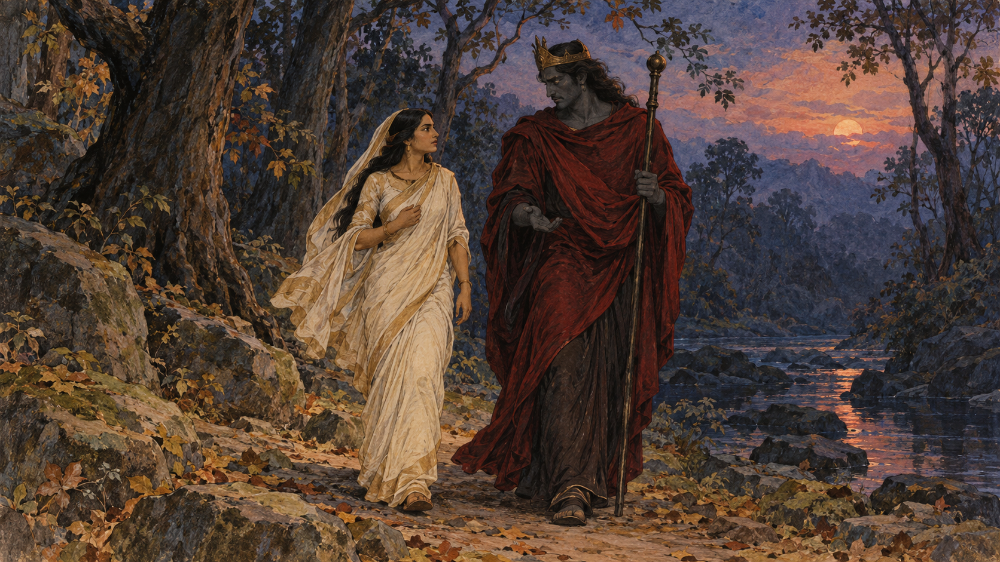

# 사비트리 — 죽음의 신을 따라 걸으며 나눈 말

*토루 더트의 시에서 읽는 선택과 예언, 끝나지 않는 대화*

Life · Folks

> 출처 대조와 공개 게시 승인을 마친 이야기입니다. 실제 게시 여부는 사이트 배포 상태를 따릅니다.

*AI 전승 장면 삽화 · 토루 더트의 시를 떠올린 독립 삽화이며 특정 종교 성화·실제 의상·인물의 초상을 복제한 자료가 아닙니다.*

죽음의 신이 사랑하는 사람의 영혼을 데리고 떠난다. 사비트리는 그 뒤를 따른다. 돌아가라는 말을 들어도 걷기를 멈추지 않고 대화를 이어 간다. 큰 무기로 신을 공격하는 대신 말과 동행으로 이야기를 움직이는 인물이다.

사비트리와 사티아반은 인도의 서사 전통에 전하는 인물들이다. 이 글은 토루 더트가 영어 시로 다시 쓴 「사비트리」를 따른다. 널리 알려진 다른 재화본과 소원의 순서나 마지막 대화가 다를 수 있다.

## 1. 사비트리가 스스로 고른 사람

사비트리는 사티아반을 만나 마음을 정한다. 그는 왕가의 아들이지만 아버지가 왕국과 시력을 잃은 뒤 숲에서 살고 있다. 사비트리의 선택은 화려한 궁전과 부를 고르는 일과는 거리가 있었다.

그의 아버지와 현자는 사티아반의 훌륭함을 인정한다. 문제는 품성이나 가문이 아니다. 현자가 밝힌 예언에 따르면 사티아반은 그날로부터 한 해 뒤에 죽을 운명이었다. 축복할 만한 만남이 두려운 선택으로 바뀐다.

## 2. 알고도 바꾸지 않은 선택

아버지는 다른 사람을 고르라고 설득한다. 그러나 사비트리는 이미 마음을 주었고 그 선택을 되돌릴 수 없다고 말한다. 누군가 대신 정한 결혼을 순순히 따르는 인물로만 보면 이 시작을 놓친다.

물론 그 시대의 혼인과 의무에 관한 생각이 시의 말 속에 들어 있다. 오늘의 모든 사람에게 같은 결정을 요구할 필요는 없다. 여기서는 한 인물이 불행을 미리 알게 된 뒤 자기 선택을 어떻게 살아가는지가 이야기의 중심이다.

## 3. 숲에서 보낸 시간의 무게

결혼 뒤 사비트리는 남편과 그 가족이 사는 곳으로 간다. 궁전에서의 생활과 달리 숲의 일상을 살아간다. 사티아반에게 다가올 날을 알고 있는 사람의 시간은 다른 이들의 시간과 같지 않다.

그녀는 예정된 날을 기억하며 준비한다. 이야기의 긴장은 큰 사건이 아직 일어나지 않은 때부터 생긴다. 독자는 한 해의 끝을 알고 있으므로 평범한 동행과 대화도 다르게 읽게 된다. 남은 날의 길이가 장면마다 함께 들어 있다.

## 4. 나무 아래에서 찾아온 죽음

그날 사비트리는 남편을 따라 숲으로 간다. 사티아반은 일하다 고통을 느끼고 그녀 곁에 쓰러진다. 예언을 말로 들을 때와 눈앞의 몸이 움직이지 않을 때의 거리는 크다. 그녀는 곁을 떠나지 않는다.

야마가 나타나 사티아반의 영혼을 데려간다. 시는 인간의 눈에 잡히기 어려운 이별을 구체적인 만남과 길로 그린다. 사비트리는 남겨진 몸 옆에만 머무르지 않고 떠나는 신을 따라 발을 옮긴다.

## 5. 거절을 들으며 이어 간 말

야마는 돌아가라고 한다. 사비트리는 함께한 관계와 약속, 선함에 관해 말한다. 그녀는 신을 단순히 나쁜 적으로만 부르지 않고 그의 권한과 성격에 호소한다. 대화가 계속될 수 있는 언어를 찾는 것이다.

야마는 그 말에 마음이 움직여 소원을 들어주겠다고 한다. 그러나 처음에는 사티아반의 생명을 돌려 달라는 요구를 제외한다. 답을 얻을 기회가 생겼어도 가장 원하는 것을 곧바로 말할 수는 없었다.

## 6. 자신만을 위한 소원이 아니었다

사비트리는 시아버지가 시력을 되찾고 왕국으로 돌아갈 수 있게 해달라고 한다. 뒤에는 자기 아버지에게 자손이 생기기를 청한다. 자기 앞의 고통 속에서도 두 가족의 미래를 이야기하는 소원들이다.

야마는 소원을 들어주며 다시 돌아가라고 하지만 대화는 끝나지 않는다. 신이 허락할 수 있는 것의 범위가 조금씩 달라진다. 같은 길을 계속 걷는 동안 권위를 가진 존재와 부탁하는 사람의 관계도 바뀐다.

## 7. 이 시의 마지막 청원

토루 더트의 시에서 야마는 마지막에 다시 소원을 청하라고 하면서 앞선 제외 조건을 붙이지 않는다. 사비트리는 그 틈에서 사티아반이 살아나고 자신들에게 자녀가 생기기를 청한다. 야마는 그 말을 받아들인다.

다른 유명한 판본의 논리 문제처럼 소원들을 맞추어 쓰지 않았다. 이 시는 선한 말과 동행, 자비가 이어지는 흐름을 강조한다. 같은 인물이 나와도 작가와 판본에 따라 마지막 문을 여는 방식이 달라질 수 있다.

## 8. 돌아온 뒤에도 걸을 길이 남았다

사티아반이 깨어나자 부부는 어두운 숲길을 지나 가족에게 돌아가야 한다. 사비트리는 힘을 되찾는 남편을 부축한다. 죽음의 신과 마주하던 큰 장면 뒤에 다시 사람의 몸과 밤길이 나타난다.

그녀는 남편의 두려움과 혼란을 달래며 함께 걷는다. 이야기의 귀환은 신에게 허락받는 순간에만 있지 않다. 돌아온 사람과 실제로 집까지 가는 시간이 있다. 시의 다정함은 이런 작은 행동에서도 드러난다.

## 9. 설득하는 사람의 이야기로 읽기

사비트리를 오직 희생하는 아내의 모범으로만 읽으면 스스로 고르고 질문하고 말하는 인물이 흐려진다. 죽음을 되돌리지 못한 사람의 사랑이 부족하다는 교훈으로 삼을 수도 없다. 현실의 상실을 평가하는 기준은 아니다.

이 이야기에서 오래 남는 것은 길 위의 대화다. 사비트리는 거절을 듣고도 상대가 알아들을 말로 관계를 이어 간다. 운명을 만나는 인물이 반드시 칼을 들어야 하는 것은 아니라는 상상, 말과 끈기가 서사를 움직이는 장면을 읽어도 좋다.

## 이야기의 바탕이 된 자료

- [Toru Dutt, Ancient Ballads and Legends of Hindustan — Savitri (1885년 수록판)](https://raw.githubusercontent.com/GITenberg/Ancient-Ballads-and-Legends-of-Hindustan_23245/master/23245-8.txt) · 확인일 2026-10-31
  - 확인 내용: 사비트리의 선택·사티아반의 1년 뒤 죽음 예언·숲 생활과 마지막 날 / 야마를 따라 걷는 대화·시아버지의 시력과 왕국·자기 아버지의 자손 / 마지막에 제외 조건 없이 주어진 소원·생환과 귀가. 다른 판본의 소원 순서/논리 함정을 혼합하지 않음

---

[같은 소주제의 이야기](README.md) · [전체 서가](../../README.md)
