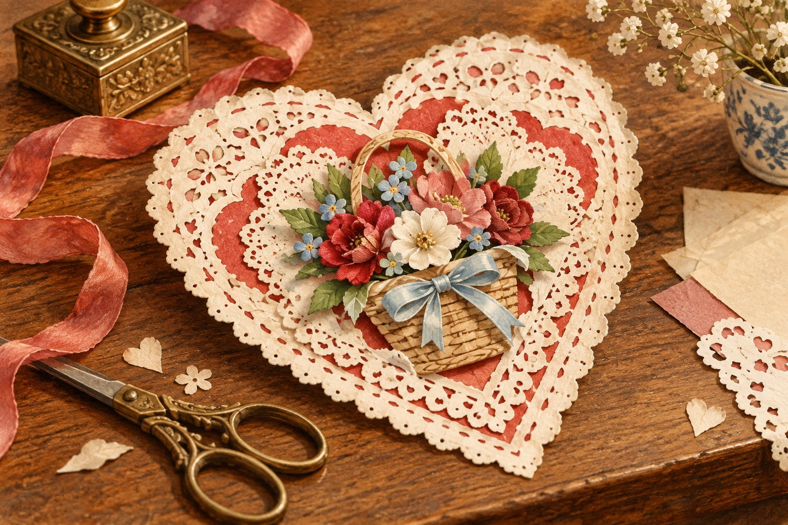

# 옛 연애편지에는 종이로 만든 레이스가 있었다

*미국의 카드 제작자가 꾸민 작은 꽃바구니*

Life · Folks

> 출처 대조와 공개 게시 승인을 마친 이야기입니다. 실제 게시 여부는 사이트 배포 상태를 따릅니다.

*KnowledgeWalk 제작 · AI 설명용 삽화. 실제 유물·작품·건축물·전시 배치를 재현한 사진이나 역사적 증거가 아닙니다.*

축하 카드 한 장을 열었는데 종이꽃과 천 조각이 층층이 붙어 있다면 어떨까. 편지를 읽기 전에 먼저 작은 공예품을 펼쳐 보는 느낌일 것이다. 19세기 밸런타인 카드 중에는 실제로 그런 물건들이 있었다.

시카고 미술관은 빅토리아 시대의 밸런타인 카드를 2천 점 넘게 소장한 컬렉션을 소개한다. 인쇄된 한 줄만 있는 카드가 아니라 종이 레이스와 천, 인조 꽃을 더한 카드들이 함께 있다.

## 1. 마음은 글자 밖에도 놓인다

당시의 카드는 형태가 다양했다. 익살스러운 주제를 인쇄한 값싼 카드도 있었고, 여러 재료를 붙여 입체적으로 만든 카드도 있었다고 한다. 누구나 같은 모양으로 마음을 전했던 것은 아니다.

종이를 오려 만든 레이스는 빈 공간까지 장식이 된다. 꽃을 평면에 그리는 대신 종이와 천으로 만들어 붙이면 카드의 표면에도 높낮이가 생긴다. 받는 사람은 문장만 읽는 것이 아니라 겹친 재료를 함께 보게 된다.

## 2. 매사추세츠의 꽃바구니

미술관의 설명은 미국 매사추세츠주 우스터에서 일한 카드 제작자 에스터 하울랜드를 소개한다. 그는 1849년에 자신의 회사를 열었고 여성들을 고용했다고 한다.

특히 인기를 끈 것은 메이 바스켓이라는 꽃바구니 형태의 카드였다. 종이 레이스 가운데 커다란 오려 낸 바구니를 두고, 안에는 종이와 천으로 만든 꽃들을 빽빽하게 모았다. 미술관은 이런 카드 두 점을 소장하고 있다고 설명한다.

## 3. 빈 부분도 장식을 만드는 재료다

종이 레이스는 선을 남기는 것만 아니라 사이를 오려 비우면서 무늬를 만든다. 밝은 면을 채운 그림과 달리 빈곳 너머로 다른 재료가 보일 수 있다. 그래서 여러 층이 겹치면 작은 그림자와 높낮이가 생긴다. 카드는 손에 들고 읽는 문장이면서 공간을 가진 공예품이 된다.

이런 표면을 사진으로 볼 때에는 꽃부터 찾은 뒤 가장자리를 따라가 보자. 무엇을 인쇄했고 무엇을 잘라 붙였는지 구별할 수 있다면 제작 과정이 조금 더 구체적으로 느껴진다. 다만 사진만으로 모든 접착 순서와 작업 시간을 확정하지는 않는다. 완성된 형태에서 남은 층의 관계를 살피는 것이 먼저다.

## 4. 공장에서 만든 것과 손으로 만든 것의 사이

여러 재료를 붙여 판매한 카드는 완전히 개인적인 편지와 기성 상품의 경계에 놓인다. 같은 모양을 여러 사람이 구입할 수 있어도 받은 사람은 그것을 자기에게 온 물건으로 읽는다. 상품으로 제작하는 과정과 관계 안에서 사용하는 경험이 겹친다. 마음을 전하는 일에 물건을 만드는 산업이 참여한 것이다.

하울랜드가 회사를 세우고 여성을 고용했다는 설명도 이 관점에서 볼 수 있다. 한 사람이 집에서 우연히 만든 카드만의 이야기가 아니라 조직해서 여러 장을 제작한 역사다. 다만 이 정보만으로 고용한 모든 여성의 경험이나 근무 조건을 미화할 수는 없다. 확인된 사업의 형태와 아직 알아보아야 할 노동의 역사를 나누어 읽는다.

## 5. 메이 바스켓은 문장을 담을 작은 무대다

종이 레이스 가운데 커다란 바구니 모양을 놓고 그 안에 꽃을 채운 구성은 표면을 단순한 글의 배경으로 두지 않는다. 꽃을 바치는 몸짓과 읽을 문장이 같은 카드 안에 있다. 실제 꽃다발을 그대로 보낸 것은 아니지만 종이와 천이 그 풍경을 떠올리게 한다. 재료가 다른 선물의 형상을 만드는 셈이다.

미술관이 이런 카드 두 점을 소장한다는 사실도 흥미롭다. 처음에는 개인에게 보내기 위한 상품이었지만 나중에는 당시의 제작과 취향을 보여 주는 자료가 된다. 사적인 기억과 공적인 수집이 물건의 서로 다른 시간을 만든다. 특정 수신자의 이야기가 확인되지 않아도 형태와 재료에서 읽을 부분은 남아 있다.

## 6. 빅토리아 시대라는 말과 제작 장소

빅토리아 시대라는 이름을 들었다고 여기의 모든 카드가 영국에서 만들어졌다고 생각해서는 안 된다. 하울랜드의 사례는 미국 매사추세츠주 우스터의 사업을 이야기한다. 시대를 부르는 이름과 개별 물건의 제작지는 구분해서 확인할 정보다. 비슷한 취향이 여러 지역을 오갈 수 있다는 관점도 생긴다.

따라서 한 종류의 카드가 그 시대의 모든 사랑 표현을 대표한다고 외우기보다 서로 다른 형식 중 한 사례로 보아도 좋다. 익살스러운 인쇄 카드와 정교한 입체 카드가 함께 있었다는 설명이 다양함을 알려 준다. 종이 레이스의 작은 틈에서 개인의 말과 상품, 장인의 손과 시대의 취향이 서로 만난다.

## 7. 짧은 문장을 감싸는 긴 손길

지금은 그림과 문구를 골라 전송하면 몇 초 안에 마음을 전할 수 있다. 이런 카드는 그 주변을 만드는 데에도 손이 많이 갔을 것이다. 말 대신 어떤 재료를 고르고 어떻게 겹쳤는지가 인사에 더해진다.

옛 카드를 모두 거창한 사랑의 증거로 읽을 필요는 없다. 오늘은 종이 레이스와 꽃바구니만 떠올려 보자. 한 장의 종이를 더 예쁘게 꾸며 누군가에게 건네고 싶었던 마음은 지금의 카드 고르기와도 크게 멀지 않다.

## 이야기의 바탕이 된 자료

- [시카고 미술관 — This Valentine’s Day, Will You Be Mine?](https://raw.githubusercontent.com/art-institute-of-chicago/api-data/main/json/articles/43.json) · 확인일 2026-10-28
  - 확인 내용: 2천 점 넘는 빅토리아 시대 카드 컬렉션에 관한 기관 소개 / 종이 레이스·천·꽃과 인쇄·입체 카드 종류 / 1849년 우스터의 에스터 하울랜드 회사와 여성 고용 / 메이 바스켓 구성과 두 점 소장

---

[같은 소주제의 이야기](README.md) · [전체 서가](../../README.md)
