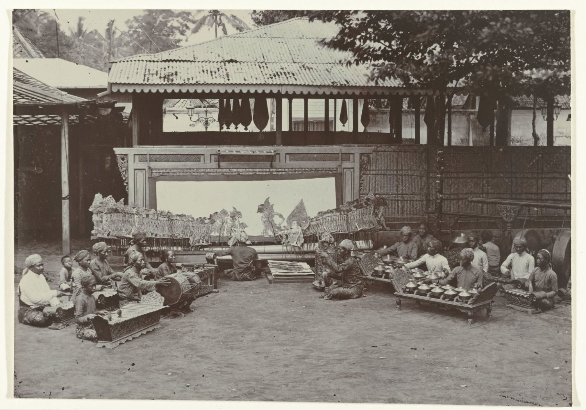

# 가죽 인형은 어떻게 무대 위 그림자가 될까

*인도네시아 와양 쿨릿의 가죽 인형과 천, 달랑의 목소리와 가믈란이 한 무대를 만드는 과정을 살펴봅니다.*

Life · Folks

> 출처 대조와 공개 게시 승인을 마친 이야기입니다. 실제 게시 여부는 사이트 배포 상태를 따릅니다.

*역사 사진 · 욕야카르타 궁정의 와양 쿨릿 공연과 가믈란 연주자들, 1890~1900년. Kassian Céphas 촬영. 암스테르담 국립미술관 소장 RP-F-2001-17-70.*

[이미지 출처·제작 근거](https://www.rijksmuseum.nl/en/collection/object/A-Gamelan-Orchestra-for-a-Shadow-Puppet-Performance--682d6521b5db29400f8b30f4f6fc961a) · Public Domain

손을 벽 가까이 가져가면 그림자 끝이 또렷해진다. 손가락 하나만 굽혀도 벽에 나타난 모양이 달라진다. 인도네시아 자바에서 시작된 와양 전통 가운데 와양 쿨릿은 이처럼 빛 앞에서 모양이 달라지는 성질로 이야기를 들려주는 인형극이다. 손 대신 가죽 인형을 세우고, 벽 대신 천을 펼친다. 그리고 관객이 그림자를 보는 동안 천 건너편에서는 한 사람이 여러 인물의 팔과 목소리를 번갈아 움직인다. 그 한 장면을 만드는 데 어떤 일들이 필요한지 인형부터 살펴보자.

## 01. 종이처럼 납작한 배우

와양은 인형극 전통을 가리킨다. 유네스코는 그 가운데 나무로 만든 입체 인형과 평평한 가죽 그림자 인형을 주요 유형으로 소개한다. 와양 쿨릿은 가죽 인형을 쓰는 공연이다. 인형을 옆에서 보면 얇지만, 넓은 면에는 얼굴과 옷, 팔의 윤곽이 마련되어 있다. 유네스코가 인형의 공통 특징으로 꼽는 것도 옷차림, 얼굴 생김새, 움직일 수 있는 몸의 일부다. 인물이 서 있을 때와 행동할 때, 서로 다른 단서가 눈에 들어온다. 그림자로 인물을 보여줄 때는 그 윤곽이 특히 중요하다. 실제 배우라면 표정을 바꾸거나 자세를 틀어 기분을 드러낼 수 있다. 납작한 인형은 이미 만들어진 얼굴과 몸을 가지고 무대에 오르므로, 제작자가 새긴 모양과 공연자가 움직이는 방식이 함께 인물의 인상을 만든다.

## 02. 흰 천 위에 인물이 나타나는 순서

그림자극에 필요한 것은 빛과 인형, 그리고 빛을 받아 줄 천이다. 조명과 천 사이에 인형을 놓으면 가죽이 빛의 일부를 가리고 그 모양이 천에 드러난다. 천 너머에서 관객의 눈에 먼저 들어오는 것은 머리와 손끝이 만드는 선이다. 인형을 천에 가까이 대거나 떼면 그림자의 크기와 또렷함이 달라진다. 같은 인형도 어느 쪽을 향하게 하고 어디에 세워 두느냐에 따라 장면의 인상이 달라질 수 있다. 공연자가 손에 든 물건의 위치가 곧 관객이 보는 화면의 구도가 되는 셈이다.

## 03. 달랑의 손과 목소리

인형을 다루며 이야기를 이끄는 사람을 달랑이라고 부른다. 유네스코 자료에 따르면 달랑은 인형에 달린 가느다란 막대를 써서 관절이 있는 팔을 움직인다. 팔을 몸에서 멀리 내밀면 인물이 손을 뻗는 모습이 되고, 손끝을 조금씩 옮기면 같은 동작도 서두르거나 망설이는 듯 보일 수 있다. 달랑은 그런 몸짓을 만들면서 대사와 이야기까지 맡는다. 공연을 이끄는 능력에는 막대를 다루는 기술과 여러 인물의 말을 구별해 들려주는 기술이 함께 들어간다. 한 인물의 팔이 움직이는 짧은 순간에도 손과 목소리가 같은 장면을 만들고 있다.

## 04. 소리가 붙으면 그림자의 속도가 달라진다

와양에는 노래와 악기 연주가 함께한다. 유네스코 자료는 청동 악기와 북이 쓰인다고 소개한다. 가믈란은 인도네시아의 합주 전통으로, 와양 무대에서는 이야기와 함께 들리는 음악을 이루는 데 중요한 몫을 한다. 관객은 천 위에서 인형이 움직이는 것을 보면서 연주와 목소리를 듣는다. 가령 똑같이 팔을 들어 올리는 몸짓도 빠른 박자가 이어질 때와 소리가 잦아든 때에는 다르게 느껴질 수 있다. 그림자는 화면에 보이는 것이고, 장면이 흘러가는 속도와 분위기에는 화면 밖에서 나는 소리도 관여한다.

## 05. 먼 곳의 이야기도 자바의 무대에 올랐다

와양의 이야기는 여러 곳에서 왔다. 유네스코는 인도 서사시와 현지 신화, 페르시아 이야기에서 가져온 인물이 있다고 설명한다. 오랜 이야기가 새 무대에 오를 때 공연자는 대사와 노래를 익혀 자기 말과 몸짓으로 전한다. 익살스러운 서민 인물이 사회와 정치의 민감한 문제를 풍자하기도 했다. 오래된 이야기가 새로운 관객 앞에서 다른 말투를 얻을 수 있었던 이유를 여기서 짐작할 수 있다. 줄거리를 아는 관객에게도 인물이 어느 순간에 농담을 하고 무엇을 빗대어 말하는지는 공연을 보는 또 하나의 즐거움이 된다.

## 06. 공연과 함께 전해진 기술

자바의 궁정과 농촌에서 이어진 와양은 발리와 여러 섬으로도 퍼졌다. 롬복, 마두라, 수마트라, 보르네오 등에서는 지역에 따라 공연 방식과 반주가 달라졌다. 유네스코는 인형을 만드는 사람, 연주자, 달랑의 가족 안에서 이야기와 기술이 말과 실연으로 이어졌다고 기록한다. 같은 이야기를 물려받아도 노래와 대사, 인형을 움직이는 법이 지역마다 달라질 수 있었다. 2008년 유네스코 인류무형문화유산 대표 목록에 오른 대상도 이런 기술과 지식이 얽힌 와양 인형극 전통이다.

## 07. 소장품에서 무대를 떠올리는 법

스미스소니언의 쿠퍼 휴잇 디자인 박물관에는 19세기 인도네시아 와양 쿨릿 인형이 있다. 소장 기록에 적힌 재료는 나무와 채색하고 금으로 장식한 가죽이다. 사진을 볼 때 얼굴의 옆선과 팔이 몸에서 떨어지는 모양을 따라가 보자. 그 윤곽은 조명 뒤에서도 인물의 자세를 읽게 하는 단서다. 전시된 인형은 움직이지 않지만, 무대에서는 달랑이 막대를 움직일 때마다 그 선이 달라진다. 소장 기록의 높이와 폭은 각각 55센티미터와 57센티미터다. 손에 드는 장난감만큼 작을 것이라고 생각했다면 뜻밖의 크기다. 그 크기 그대로 보관된 인형이 빛을 받으면 천 위에서는 또 다른 크기로 관객 앞에 선다. 한 장의 사진에서 무엇이 보이는지 살피다 보면 공연에서 무엇이 더해지는지도 상상할 수 있다.

## 이야기의 바탕이 된 자료

- [유네스코 — The Wayang Puppet Theatre, 46~47쪽](https://ich.unesco.org/doc/src/00010-EN.pdf#page=47) · 확인일 2026-11-09
- [유네스코 — Wayang puppet theatre 등재 기록](https://ich.unesco.org/en/RL/wayang-puppettheatre-00063) · 확인일 2026-11-09
- [스미스소니언 소장품 검색 — Shadow puppet (wayang kulit), 1935-15-1](https://collections.si.edu/search/results.htm?q=%22Wayang%22) · 확인일 2026-11-09
- [역사 사진 · 욕야카르타 궁정의 와양 쿨릿 공연과 가믈란 연주자들, 1890~1900년. Kassian Céphas 촬영. 암스테르담 국립미술관 소장 RP-F-2001-17-70.](https://www.rijksmuseum.nl/en/collection/object/A-Gamelan-Orchestra-for-a-Shadow-Puppet-Performance--682d6521b5db29400f8b30f4f6fc961a) · 확인일 2026-11-09

---

[같은 소주제의 이야기](README.md) · [전체 서가](../../README.md)
