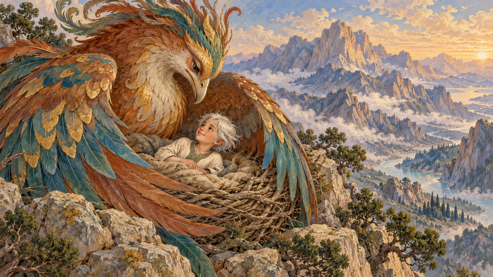

# 잘과 시무르그 — 흰 머리의 아이를 품은 거대한 새

*『샤나메』에서 읽는 버려짐과 돌봄, 돌아갈 때 받은 깃털*

Life · Folks

> 자료 대조를 마친 검토용 이야기입니다. 공개 게시 승인은 아직 받지 않았습니다.

*AI 전승 장면 삽화 · 서사 속 시무르그와 아이를 그린 독립 삽화이며 실제 새·특정 유물·고대 의상을 고증한 자료가 아닙니다.*

아이가 태어났는데 머리카락이 희다. 사람들은 그것을 불길한 징조로 보고 아버지는 두려움에 사로잡힌다. 그 아이를 산에 두고 떠났을 때, 사람 대신 거대한 새가 다가온다. 잡아먹으려는 괴물이 아니라 품어 기를 존재였다.

페르시아의 서사시 『샤나메』에 전하는 잘과 시무르그의 만남이다. 이 글은 1909년 개정판 『페르시아 문학』 선집에 실린 영문 재화를 따른다. 나중에 영웅의 아버지가 될 인물도 이 시작에서는 보호가 필요한 아이로 등장한다.

## 1. 다르다는 이유로 두려워한 아버지

전사 삼은 아들의 흰 머리를 보고 기뻐하지 못한다. 주변에서는 나쁜 일이 생길 징조라며 아이를 숨기는 편이 낫다고 말한다. 아이의 얼굴과 몸은 건강하게 그려지지만 머리색 하나가 사람들의 판단을 붙잡는다.

이것은 독자에게 그 판단이 옳다고 가르치는 설명이 아니다. 이야기 속 사람들이 무엇을 두려워했고 그 두려움이 어떤 행동으로 이어졌는지 보여 주는 시작이다. 아이의 잘못보다 어른이 받아들이지 못한 차이가 먼저 있었다.

## 2. 산에 남겨진 아이를 발견한 새

삼은 아이를 알보르즈산에 버린다. 그곳에는 시무르그가 살고 있었다. 새끼의 먹이를 찾던 거대한 새는 혼자 놓인 아이를 발견한다. 그러나 먹잇감으로 삼지 않고 자기 둥지로 데려간다.

새끼들도 아이를 받아들이고 함께 자란다. 사람의 사회에서 위험으로 여긴 존재가 다른 생명과의 관계에서는 돌봄을 얻는다. 겉모습이 무서워 보일 수 있는 큰 새와 이름난 전사 가운데 누가 보호자가 되는지 예상이 바뀐다.

## 3. 먹이는 것 이상의 보살핌

시무르그는 아이가 살아남도록 먹이기만 하지 않는다. 이 재화에서는 사람의 언어와 이해력도 길러 주었다고 한다. 사람 곁을 떠나 자랐지만 나중에 사회로 돌아가 살아갈 준비가 이루어지는 것이다.

잘에게 그 둥지는 임시로 숨은 곳을 넘어 집이 된다. 자기를 데려간 존재를 두려운 짐승으로만 보지 않는다. 훗날 떠나야 한다는 말을 들었을 때 기뻐하기만 하지 않고 울음을 터뜨리는 까닭도 여기에 있다.

## 4. 아버지의 꿈에 돌아온 질문

삼은 시간이 흐른 뒤 아이가 살아 있을지 모른다는 꿈과 해석을 듣는다. 다시 꾼 꿈에서는 아이를 버린 행동을 꾸짖는 말이 나타난다. 흰 머리가 잘못이라면 나이 들어 자기 머리가 희어진 것은 어떻게 보아야 하느냐는 질문도 있다.

처음에는 부끄러워 숨기고 싶었던 아이가 이번에는 자기 판단을 돌아보게 하는 존재가 된다. 나쁜 징조가 있으니 피한다는 계산만으로는 이 일을 설명할 수 없었다. 그가 저지른 일의 책임이 꿈을 통해 되돌아온다.

## 5. 직접 산을 오른 삼

삼은 다른 사람을 보내는 데서 그치지 않고 스스로 산을 오른다. 아이를 돌려 달라고 간청하고 자신의 행동을 뉘우친다. 그러나 아이가 이미 자랐다는 사실은 시간을 되돌릴 수 없음을 알려 준다.

그가 돌아왔다고 둥지에서 쌓인 관계가 가짜가 되는 것은 아니다. 시무르그는 잘에게 아버지가 왔고 이제 떠날 때가 되었다고 말한다. 사람의 집으로 가는 길은 다른 집과 헤어지는 길이기도 했다.

## 6. 잘은 떠나고 싶지만은 않았다

잘은 자기를 길러 준 존재와 헤어져야 한다는 말에 운다. 생물학적 아버지를 만난 기쁨 하나로 이 장면을 설명하기 어렵다. 자신을 받아들인 시간과 보살핌이 그에게 더 가까운 기억일 수 있었다.

시무르그는 떠나는 일이 버림받는 것과 같지 않다고 달랜다. 더 넓은 곳에서 살아갈 기회를 주려는 것이다. 처음 산에 놓였을 때와 이번에 산을 떠날 때는 모두 이동이지만 그 안의 뜻은 정반대다.

## 7. 헤어질 때 남긴 깃털

시무르그는 자기 깃털을 잘에게 준다. 어려움에 처하면 도움을 청할 수 있도록 남기는 표식이다. 둥지를 떠난 뒤에도 관계가 끊기는 것은 아니라는 약속이 물건 하나에 담긴다.

깃털은 앞으로의 이야기에서도 시무르그와의 연결을 떠올리게 한다. 부와 무기를 주는 선물과 다르게 누군가 응답해 줄 수 있다는 보증이다. 실제 새의 깃털에 그런 힘이 있다는 생활의 요령이 아니라 서사 속 약속의 물건이다.

## 8. 인간의 집에서 이어진 삶

잘은 아버지와 함께 사람들의 세계로 들어가 교육을 받고 역할을 맡게 된다. 뒤에는 루다베와의 관계와 영웅 로스탐의 탄생으로 이어지는 긴 이야기가 있다. 산에서의 시절은 그 뒤 삶의 출발점으로 남는다.

그러나 나중에 중요한 사람이 되었으니 버려서는 안 되었다는 식으로만 읽으면 곤란하다. 아이를 돌볼 이유를 미래의 공로에서만 찾게 되기 때문이다. 시무르그가 처음 받아들인 것은 아직 아무 업적도 없는 아이였다.

## 9. 누가 가족이 되어 주었을까

잘의 이야기는 인간 사회의 편견과 다른 존재의 돌봄을 나란히 놓는다. 유명한 전사가 보호하지 못한 자리를 거대한 새가 채운다. 어느 쪽이 문명이고 야생인지 쉽게 구분하던 눈이 잠깐 멈춘다.

깃털을 다시 떠올리면 그 다정한 역전이 보인다. 품어 준 존재는 자기 곁에만 남으라고 붙잡지 않고 떠난 뒤에도 돌아볼 길을 남긴다. 잘의 흰 머리보다 오래 생각하게 되는 것은 누가 그 아이의 집이 되어 주었느냐는 질문이다.

## 이야기의 바탕이 된 자료

- [Persian Literature, revised edition Vol. 1 (1909) — Shah Nameh: Zal / The Dream of Sam](https://raw.githubusercontent.com/GITenberg/The-Persian-Literature-Comprising-The-Shah-Nameh-The-Rubaiyat-The-Divan-and-The-Gulistan-Volu__10315/master/10315-8.txt) · 확인일 2026-10-31
  - 확인 내용: 흰 머리 아이에 대한 아버지와 주변의 두려움·알보르즈산 유기 / 시무르그와 새끼들의 돌봄·말과 이해력의 교육·아버지를 꾸짖는 꿈 / 아버지의 직접 수색·이별의 슬픔과 깃털의 약속·인간 사회로 돌아감. 원 페르시아어 운문과 영어 발췌/재화를 구별

---

[같은 소주제의 이야기](README.md) · [전체 서가](../../README.md)
