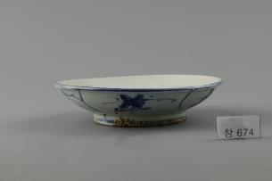

# 접시 바닥에서 복 한 글자를 만나다

*음식 아래에 숨어 있을 푸른 인사*

Life · Food

> 출처 대조와 공개 게시 승인을 마친 이야기입니다. 실제 게시 여부는 사이트 배포 상태를 따릅니다.

*백자청화복자·풀꽃무늬접시 · 국립고궁박물관 소장·제공. 전체 사진을 자르지 않고 사용했습니다.*

[이미지 출처와 소장품 안내](https://www.gogung.go.kr/gogung/pgm/psgudMng/view.do?menuNo=800065&psgudSn=409289) · 공공누리 제1유형(출처표시)

음식을 담은 접시에서는 요리가 먼저 보인다. 그릇 한가운데 어떤 그림이 있는지는 다 먹고 나서야 알게 되는 경우가 많다. 이 접시라면 마지막에 복 한 글자를 만나게 될지도 모르겠다.

국립고궁박물관이 소장한 백자청화복자·풀꽃무늬접시다. 이름은 길지만 눈여겨볼 것은 어렵지 않다. 흰 바탕에 푸른 선, 안쪽의 글자, 바깥쪽의 꽃이다.

## 가운데 그려 둔 글자

박물관 설명에 따르면 접시 안바닥에는 커다란 원 두 줄이 있고 그 안에 도안화된 복, 곧 福 글자가 있다. 붓글씨 한 글자를 그대로 적은 것이 아니라 무늬처럼 구성한 글자다.

그래서 처음에는 꽃이나 기하학무늬로 보일 수 있다. 글자라는 설명을 듣고 나면 가운데를 다시 들여다보게 된다. 사진에서 한 번에 읽히지 않는다고 이상한 일은 아니다. 이름을 알고 찾아보는 과정 자체가 이 접시를 보는 재미다.

## 꽃은 바깥으로 이어진다

장식은 음식이 놓일 안쪽에서 끝나지 않는다. 바깥면은 S자 모양의 선으로 다섯 구역을 나누고 각 칸에 풀꽃무늬를 그렸다고 한다. 테두리와 굽에도 푸른 선이 둘러져 있다.

한 접시를 위에서 보면 글자가 중심이고, 옆에서 보면 꽃이 중심이 된다. 정면 사진 한 장만으로 물건을 다 보았다고 느끼기 쉬운데, 그릇은 바라보는 방향에 따라 전혀 다른 부분을 내준다.

## 소박하게 찾아보는 순서

소장품 정보에는 입지름이 18센티미터라고 적혀 있다. 거대한 전시용 접시를 상상하기보다 크기를 가늠하며 보면 무늬와의 거리도 조금 가까워진다.

실제로 어떤 음식을 담았고 누가 사용했는지는 이 자료에서 확인하지 못했다. 복을 만난다는 첫 장면도 그릇의 배치를 떠올려 본 우리의 상상이다. 확실한 것은 빈 접시만으로도 볼거리가 있다는 사실이다. 가운데의 글자를 보고, 옆의 꽃을 보는 것. 식탁의 물건을 천천히 읽는 간단한 방법이다.

## 이야기의 바탕이 된 자료

- [국립고궁박물관 — 백자청화복자·풀꽃무늬접시](https://www.gogung.go.kr/gogung/pgm/psgudMng/view.do?menuNo=800065&psgudSn=409289) · 확인일 2026-10-28
  - 확인 내용: 안바닥 두 원과 도안화된 福자 / S자 구획 다섯 면의 풀꽃무늬 / 구연·굽 청화선과 입지름 18cm

---

[같은 소주제의 이야기](README.md) · [전체 서가](../../README.md)
