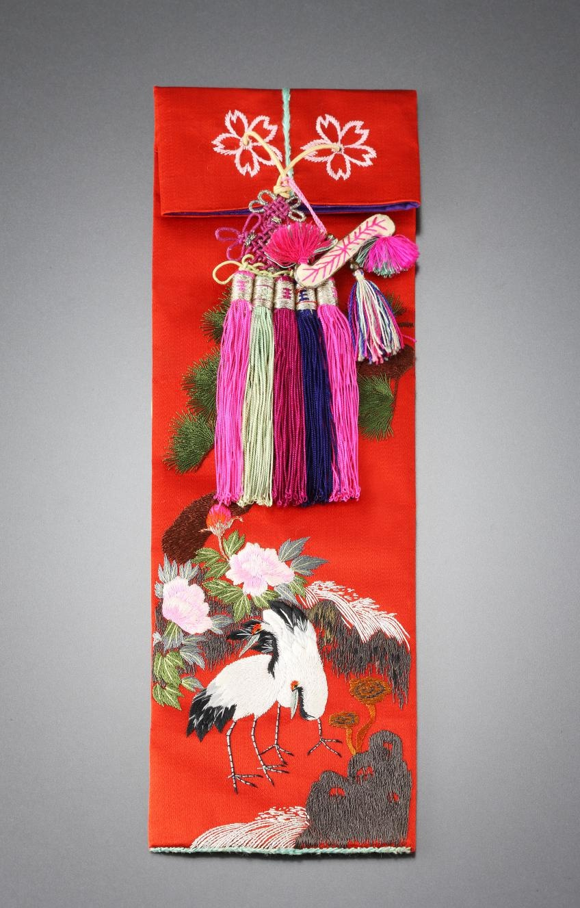

# 수저를 넣는 주머니에 바람을 수놓았다

*밥상 곁의 작은 물건에 담긴 긴 축원*

Life · Food

> 자료 대조를 마친 검토용 이야기입니다. 공개 게시 승인은 아직 받지 않았습니다.

*자수수저집 · 국립고궁박물관 소장·제공. 전체 사진을 자르지 않고 사용했습니다.*

[이미지 출처와 소장품 안내](https://www.gogung.go.kr/gogung/pgm/psgudMng/view.do?menuNo=800065&psgudSn=365789) · 공공누리 제1유형(출처표시)

사진을 얼핏 보면 길쭉한 장식품 같다. 붉은 바탕에 꽃이 피고, 새가 서 있고, 여러 색의 술이 아래로 늘어진다. 이름을 보고 나서야 고개를 끄덕인다. 자수수저집이다.

숟가락과 젓가락을 담는 물건인데 장식은 꽤 풍성하다. 무엇을 담는 주머니인지만 알면 지나치기 쉽지만, 무엇을 수놓았는지까지 보면 또 하나의 이야기가 열린다.

## 앞면의 작은 정원

국립고궁박물관은 앞면 아래쪽에 바위와 영지, 파도가 있고 가운데에 소나무와 모란, 학 두 마리 등이 수놓였다고 설명한다. 여러 색의 실로 그린 풍경이다.

박물관은 이 문양들이 오래 살고 복을 누리며 평안하기를 바라는 마음을 표현한다고 풀이한다. 모르는 문양의 이름을 전부 외우지 않아도 좋다. 식사 도구를 넣는 주머니가 좋은 삶에 대한 바람까지 품고 있다는 점이 재미있다.

## 뒤로 돌리면 글이 나온다

이 수저집은 앞면만 보고 끝낼 물건이 아니다. 뒷면에는 중앙선을 사이에 두고 길한 뜻의 글귀가 수놓여 있다. 오래 살고 평안하기를 바라는 표현과 여유와 부귀를 바라는 표현이다.

눈으로 보는 그림과 읽는 글이 한 주머니에 함께 놓였다. 앞의 풍경을 뒤의 문장이 다시 풀어 주는 것처럼 느껴진다. 오늘날 선물에 짧은 축하 카드를 덧붙이는 일을 비교해 볼 수도 있겠다. 물론 이 물건이 실제 어떤 선물 자리에서 쓰였는지는 확인된 이야기가 아니다.

## 닫는 곳까지 꽃을 피우다

뚜껑의 앞뒷면에도 매화가 두 송이씩 수놓였다. 꽃의 씨방에는 구멍을 내고 끈을 꿰었으며 그 아래로 여러 색의 술을 달았다. 주머니를 꾸미는 일이 몸체에서 끝나지 않은 셈이다.

사진에서 한꺼번에 모든 무늬를 찾으려 하면 눈이 바빠진다. 먼저 학을 보고 다음에 꽃을 보는 정도면 충분하다. 매일의 식사와 멀지 않은 물건에 이렇게 많은 좋은 뜻을 모아 두었다는 사실만으로도, 붉은 수저집은 작은 그림책처럼 읽힌다.

## 이야기의 바탕이 된 자료

- [국립고궁박물관 — 자수수저집](https://www.gogung.go.kr/gogung/pgm/psgudMng/view.do?menuNo=800065&psgudSn=365789) · 확인일 2026-10-28
  - 확인 내용: 앞면 바위·영지·파도·소나무·모란·쌍학 자수 / 수복부귀강녕의 소망에 대한 박물관 해설 / 뒷면 길상 글귀와 뚜껑 매화·끈·술 장식

---

[같은 소주제의 이야기](README.md) · [전체 서가](../../README.md)
