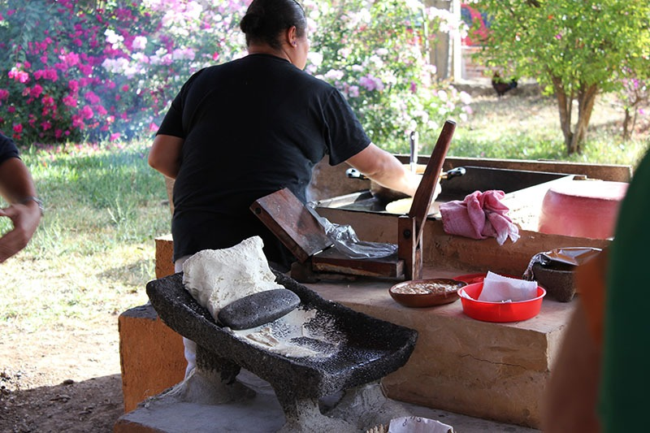

# 토르티야 앞에는 돌 두 개가 있었다

*멕시코의 옥수수 음식과 손 가까운 도구*

Life · Food

> 출처 대조와 공개 게시 승인을 마친 이야기입니다. 실제 게시 여부는 사이트 배포 상태를 따릅니다.

*“Grinding Corn for Tortillas” by Terri Bateman/flickr, CC BY 2.0 · OpenStax 수록본. 원본 전체 사진을 자르지 않고 사용했습니다.*

[이미지 출처·제작 근거](https://raw.githubusercontent.com/openstax/osbooks-introduction-anthropology/main/media/ANTHRO_Figure_14_Intro_002.jpg) · CC BY 2.0

멕시코 음식 토르티야를 떠올릴 때는 둥글고 납작한 완성품이 먼저 생각난다. 사진을 조금 뒤로 돌려 보면 그 앞에 돌 두 개와 손의 움직임이 있다. 한쪽은 넓고 다른 쪽은 길쭉하다.

OpenStax 교재는 멕시코 푸에르토바야르타에서 토르티야를 만드는 장면으로 이 사진을 소개한다. 사진 속 도구는 옥수수를 갈아 재료를 준비하는 데 쓰는 메타테와 마노다.

## 넓은 돌과 움직이는 돌

메타테는 재료를 받치는 넓은 갈돌이고, 마노는 손으로 잡아 움직이는 길쭉한 돌이다. 모양이 다른 두 물건이 만나 하나의 작업을 이룬다.

믹서처럼 덮개를 닫고 기다리는 도구를 생각했다면 만드는 사람의 손이 차지하는 자리가 다르게 보일 수 있다. 재료를 얼마나 잘게 갈지 살피고 몸을 움직이는 일이 준비 과정 안에 들어 있다.

## 음식에는 판단도 들어간다

교재는 전통적인 가루 준비에 알맞은 재료를 고르고, 원하는 고운 정도를 판단하며, 갈돌을 다루는 능력이 필요하다고 설명한다. 도구가 있다고 같은 결과가 저절로 나오는 것은 아니다.

우리는 음식 이름은 자주 기억하지만 그 음식의 재료를 준비하는 손놀림은 잘 보지 못한다. 사진 한 장에서 갈돌의 표면과 손이 놓인 자리를 살펴보면 먹기 직전보다 조금 이른 시간으로 들어가게 된다.

## 완성품 밖으로 시선을 옮기면

이 사진이 멕시코의 모든 가정이 같은 방식으로 토르티야를 만든다는 뜻은 아니다. 여기서는 실제 남아 있는 한 작업 장면을 보고 있다. 구체적인 조리법이나 재료 처리법을 이 사진만으로 정하지도 않는다.

대신 익숙한 음식을 볼 때 그 앞에 어떤 도구가 있었는지 물어볼 수 있다. 납작한 한 장이 식탁에 오기 전에 누군가는 돌의 무게와 재료의 상태를 손으로 다루었다. 토르티야의 다른 얼굴은 그렇게 완성품 바깥에 있다.

## 이야기의 바탕이 된 자료

- [OpenStax — Introduction to Anthropology: Introduction](https://raw.githubusercontent.com/openstax/osbooks-introduction-anthropology/main/modules/m00081/index.cnxml) · 확인일 2026-10-29
  - 확인 내용: 푸에르토바야르타의 토르티야 준비 장면이라는 캡션 / 메타테와 마노라는 도구·형태·옥수수를 가는 용도 / 재료 선택·분쇄 정도 판단·갈돌 사용 능력이 준비 과정에 필요하다는 해설

---

[같은 소주제의 이야기](README.md) · [전체 서가](../../README.md)
