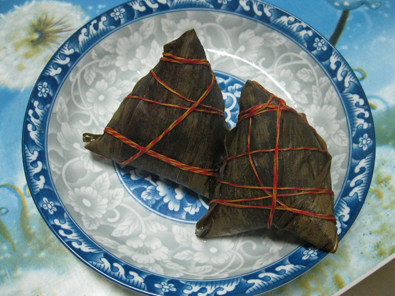

# 중국의 명절 음식에는 잎사귀 포장이 있다

*실로 묶은 쫑쯔를 열기 전에 보기*

Life · Food

> 출처 대조와 공개 게시 승인을 마친 이야기입니다. 실제 게시 여부는 사이트 배포 상태를 따릅니다.

*“Dragon Boat Festival Zongzi” by Evan Wood/flickr, CC BY 2.0 · OpenStax 수록본. 원본 전체 사진을 자르지 않고 사용했습니다.*

[이미지 출처·제작 근거](https://raw.githubusercontent.com/openstax/osbooks-introduction-anthropology/main/media/ANTHRO_Figure_14_03_011.jpg) · CC BY 2.0

접시 위에 작은 꾸러미들이 놓여 있다. 짙은 잎으로 싸고 실을 둘러 묶어서 음식이라기보다 먼저 풀어야 할 선물처럼 보인다. 중국의 쫑쯔다.

OpenStax의 인류학 교재는 사진 속 음식을 대나무 잎에 싼 찹쌀 음식으로 소개한다. 먹기 전부터 모양과 포장이 눈에 들어오는 명절 음식이다.

## 1. 안쪽과 바깥쪽을 함께 만들기

교재는 쫑쯔를 여러 종류의 속재료를 넣는 찹쌀 음식으로 설명한다. 겉의 잎과 실이 보인다고 안의 맛까지 모두 알 수 있는 것은 아니다. 같은 이름 안에도 다른 속이 있을 수 있다.

사진에서는 먼저 잎이 접힌 선과 묶인 실을 따라 보자. 포장지처럼 보이는 부분도 음식의 모습을 이루고 있다. 여기서는 잎이 어떤 화학적 효과를 낸다거나 모두 같은 모양으로 싸야 한다고 설명하지는 않는다.

## 2. 매년 돌아오는 날짜와 음식

쫑쯔는 중국의 단오, 곧 두안우와 이어지는 대표 음식으로 소개된다. 교재는 이 명절을 중국 음력의 다섯째 달 다섯째 날에 지내는 행사로 설명한다.

익숙한 달력 날짜와 특정 음식이 만나면 맛을 기억하는 방식도 달라질 수 있다. 아무 날이나 먹을 수 있는 재료라도 어떤 날의 음식이 되면 사람들은 다음 해 같은 시기를 함께 떠올리게 된다. 이것은 명절 음식을 읽는 한 가지 관점이다.

## 3. 잎을 접고 묶으면 음식의 윤곽이 생긴다

포장은 내용물을 가리는 것처럼 보이지만 쫑쯔에서는 음식의 바깥모양을 함께 만든다. 잎이 접힌 면과 실이 지나가는 방향을 보면 작게 나누어 담는 행동이 떠오른다. 다만 사진 속 한 개의 형태가 모든 지역의 유일한 모양이라고 정할 필요는 없다. 같은 이름 아래에도 재료와 싸는 방식의 차이가 있을 수 있다.

잎의 종류도 자료가 설명하는 범위에서 읽어야 한다. 이 사진은 대나무 잎과 실로 감싼 모습으로 소개된다. 식물 이름이 있다고 향과 조리 효과의 모든 세부가 저절로 입증되는 것은 아니다. 여기서는 표면에 놓인 잎이 단순한 배경이 아니라 음식의 모습을 이루는 부분이라는 점부터 살펴본다.

## 4. 전해지는 이야기는 역사적 확정과 다르다

교재는 여러 기원 이야기 가운데 굴원을 기리는 전승을 소개한다. 권력에서 멀어진 시인과 관리의 죽음 뒤에 사람들이 강에 쌀 음식을 던졌다는 이야기다. 물고기의 관심을 돌려 그의 몸을 찾으려 했다고 전해진다. 음식이 누군가를 기억하는 행동과 연결되는 설명이다.

다만 이 전승을 한 번의 사건이 모든 쫑쯔의 시작이었다는 확정된 기록으로 바꾸지는 않는다. 교재 자체도 단오의 유래가 여러 가지라고 알려 준다. 전승은 사람들이 음식과 명절을 어떤 이야기로 기억했는지 보여 줄 수 있다. 실제 기원을 밝히는 역사 연구와 문화적 의미를 읽는 일은 같은 자료를 보아도 질문이 다를 수 있다.

## 5. 달력의 약속이 맛을 다시 불러온다

음력 다섯째 달 다섯째 날이라는 시점은 매년 돌아온다. 특정 음식을 그날과 연결하면 재료의 맛이 사람과 행사의 기억을 함께 불러올 수 있다. 언제 먹느냐가 무엇을 먹느냐의 뜻에 영향을 주는 것이다. 같은 찹쌀이라도 일상의 식사와 명절 음식이라는 자리는 달라질 수 있다.

그렇다고 명절 밖에는 전혀 먹지 않는다거나 모든 사람이 같은 추억을 가진다고 말할 수는 없다. 지역과 가정, 개인의 경험은 다양하다. 여기서는 행사와 음식의 연결을 소개하는 교재의 관점을 따라간다. 하나의 이름을 배운 뒤 맛의 표준 하나로 줄이기보다 어떤 자리에 놓였는지 질문하는 편이 문화에 가까이 간다.

## 6. 겉을 보고도 남겨 두어야 할 안쪽

사진의 포장을 알아보아도 속재료까지 자동으로 읽을 수는 없다. 교재는 다양한 속을 넣는다고 설명한다. 닫힌 물건에서 보이지 않는 부분을 일반적인 예 하나로 채우지 않는 것이 정확하다. 이름이 같다는 사실과 모든 구성 요소가 같다는 주장을 구분할 수 있다.

이 작은 한계는 감상을 막기보다 더 많은 관심을 남긴다. 다른 지역의 쫑쯔를 만나면 무엇으로 싸고 어떻게 묶었는지, 어떤 날의 음식으로 소개하는지 살펴볼 수 있다. 잎사귀와 실로 둘러싼 모양에서 재료와 손일, 달력과 이야기의 관계가 드러난다. 음식의 이름 하나가 그 뒤의 여러 생활을 보는 표지가 된다.

## 7. 유래 하나로 전부 설명하지 않기

이 명절에는 굴원과 관련된 이야기를 비롯해 여러 기원 이야기가 전해진다. 교재도 하나의 유래만이 유일한 사실이라고 제시하지 않는다. 오랜 풍습에 붙은 이야기는 그 자체로 나누어 읽을 부분이다.

오늘은 실로 묶인 꾸러미 하나만 기억해도 좋겠다. 우리가 음식이라고 부르는 것은 맛만이 아니다. 싸는 모양과 여는 손길, 해마다 돌아오는 때도 함께 들어 있다. 쫑쯔는 그런 여러 겹을 한눈에 보여 주는 음식이다.

## 이야기의 바탕이 된 자료

- [OpenStax — Introduction to Anthropology: Food and Cultural Identity](https://raw.githubusercontent.com/openstax/osbooks-introduction-anthropology/main/modules/m00084/index.cnxml) · 확인일 2026-10-29
  - 확인 내용: 실제 사진은 대나무 잎·실로 감싼 단오 쫑쯔로 캡션에 소개 / 찹쌀과 다양한 속재료라는 설명 / 중국 음력 5월 5일 행사와 쫑쯔의 연관 / 굴원 관련 유래는 복수의 기원 이야기 중 하나로 소개

---

[같은 소주제의 이야기](README.md) · [전체 서가](../../README.md)
