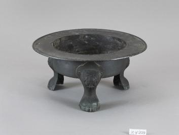

# 화로 아래에 작은 짐승의 발이 있다

*따뜻함을 담는 그릇의 뜻밖의 표정*

Life · Housing

> 출처 대조와 공개 게시 승인을 마친 이야기입니다. 실제 게시 여부는 사이트 배포 상태를 따릅니다.

*삼족화로 · 국립고궁박물관 소장·제공. 전체 사진을 자르지 않고 사용했습니다.*

[이미지 출처와 소장품 안내](https://www.gogung.go.kr/gogung/pgm/psgudMng/view.do?menuNo=800065&psgudSn=439135) · 공공누리 제1유형(출처표시)

둥근 화로 한 점이 놓여 있다. 가운데는 깊게 파였고 가장자리는 넓게 벌어졌다. 위에서 보면 꽤 얌전한 물건인데, 시선을 아래로 내리면 분위기가 달라진다. 세 다리가 작은 짐승처럼 생겼다.

국립고궁박물관이 소장한 삼족화로다. 박물관은 영친왕비 이방자가 소유했던 물건으로 소개한다. 거창한 의례 장면을 상상하기 전에, 먼저 그 발부터 살펴보면 좋겠다.

## 얼굴은 다리 위쪽에

다리의 위쪽에는 뿔이 두 개 달린 얼굴이 표현되어 있다. 박물관 설명의 이름은 귀면이다. 낯선 단어지만 사진과 함께 보면 조금 쉽다. 다리와 몸통이 만나는 곳에 입체적인 얼굴이 놓여 있다는 뜻이다.

그 아래는 동물의 발 형태로 만들었다. 얼굴이 있고 발이 있으니 단순히 받침 세 개를 붙인 것과는 인상이 다르다. 둥근 몸체를 작은 생물들이 받들고 있는 것처럼 느껴질 수도 있다. 이것은 모양에서 얻는 감상이지, 특정 동물을 확인했다는 이야기는 아니다.

## 한 덩어리처럼 보여도

화로는 구리로 만든 몸체에 세 개의 다리가 달린 구조다. 박물관은 다리를 따로 주조한 다음 리벳으로 몸체에 붙였다고 설명한다. 멀리서는 한 덩어리 같아도 만드는 과정에서는 부품이 나뉘었던 것이다.

넓은 테두리 끝에는 둥글게 턱도 졌다. 몸체와 다리, 가장자리를 차례로 보면 큰 모양 안에 서로 다른 작업이 들어 있음을 알게 된다. 장인의 손길을 찾는 데 반드시 복잡한 문양부터 읽어야 하는 것은 아니다.

## 위를 보고, 아래를 보고

이 물건에서 어떤 얼굴이 어떤 힘을 지켜 주었다고 단정할 자료는 여기서 확인하지 못했다. 그래서 상징 풀이를 길게 붙이기보다 실제 남아 있는 형태를 보는 편이 더 즐겁다.

다음에 화로나 향로를 만나면 그릇 안쪽만 들여다보지 말고 아래도 보자. 바닥을 딛고 있는 발에 의외로 가장 재미있는 표정이 숨어 있을지 모른다. 이 삼족화로에서는 따뜻한 그릇보다 먼저 세 발의 개성이 기억에 남는다.

## 이야기의 바탕이 된 자료

- [국립고궁박물관 — 삼족화로](https://www.gogung.go.kr/gogung/pgm/psgudMng/view.do?menuNo=800065&psgudSn=439135) · 확인일 2026-10-28
  - 확인 내용: 이방자 소유 삼족 동제 화로 / 따로 주조해 리벳으로 붙인 다리 / 귀면 형태 상부와 동물 발 형태 하부

---

[같은 소주제의 이야기](README.md) · [전체 서가](../../README.md)
